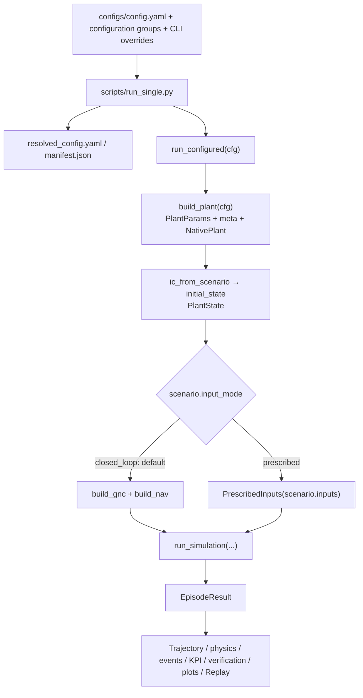
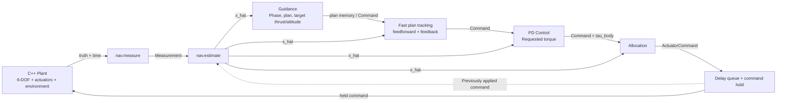
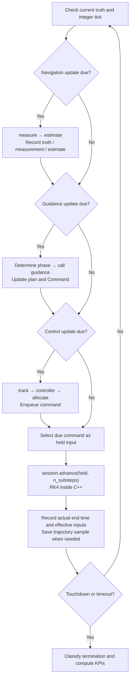
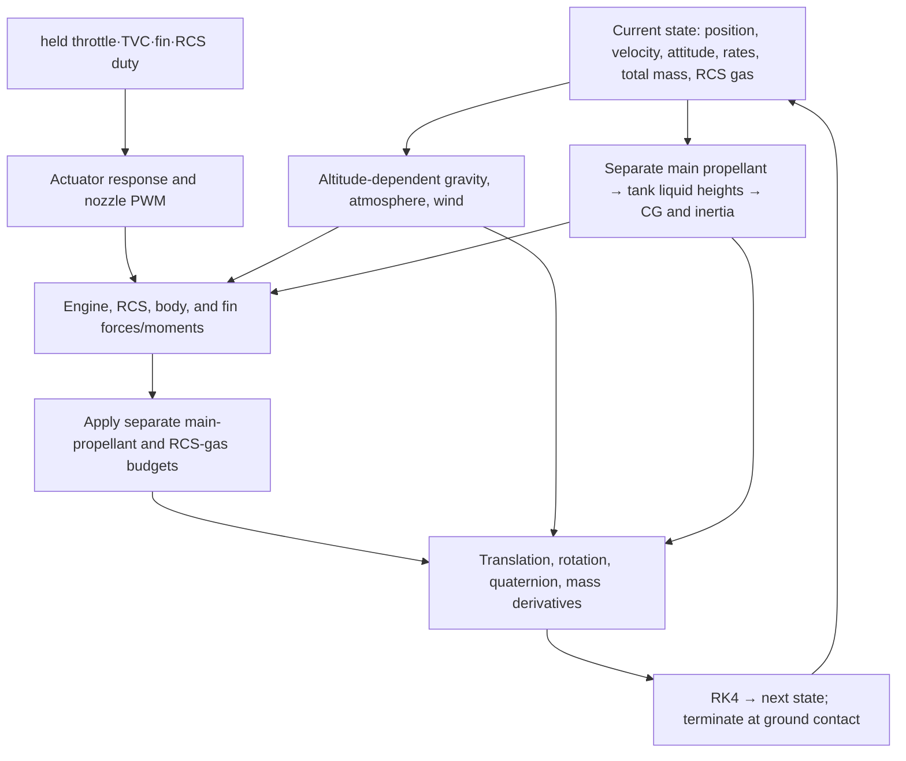
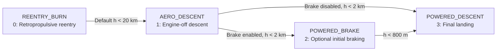
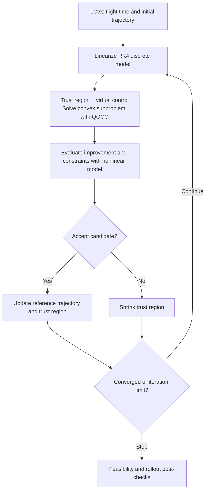

# RLV-Sim Code Structure and Mathematical Models

[Korean version](3_project_guide_ko.md)

RLV-Sim is a research simulator for Falcon 9 first-stage reentry, descent, and landing, with interchangeable guidance, navigation, and control algorithms. Python handles configuration, GNC, execution scheduling, and analysis; C++ handles the six-degree-of-freedom physics and numerical integration.

This guide reflects the shared runner, prescribed-input open-loop experiments, and physics verification features as of 2026-10-21. It covers existing closed-loop GNC and Monte Carlo capabilities, 13 vehicle experiments with independent initial conditions, fin deployment, physical quantities and event logging, analytical references, and integration-step comparisons. Sensor-based navigation is not yet implemented. Equations explain the implementation; omitted terms and nominal approximations are identified where relevant. Source links accompany each section. Enable math and Mermaid support in your Markdown viewer to render `$...$`, `$$...$$`, and diagrams.

## Contents

1. [Scope and implementation status](#overview)
2. [Directories and entry points](#layout)
3. [Overall code flow](#flow)
4. [Data contracts and coordinate frames](#contracts)
5. [Building modules from configuration](#configuration)
6. [Execution rates and command delivery](#timing)
7. [Plant: physics and integration](#plant)
8. [GNC: navigation, phase transitions, control, and allocation](#gnc)
9. [LCvx and SCvx landing trajectory optimization](#optimization)
10. [Termination, performance metrics, and output files](#results)
11. [Commands and arguments](#examples)
12. [Extension and verification code](#extension)
13. [Assumptions and implementation limits](#limitations)

To start with vehicle physics experiments, see [open-loop scenarios and initial conditions](#prescribed-experiments), [verification objectives by scenario](#scenario-verification-purpose), [integration-step checks](#convergence-check), and [verification run records](#vehicle-check-records).

<a id="overview"></a>

## 1. Scope and implementation status

The key distinction is between the **6-DOF Plant**, **3-DOF landing trajectory optimization**, and **separate attitude control and actuator allocation**. The optimizer does not directly optimize every Plant state.

| Area | Implementation | Status and interpretation |
|---|---|---|
| Vehicle | Single-engine `falcon9_stage1`, nine-engine `falcon9_octaweb` | Falcon 9 first-stage model based on public approximations |
| Motion | Translation, rotation, quaternion, propellant consumption, variable inertia | One physics implementation in C++ |
| Aerodynamics | Linear model, analytically generated coefficient tables, file-based tables, grid fins | Default tables are not a measured aerodynamic database |
| Actuators | Throttle, TVC, fins | Ideal, simplified, and realistic models |
| RCS | Individual nozzle forces, torques, and propellant flow; 12 nozzles for three axes or four for roll only | Independent PWM/averaged-thrust model; allocation disabled by default |
| Mass properties | LOX/RP-1 liquid heights, CG, inertia, separate RCS gas | O/F 2.56; configurable cylindrical geometry |
| Environment | Altitude-dependent inverse-square gravity, layered standard atmosphere, steady wind/turbulence, local Earth-rotation terms | Fixed-origin NED; `inverse_square` and `ussa_poly` by default |
| Slosh | None, pendulum, spring-mass | Two lateral modes |
| Faults | Engine shutdown/underperformance, TVC bias, fin lock, RCS nozzle degradation | RCS faults configured separately through `plant.rcs.thrust_scale` |
| Navigation | `IdentityNav`, navigation template | Truth passthrough; sensors, INS, and EKF not implemented |
| Guidance | Retropropulsive reentry, aerodynamic-descent attitude, LCvx/SCvx landing | Powered-landing guidance selected through configuration |
| Control | Quaternion-error PD | Generates requested body torque |
| Allocation | Throttle, gimbal, fin, and RCS commands | Nominal-effectiveness allocation with limits |
| Prescribed-input execution | Open-loop actuator commands specified by a time schedule | Same Plant and loop without constructing GNC or navigation |
| Configuration changes | Binary fin aerodynamic exposure | Instantaneous deployment approximation; no deployment impulse or mass/inertia change |
| Experiments | Single runs, CPU-parallel Monte Carlo, command delay | Initial-condition dispersion and reproducible seeds |
| Analysis | Trajectory, forces/moments, mass properties, events, landing assessment, computation time | CSV, JSON, NPZ, plots; navigation logs only when navigation runs |
| Physics verification | Six analytical checks and deterministic integration-step comparisons | Implementation/numerical verification, distinct from flight-data accuracy validation |
| Visualization | 3D Replay, Frame Studio | Result playback and coordinate-frame exploration |

`gnc/navigation=ekf` raises `NotImplementedError`. Optional noise and bias in `IdentityNav` are synthetic state perturbations, not IMU/GNSS/altimeter models. The default builder returns noise-free `IdentityNav()`.

<a id="layout"></a>

## 2. Directories and entry points

```text
RLV-Sim/
├── configs/                 # Hydra: vehicle, environment, GNC, scenarios, experiments
├── scripts/
│   ├── run_single.py        # Single closed-loop/prescribed-input run and export
│   ├── check_convergence.py # Prescribed-input integration-step comparison
│   ├── run_montecarlo.py    # Multiprocess runs and statistics
│   ├── view_replay.py       # Web viewer for recorded trajectories
│   ├── view_frames.py       # Coordinate-frame exploration
│   ├── benchmark_native.py  # Native performance benchmark
│   └── paper/              # Literature collection and processing helpers
├── src/
│   ├── core/               # Data types, frame conventions, seed contracts
│   ├── plant/              # Configuration conversion, aero tables, initial state
│   ├── native/             # C++ physics, frame transformations, SCvx
│   │   └── vendor/qoco/     # Optimizer used by native SCvx
│   ├── gnc/
│   │   ├── build.py        # GNC construction and wiring
│   │   ├── context.py      # GncContext passed during construction
│   │   ├── stack.py        # Guidance, control, and allocation composition
│   │   ├── navigation/     # Navigation
│   │   ├── guidance/       # Phase transitions, guidance, convex optimization
│   │   ├── control/        # Attitude control
│   │   └── allocation/     # Actuator allocation
│   ├── validation/         # Analytical references and integration-step comparisons
│   └── sim/                # Shared execution, timing, logging, aggregation, replay export
│       ├── run.py          # Assemble execution mode from configuration
│       ├── loop.py         # Shared run_simulation loop
│       └── open_loop.py    # PrescribedInputs schedules and smoke-test helper
├── tests/                  # Core, Plant, GNC, and simulation verification
├── viz/                    # Replay and Frame Studio web code/assets
├── results/                # Per-run results
├── docs/                   # Architecture, extension guides, literature reviews
├── materials/              # Reference PDFs
├── pyproject.toml          # Python dependencies, packaging, checks
└── setup.py                # pybind11 C++ extension build
```

The main entry point is [run_single.py](../scripts/run_single.py). [setup.py](../setup.py) builds `frames.cpp`, `plant.cpp`, `scvx.cpp`, and QOCO sources into the `_rlv_sim_native` extension. Python's `plant/dynamics.py` configures this extension. `plant/mass_properties.py` computes wet mass properties and nominal GNC CG during construction; time integration and truth-state physics run in C++.

<a id="flow"></a>

## 3. Overall code flow

### 3.1 Construction and result export



`build_plant()` returns `PlantBundle(params, make_initial_state, meta, native)`. `params` contains numerical parameters, `meta` contains model names and structural information, and `native` is the C++ model. Each episode creates independent mutable state through `native.create_session(state0)`.

`run_configured()` in [sim/run.py](../src/sim/run.py) assembles the run from configuration. The existing name `run_closed_loop` remains a compatibility alias for the shared `run_simulation`. Prescribed-input runs use the same integration, termination, and logging paths without calling navigation, guidance, control, or allocation.

### 3.2 Closed-loop information flow



Guidance generates thrust and attitude references, the controller fills `Command.tau_body`, and allocation converts this into `ActuatorCommand`. **The Plant input is `ActuatorCommand`.** `phase` is a GNC/logging tag; the Plant equations do not branch on it.

### 3.3 Sequence within a closed-loop execution block



Sources: [sim/loop.py](../src/sim/loop.py), [gnc/stack.py](../src/gnc/stack.py).

### 3.4 Prescribed-input open-loop flow

[PrescribedInputs](../src/sim/open_loop.py) selects actuator commands and fin deployment state from a schedule. The loop splits C++ integration blocks at input/logging boundaries and scheduled events. Each input is held until its next change; it is not adjusted from vehicle feedback. `phase` and Replay phase names correspond to the schedule segment index and `label`.

Fin deployment is sent separately from actuator deflection commands through the native session's `set_fin_deployment()`. Physical samples and Replay frames are also retained at event times. This path needs neither navigation estimates nor an optimized plan.

<a id="contracts"></a>

## 4. Data contracts and coordinate frames

### 4.1 State and command types

Common types are defined in [core/interfaces.py](../src/core/interfaces.py). Here $N_e$ is the engine count and $N_g$ the gimballed-engine count, distinct from the optimization node count $N$.

| Type | Main fields | Data path |
|---|---|---|
| `PlantState` | Time, position, velocity, quaternion, angular velocity, mass, actuator internal states, RCS propellant, slosh, wind filter, seed, done | Initialization → C++ session; full-state diagnostics |
| Public snapshot | Time, rigid-body state, mass, effective throttle/TVC/fin/RCS, done | C++ → loop/navigation/logging |
| `Measurement` | `r_ned`, `v_ned`, `q_bn`, `w_body`, `m`, `t` | Measurement function → estimation function |
| `x_hat` | Estimated state and state timestamp | Navigation → guidance/control/allocation; not a separate fixed class name |
| `Command` | `phase`, `mode`, `thrust_vector`, `q_ref`, `tau_body`, `active_engines`, `w_ref` | Guidance → control → allocation |
| `ActuatorCommand` | `throttle`, `gimbal`, `fin`, `rcs` | Closed loop: allocation → delay queue → Plant; open loop: prescribed input → Plant |
| `memory` | Phase index, plan, ignition time, replanning/control state, computation time | Retained between module calls |
| `EpisodeResult` | Trajectory, phases, diagnostics, termination reason, KPIs, navigation/actuator histories | Loop → analysis/export |

`Command.mode=0` denotes thrust-vector mode; `mode=1` denotes engine-off attitude mode. `active_engines` is a phase-specific mask, separate from the physical model's `engine_on` fault flags.

| Field | Shape | Meaning and units |
|---|---|---|
| `r_ned`, `v_ned` | `(3,)` | NED position [m], velocity [m/s] |
| `q_bn`, `q_ref` | `(4,)` | Body → NED quaternion, `[w, x, y, z]` |
| `w_body`, `w_ref` | `(3,)` | Body angular velocity [rad/s] |
| `m` | scalar | Total mass: structure + main propellant + RCS gas [kg] |
| `thrust_vector` | `(3,)` | Requested thrust in NED [N] |
| `tau_body` | `(3,)` | Requested body torque [N·m] |
| `active_engines` | `(N_e,)` | Binary engine mask |
| `throttle` | `(N_e,)` | Per-engine commanded fraction, 0–1 |
| `gimbal` | `(N_g, 2)` | Per-engine pitch/yaw deflection [rad] |
| `fin` | `(4,)` | Grid-fin deflection [rad] |
| `rcs` | `(3,)` | Signed roll/pitch/yaw duty commands, −1–1; not individual nozzle commands |

### 4.2 Coordinate frames and notation

NED axes point north, east, and down. Body $+x$ points toward the nose; vehicle geometry coordinates start at the nose and become negative aft. Distinguish these geometry coordinates from the simulated center-of-mass position.

$$
\mathbf r_n=[r_N,r_E,r_D]^T,\qquad
\mathbf v_n=[v_N,v_E,v_D]^T,\qquad
h=-r_D.
$$

Thus `[0, 0, -300] m` and `[0, 0, 25] m/s` describe descent at 25 m/s from 300 m altitude. Let $C_{bn}(q)$ rotate Body vectors into NED:

$$
\mathbf a_n=C_{bn}(q)\mathbf a_b,\qquad
\mathbf a_b=C_{bn}(q)^T\mathbf a_n.
$$

Below, $\boldsymbol\omega$ is body angular velocity, $\mathbf F_b$ and $\boldsymbol\tau_b$ are body force and torque, and $\bar q$ is dynamic pressure. Distinguish quaternion $q$ from dynamic pressure $\bar q$.

### 4.3 Python–C++ boundary

| Operation | Python → C++ | C++ → Python |
|---|---|---|
| Model construction | `PlantParams`, model-selection `meta` | `NativePlant` |
| Episode creation | Complete `PlantState` | Independent session |
| Observation | `observe()` | Current snapshot/diagnostics; neither time nor RNG advances |
| Integration block | Held command and `n_substeps` | Snapshot/diagnostics at the actual block end |

Servo rates, slosh, wind filters, RNG state, and RK4 intermediate states remain inside the session. If touchdown occurs mid-block, the actual native termination time is returned rather than the requested block end. `snapshot(full=True)` provides internal-state diagnostics; `rhs()` and `step()` support individual physics checks.

<a id="configuration"></a>

## 5. Building modules from configuration

### 5.1 Configuration hierarchy

The root [config.yaml](../configs/config.yaml) composes Hydra groups. `group=name` selects a component, `key=value` changes a field, and expressions with `+`, such as `+baseline=pdg`, add a new configuration group.

| Configuration | Main information | Consumers |
|---|---|---|
| `plant/vehicle` | Geometry, dry/wet mass, inertia, engine layout, servo coefficients | `plant/dynamics.py`, C++ Plant, GNC nominal values |
| `plant/aero` | Aero model, table generation/file input, fin geometry | `plant/aero_data.py`, C++ aerodynamics, allocation |
| `plant/actuator`, `plant/thrust`, `plant/slosh` | Physics model types | C++ model selection |
| `environment/atmosphere` | Density, pressure, temperature parameters | Plant and GNC atmosphere approximations |
| `environment/gravity`, `plant/rcs` | Gravity constants/radius, RCS layout/PWM | C++ physics |
| `environment/wind`, `environment/earth` | Wind/turbulence, latitude/rotation settings | C++ environment |
| `fault` | Engine shutdown, thrust scaling, gimbal bias, fin lock | Plant fault parameters |
| `scenario.ic` | Initial position, velocity, Euler attitude, angular velocity, mass | `ic_from_scenario`, `initial_state` |
| `scenario.dispersion` | Enable dispersion, position/velocity standard deviations | Initial-condition generation |
| `scenario.horizon` | Maximum duration, update periods | `sim/schedule.py` |
| `scenario.input_mode`, `scenario.inputs` | `closed_loop` / `prescribed`, input schedule | `sim/run.py`, `sim/open_loop.py` |
| `scenario.validation` | Analytical reference type and tolerances | `validation/analytical.py` |
| `scenario.success` | Position, speed, and tilt tolerances | KPI assessment |
| `gnc/guidance` | Target, optimization grid/constraints, tracking gains, replanning | Landing guidance |
| `gnc/control` | `wn_axis`, `zeta` | PD gain construction |
| `gnc/allocation` | Allocation mode/weights, fin dynamic-pressure lockout, RCS enable | Actuator allocation |
| `gnc/scheduler` | Transition altitudes, active engines | Phase scheduler |
| `gnc/navigation` | Navigation builder | Navigation module |
| `plant_dt`, `gnc.delay_ticks`, `seed`, `run` | Integration step, delay, reproducibility, output/repeated execution | Execution code |

`PlantParams` groups `geom`, `mass`, `aero`, `atmosphere`, `wind`, `earth`, `slosh`, `actuator`, `engines`, `gravity`, `rcs`, `g_ned`, and `plant_dt`. `default_nominal()` extracts GNC thrust, mass, moment arms, atmosphere functions, and allocation options.

The root configuration composes `scenario` after `vehicle_set`. New scenarios reuse [_prescribed.yaml](../configs/scenario/_prescribed.yaml) while selecting vehicle, environment, and initial conditions. `_prescribed` is a shared configuration, not a named example to run directly. Check `resolved_config.yaml` for actual run settings. The `GncContext` below is constructed only in closed-loop runs; a remaining `gnc` node in a prescribed-input configuration does not imply that those modules execute.

### 5.2 GncContext and builders

```python
# Conceptual construction path
ctx = GncContext(
    cfg=cfg.gnc.guidance,
    nominal=nominal,
    params=params,
    active_engines=active,
    phase=phase,
)
guidance = instantiate(cfg.gnc.guidance.law, ctx)
```

| Field | Meaning |
|---|---|
| `cfg` | Resolved configuration node for the module |
| `nominal` | Nominal GNC physical values and allocation options |
| `params` | Complete `PlantParams` |
| `active_engines` | Engine mask for this guidance phase |
| `phase` | Guidance phase tag |

Navigation construction currently passes only `GncContext(cfg=...)`. Guidance, navigation, and control can be replaced through the `build(ctx)` addressed by `law._target_`; allocation and the reentry/aerodynamic-descent guidance laws are wired directly in [build.py](../src/gnc/build.py).

<a id="timing"></a>

## 6. Execution rates and command delivery

Sources: [schedule.py](../src/sim/schedule.py), [loop.py](../src/sim/loop.py).

| Operation | Default `pdg` period | Frequency | Work |
|---|---:|---:|---|
| Plant | 0.001 s | 1,000 Hz | RK4 integration |
| Navigation | 0.01 s | 100 Hz | Measurement and estimation |
| Control + Allocation | 0.02 s | 50 Hz | Plan tracking, attitude control, allocation |
| Guidance | 1.0 s | 1 Hz | Phase selection, guidance call, optimization when needed |
| Trajectory log | 0.1 s | 10 Hz | Trajectory recording |

For closed-loop integration step $\Delta t_p$ and task periods $\Delta t_i$:

$$
n_i=\frac{\Delta t_i}{\Delta t_p}\in\mathbb Z_{>0},\qquad
n_b=\gcd(n_{nav},n_{guidance},n_{ctrl},n_{log}).
$$

A native block normally contains $n_b$ integration steps. Defaults return to Python every 10 ms, with ten 1 ms steps inside C++. Every period and `t_max` must be representable as a positive integer number of ticks; nonrepresentable values are not silently rounded.

Command delay $d=$ `gnc.delay_ticks` is measured in control periods.

$$
\tau_{delay}=d\Delta t_{ctrl}.
$$

Estimates and actuator commands are held between updates. Navigation is synchronous: measurement/estimate timestamps must match truth time. A held estimate between navigation updates is not recorded as a new measurement. The estimator receives the command held before the new control output at that instant.

The initial truth sample precedes the first control command. Trajectories include initial, regular logging, and actual terminal epochs. With `convex_replan=false`, calling guidance at 1 Hz does not re-solve the optimization on every call after ignition.

Prescribed-input runs use blocks based on the greatest common divisor of `horizon.input_dt` and `log_dt`, splitting further at intervening input/configuration events. Both default to 0.02 s in the shared configuration. Event times are relative to the start and must lie on the `plant_dt` grid; they need not be multiples of `input_dt`. Navigation/guidance periods and GNC transport delay do not apply to this open-loop mode. Trajectories also retain prescribed-input event epochs.

<a id="plant"></a>

## 7. Plant: physics and integration

Main sources: `evaluate`, `engines`, `body_aero`, `fin_forces`, `actuator_derivatives`, `slosh`, and `integrate_once` in [native/plant.cpp](../src/native/plant.cpp).

Requirements from [Module 4 Simulation Examples](../materials/RSLV_GNC_Module4_Simulation_Examples.pdf) map to the implementation as follows.

| Reference | Current implementation | Detailed section |
|---|---|---|
| pp.10–12, 15: forces, moments, 6-DOF integration | NED translation, body rotation, quaternion, RK4 | 7.1, 7.7 |
| p.11: altitude-dependent gravity | Inverse-square law and body-frame gravity force | 7.1 |
| p.13: dual tank | O/F 2.56, liquid heights, parallel-axis theorem | 7.2 |
| pp.11–14: propulsion and RCS | Per-engine thrust and individual RCS nozzle force, torque, flow | 7.3, 7.5 |
| p.17: layered atmosphere | Density, sound speed, backpressure in default `ussa_poly` | 7.4 |
| pp.18–20, 22–23: body/fin aerodynamics | Relative airflow, local fin flow, forces/moments, neutral-fin increments | 7.4 |
| p.21: wind-tunnel coefficient identification | External coefficient-table input supported; defaults are analytical approximations | 7.4, 13 |



Main-propellant depletion sets engine thrust and flow to zero. It does not terminate the episode; RCS and unpowered flight continue.

### 7.1 Translational and rotational motion

The stored rigid-body state has three position components, three velocity components, four quaternion components, three angular rates, and one mass. Six degrees of freedom describes motion, not a six-element state array.

$$
\dot{\mathbf r}_n=\mathbf v_n,
\qquad
\dot{\mathbf v}_n=\mathbf g_n+\mathbf a_{rot}
+\frac{C_{bn}(q)\mathbf F_b}{m}.
$$

$$
\mathbf F_b=\mathbf F_{engine}+\mathbf F_{body\ aero}
+\mathbf F_{fin}+\mathbf F_{slosh}+\mathbf F_{RCS}.
$$

Default gravity follows the inverse-square law in Module 4 p.11, using $h=-r_D$, $\mu=3.986004418\times10^{14}\;\mathrm{m^3/s^2}$, and $R_e=6371000\;\mathrm m$.

$$
g(h)=\frac{\mu}{(R_e+h)^2},\qquad
\mathbf g_n(h)=\begin{bmatrix}0&0&g(h)\end{bmatrix}^{T},\qquad
\mathbf F_{g,b}=mC_{bn}^{T}\mathbf g_n(h).
$$

Because velocity is stored in NED, $\mathbf g_n(h)$ is added directly to the translational derivative. This is equivalent to adding $\mathbf F_{g,b}$ in Body and rotating it; gravity is not counted twice. Diagnostics `gravity_ned` and `F_gravity_body` expose both forms. `environment/gravity=uniform` provides constant gravity for analytical verification. Standard gravity $g_0=9.80665$ used in specific-impulse conversion is independent of altitude-dependent gravity.

Individual RCS thruster forces also enter the translational sum. Healthy symmetric pairs cancel net force, but a failed thruster leaves a residual. With inertia $I(m,m_{RCS})$ and lateral CG offset $\mathbf r_{lat}=[0,y_{cg},z_{cg}]^T$, the rotational equation is:

$$
I(m,m_{RCS})\dot{\boldsymbol\omega}
=\boldsymbol\tau_{sum}-\mathbf r_{lat}\times\mathbf F_b
-\boldsymbol\omega\times\bigl(I(m,m_{RCS})\boldsymbol\omega\bigr)
-\dot I(m,m_{RCS})\boldsymbol\omega.
$$

$\boldsymbol\tau_{sum}$ includes engine, body-aerodynamic, fin, slosh, RCS, and jet-damping torques. For positive main-engine outflow $\dot m_{out}>0$ and nozzle moment arm $\ell$, the implemented jet damping is:

$$
\boldsymbol\tau_{jet}
=\begin{bmatrix}0&-\dot m_{out}\ell^2\omega_y&-\dot m_{out}\ell^2\omega_z\end{bmatrix}^T.
$$

Quaternions use the scalar-first Hamilton product:

$$
\dot q_{bn}=\frac12 q_{bn}\otimes
\begin{bmatrix}0\\\boldsymbol\omega\end{bmatrix},
\qquad q_{bn}\leftarrow\frac{q_{bn}}{\lVert q_{bn}\rVert_2}
\quad\text{(after each integration step)}.
$$

### 7.2 Mass, center of gravity, and inertia

The `prescribed` mass-properties model linearly interpolates between dry and wet endpoints.

$$
f=\operatorname{clip}\left(\frac{m-m_{dry}}{m_{wet}-m_{dry}},0,1\right),
\qquad x_{cg}=x_{cg,dry}+f(x_{cg,wet}-x_{cg,dry}),
$$

$$
I_j=I_{j,dry}+f(I_{j,wet}-I_{j,dry}).
$$

Default `dual_tank` uses the O/F ratio and cylindrical liquid-tank mass distribution from Module 4 p.13. `m_dry` is structural mass excluding both main propellant and RCS gas; initial `scenario.ic.m` and `m_wet` are **total masses** including RCS gas. Main-propellant mass is:

$$
m_p=\max(m-m_{dry}-m_{RCS},0),\qquad
m_f=\frac{m_p}{1+O/F},\qquad m_{ox}=(O/F)m_f,\qquad O/F=2.56.
$$

Each liquid is assumed to fill from its tank's aft boundary $x_{bottom,i}$ toward Body $+x$. For density $\rho_i$ and radius $R_i$:

$$
H_i=\frac{m_i}{\rho_i\pi R_i^2},\qquad
x_i=x_{bottom,i}+\frac{H_i}{2},\qquad
x_{cg}=\frac{m_{dry}x_{dry}+\sum_i m_ix_i+m_{RCS}x_{RCS}}{m}.
$$

Each liquid cylinder has centroidal inertia $I_{xx,i}=m_iR_i^2/2$, $I_{yy,i}=I_{zz,i}=m_i(3R_i^2+H_i^2)/12$. Dry structure, liquids, and RCS gas are shifted to the current CG and summed. Gas is uniformly distributed in a fixed-geometry equivalent cylinder. No arbitrary correction fits the old wet inertia. `dual_tank` wet CG/inertia are computed from geometry and stored in `PlantParams.mass`; YAML `x_cg_wet` and `I_wet` are inputs for the `prescribed` model.

Both main engines and RCS reduce total mass.

$$
\dot m=-\dot m_{main,out}-\dot m_{RCS,out},\qquad
\dot m_{RCS}=-\dot m_{RCS,out}.
$$

The inertia rate accounts for consumption of both propellants. The allocator's nominal CG uses the same tank geometry but holds RCS gas at its initial amount because navigation does not estimate the remaining reserve.

For example, default `pdg` initial total mass of 29,500 kg consists of 25,600 kg structure, 200 kg RCS gas, and **3,700 kg main propellant**. Consuming all main propellant without using RCS leaves 25,800 kg total mass, distinct from structural `m_dry=25,600 kg`.

Tank density, radius, aft boundary, and length are configured under `plant.vehicle.tanks`. Default dimensions are **explicit assumptions, not validated flight-vehicle values**. The model is quasi-static with axially settled liquid; it does not solve zero-gravity free surfaces, time-varying mixture ratio, pressure, or thermodynamics. Tank-capacity violations and nonphysical inputs are rejected during construction.

### 7.3 Engine thrust and mass flow

For engine $i$, let $u_i$ be effective throttle, $T_{vac,i}$ maximum vacuum thrust, $A_{e,i}$ nozzle exit area, $e_i$ the engine-enable/fault flag, and $s_i$ thrust scaling. The code includes $\phi_i$ to smooth combustion onset near minimum throttle.

$$
z_i=\operatorname{clip}\left(\frac{u_i-(u_{min,i}-0.1)}{0.1},0,1\right),
\qquad \phi_i=z_i^2(3-2z_i),
$$

$$
T_i=s_ie_i\phi_i\max\left(u_iT_{vac,i}-p_{amb}(h)A_{e,i},0\right).
$$

For pitch/yaw deflections $\delta_{p,i},\delta_{y,i}$, the nozzle direction including fixed cant and fault bias is:

$$
\mathbf d_i=
\begin{bmatrix}
\cos\delta_{p,i}\cos\delta_{y,i}\\
\cos\delta_{p,i}\sin\delta_{y,i}\\
-\sin\delta_{p,i}
\end{bmatrix},\qquad
\mathbf F_{engine}=\sum_iT_i\mathbf d_i,
$$

$$
\boldsymbol\tau_{engine}=\sum_i
(\mathbf r_{engine,i}-\mathbf r_{cg})\times(T_i\mathbf d_i).
$$

Main-engine mass flow uses throttle-scaled vacuum thrust, not net thrust.

$$
\dot m_{main,out}=\sum_i\frac{e_i\phi_i u_iT_{vac,i}}{I_{sp,i}g_0}.
$$

Currently, `thrust_scale` reduces thrust without reducing this mass-flow expression proportionally. `engine_on=0` disables both thrust and propellant consumption for that engine.

### 7.4 Atmosphere, wind, and aerodynamics

Relative airflow and basic aerodynamic quantities are:

$$
\mathbf v_{air,b}=C_{bn}^T(\mathbf v_n-\mathbf v_{wind,n}),\qquad
V=\lVert\mathbf v_{air,b}\rVert_2,
$$

$$
\bar q=\frac12\rho(h)V^2,\qquad M=\frac{V}{a(h)}.
$$

Body total angle of attack is the angle between air-relative velocity and the engine-facing `fwd_axis` $\mathbf e_f=[-1,0,0]^T$. It differs from a conventional nose-forward Euler angle of attack.

$$
c_\alpha=\mathbf e_f^T\widehat{\mathbf v}_{air,b},\qquad
\alpha=\arccos(c_\alpha),\qquad
\widehat{\mathbf l}=\operatorname{unit}
(\mathbf e_f-c_\alpha\widehat{\mathbf v}_{air,b}).
$$

$$
\mathbf F_{body\ aero}
=-\bar qSC_D\widehat{\mathbf v}_{air,b}
+\bar qSC_L\widehat{\mathbf l}.
$$

Coefficient tables use PCHIP-based Hermite interpolation along $\cos\alpha$ and linear interpolation along Mach. The default moment for analytically generated tables is:

$$
\boldsymbol\tau_{aero}=
\begin{bmatrix}x_{cp}-x_{cg}\\0\\0\end{bmatrix}
\times\mathbf F_{body\ aero}.
$$

The table-based model adds pitch/yaw damping. In file-based $C_m$ mode, the moment about the reference CG is formed directly as $\bar qSDC_m$, then corrected for CG shift. This avoids the unstable inversion of pressure center through $C_m/C_N$ near $C_N\approx0$.

Each fin uses local flow including rotational velocity at its mounting location.

$$
\mathbf v_{local,i}=\mathbf v_{air,b}
+\boldsymbol\omega\times(\mathbf r_{fin,i}-\mathbf r_{cg}),
\qquad
\boldsymbol\tau_{fin}=\sum_i(\mathbf r_{fin,i}-\mathbf r_{cg})\times\mathbf F_{fin,i}.
$$

The local fin flow angle uses axial and tangential velocity components.

$$
\phi_i=\operatorname{atan2}(\mathbf v_{local,i}\cdot\mathbf e_{tan,i},
|\mathbf v_{local,i}\cdot\mathbf e_{axial}|),\qquad \alpha_i=\delta_i-\phi_i.
$$

At small angles, $L_i=\bar q_i S_i C_{L\alpha}\alpha_i$ and $D_i=\bar q_iS_i(C_{D0}+C_{D\alpha^2}\alpha_i^2)$. Lift is perpendicular to local velocity; drag opposes it. `fin_cd_alpha2` is the quadratic drag coefficient.

The analytical fin model smooths stall through $\alpha_s\tanh(\alpha/\alpha_s)$ and includes transonic effects. The incremental model (`fins.incremental=true`) computes $F(\delta_i)-F(0)$ at the same local flow. Because the body table includes static neutral fins, it also adds $F_{neutral}(v_{local})-F_{neutral}(v_{air})$ to preserve rotational damping without double-counting neutral-fin aerodynamics. Default analytical body tables exclude fins and use a separate component model with `incremental=false`.

Default coefficients are analytical approximations with physical structure. They do not imply completion of wind-tunnel identification from Module 4 p.21. Connect a validated coefficient table through `backend=file` when available.

| Environment selection | Implementation |
|---|---|
| `atmosphere=vacuum` | Zero density |
| `atmosphere=exp` | $\rho=\rho_0e^{-h/H}$, temperature-dependent sound speed |
| `atmosphere=ussa_poly` | Layered standard atmosphere based on geopotential altitude |
| `atmosphere=nonstd_day` | Same layered model with temperature offset and density scaling |
| `wind=none`, `steady` | No wind, constant NED wind |
| `wind=dryden`, `von_karman` | OU mean wind and turbulence shaping filters |

Exponential-atmosphere backpressure is $p_{amb}=p_{sea}e^{-h/H}$. The layered atmosphere derives density from pressure and temperature. Turbulence filters update at each physics substep and hold the same wind through that substep's intermediate RK4 stages.

### 7.5 Actuator models

`ideal` immediately uses limited commands as effective inputs. `simplified` uses linear lag/servo models; `realistic` uses nonlinear rate limits and servos. RCS pulsed/averaged behavior is independent of this selection.

For target throttle $u_{ref}$, the realistic response is:

$$
\dot u=\dot u_{max}\tanh\left(
\frac{u_{ref}-u}{\tau_u\dot u_{max}}\right).
$$

Target throttle is clipped to 0–1 and treated as zero below minimum throttle. The simplified model uses $\dot u=(u_{ref}-u)/\tau_u$.

For gimbal/fin angle $\delta$ and rate $v_\delta$, the saturated rate-command structure is:

$$
k_p=\frac{\omega_n}{2\zeta},\qquad k_v=2\zeta\omega_n,
$$

$$
v_{ref}=v_{max}\tanh\left(\frac{k_p(\delta_{ref}-\delta)}{v_{max}}\right),
\qquad \dot\delta=v_\delta,\qquad
\dot v_\delta=k_v(v_{ref}-v_\delta).
$$

Deflection limits are applied to $\delta_{ref}$. The simplified model replaces this with $v_{ref}=k_p(\delta_{ref}-\delta)$, giving a linear second-order system. Fin lock in realistic actuation freezes derivatives of the affected fin state.

#### RCS: individual thrusters and pulses

`plant/rcs=paired` provides 12 nozzles for positive/negative torques on three axes (four per axis). `plant/rcs=roll_four` provides the four-nozzle roll-only arrangement of Module 4 p.14, without independent pitch/yaw authority. Both are explicitly assumed symmetric layouts rather than measured flight-vehicle installations.

$$
\mathbf F_{RCS}=\sum_j u_j T_js_j\widehat{\mathbf d}_j,\qquad
\mathbf M_{RCS}=\sum_j(\mathbf r_j-\mathbf r_{cg})\times u_jT_js_j\widehat{\mathbf d}_j,
\qquad
\dot m_{RCS,out}=\sum_j\frac{u_jT_js_j}{I_{sp,RCS}g_0}.
$$

$\widehat{\mathbf d}_j$ is the **force direction acting on the vehicle**, opposite to exhaust flow. A symmetric pair has maximum torque $2T\ell$ and consumes the sum of both nozzle flows. `thrust_scale` is scalar or per-nozzle; zero represents a failed-closed nozzle.

`plant.rcs.mode=pulsed` switches nozzles on/off with a default 20 ms PWM period. Commands are signed axis duties rounded to on-ticks, giving duty resolution 0.05 at the default 1 ms step. Nozzle state is held through one RK4 step. `mode=averaged` approximates mean thrust. To enable RCS allocation, also set `gnc.allocation.rcs_enabled=true`.

Diagnostics include `rcs_thruster_on`, `F_rcs_body`, `M_rcs_body`, `rcs_mdot`, and `main_propellant`. For the final partially fueled step, force and flow are averaged to fit remaining propellant, preventing negative reserves and excess impulse.

### 7.6 Slosh and Earth rotation

Slosh uses two lateral internal coordinates $\xi_j$. In the implemented equations they are displacement-type coordinates driven by acceleration; do not infer units solely from the angle wording in the `PlantState` comment.

$$
\ddot\xi_j+2\zeta\omega_d\dot\xi_j+\omega_s^2\xi_j
=-a_{attach,j},\qquad
F_{slosh,j}=m_s(\omega_s^2\xi_j+2\zeta\omega_d\dot\xi_j).
$$

The spring-mass model uses fixed $\omega_s=\omega_d=\omega$. The pendulum model uses attachment-point axial acceleration $a_{attach,x}$ to set $\omega_s^2=a_{attach,x}/L$ and $\omega_d=\sqrt{|a_{attach,x}|/L+\epsilon}$. Attachment acceleration includes translational-force, angular-acceleration, and centripetal contributions.

With `earth=rotating`:

$$
\mathbf a_{rot}=-2\boldsymbol\Omega_n\times\mathbf v_n
-\boldsymbol\Omega_n\times\left[\boldsymbol\Omega_n\times(\mathbf R_{origin}+\chi\mathbf r_n)\right].
$$

$\chi$ enables differential centrifugal acceleration, and $\mathbf R_{origin}=[0,0,-R_e]^T$. Inverse-square gravity is purely attractive, so origin centrifugal acceleration is added separately. This is a fixed local NED model, not spherical/ellipsoidal ECEF/LLA propagation.

### 7.7 RK4 and termination

For held actuator command $u$ and full derivative $f(x,u)$:

$$
\begin{aligned}
k_1&=f(x_k,u),\\
k_2&=f(x_k+\tfrac12\Delta t_pk_1,u),\\
k_3&=f(x_k+\tfrac12\Delta t_pk_2,u),\\
k_4&=f(x_k+\Delta t_pk_3,u),\\
x_{k+1}&=x_k+\frac{\Delta t_p}{6}(k_1+2k_2+2k_3+k_4).
\end{aligned}
$$

Quaternions are normalized after integration. Each step jointly limits forces and flows by main-propellant/RCS budgets. Main-propellant depletion shuts down engines while remaining RCS and ballistic flight continue. Native termination occurs at altitude zero or below; the overall run also stops at its time limit. No contact dynamics continue leg deformation or rebound after touchdown.

### 7.8 Configuration change through fin deployment

The native session's `set_fin_deployment(d)` switches aerodynamic exposure of fin force and moment for $d\in\{0,1\}$.

$$
\mathbf F_{fin,applied}=d\mathbf F_{fin},\qquad
\mathbf M_{fin,applied}=d\mathbf M_{fin}.
$$

Session creation/reset defaults to deployed state `1`. A prescribed `fin_deployment: 0` starts stowed. Stowing is rejected for incremental models whose body table already contains neutral-fin aerodynamics, because those fin contributions cannot be separately removed by the deployment factor.

This model represents **instantaneous aerodynamic exposure only**. It excludes stowed-fin drag, hinge motion, deployment impulse, structural vibration, and deployment-induced mass/inertia changes. Main/RCS propellant consumption still changes mass properties through the existing model. Diagnostics record `fin_deployment` and `M_fin_body`, and the same deployment state is exported to Replay. This is separate from cosmetic landing-leg deployment.

Sources: [plant.cpp](../src/native/plant.cpp), [open_loop.py](../src/sim/open_loop.py).

<a id="gnc"></a>

## 8. GNC: navigation, phase transitions, control, and allocation

This section applies to `scenario.input_mode=closed_loop`. Runs with `prescribed` inputs do not construct these modules.

### 8.1 Navigation

Sources: [navigation/identity.py](../src/gnc/navigation/identity.py), [navigation/ekf_stub.py](../src/gnc/navigation/ekf_stub.py).

```python
measurement = nav.measure(truth, seed)
x_hat, nav_memory = nav.estimate(measurement, held_actuator, nav_memory)
```

Default navigation is $\widehat x(t_k)=x_{truth}(t_k)$. Directly constructing `IdentityNav` allows perturbations such as $y=x+b+\sigma\epsilon$, $\epsilon\sim\mathcal N(0,I)$ for position and other states. Attitude perturbations multiply by a small-rotation quaternion and normalize. General sensor observation equations and filter prediction/update are not yet implemented.

### 8.2 Flight phases and guidance

Sources: [phase.py](../src/gnc/guidance/phase.py), [scheduled.py](../src/gnc/guidance/scheduled.py).



The altitude scheduler advances only forward when altitude drops below a threshold. General guards are expressed as $\psi(\widehat x,t;\theta)\ge0$; the current `guard` configuration also builds altitude-based functions. Phase updates occur at guidance epochs; fast `track()` follows the last selected phase.

| Phase | Guidance | Default engine selection |
|---|---|---|
| Reentry | $\mathbf T_{ref}=-T_{max}\widehat{\mathbf v}$, retrothrust opposite velocity | `[0, 1, 5]` for the nine-engine configuration |
| Aerodynamic descent | Upright attitude by default; optional tilt opposing horizontal velocity | All off |
| Initial powered braking | Selected LCvx/SCvx with multiple engines | `[0, 1, 5]` |
| Final landing | Selected LCvx/SCvx planning and tracking | `[0]` |

`pdg` starts in final landing. Single-engine configurations do not use engine lists for earlier phases they never enter. `reentry_to_landing` starts after the flip, descending from 60 km.

### 8.3 Plan tracking and reference attitude

Sources: `_ref`, `_track`, `_project_achievable` in [convex/guidance.py](../src/gnc/guidance/convex/guidance.py); [base.py](../src/gnc/guidance/base.py).

Reference position and velocity between stored plan nodes use cubic Hermite interpolation. Position/velocity feedback is:

$$
\mathbf a_{fb}=k_r(\mathbf r_{ref}-\widehat{\mathbf r})
+k_v(\mathbf v_{ref}-\widehat{\mathbf v}).
$$

LCvx stores specific thrust $\mathbf u_{ff}$, while SCvx stores physical thrust $\mathbf T_{ff}$.

$$
\mathbf T_{raw}=
\begin{cases}
\widehat m(\mathbf u_{ff}+\mathbf a_{fb}),&\text{LCvx},\\
\mathbf T_{ff}+\widehat m\mathbf a_{fb},&\text{SCvx}.
\end{cases}
$$

Thrust magnitude is then limited to backpressure-corrected available bounds, and direction to the maximum-tilt cone. Requests without an upward component are projected to vertical upward minimum thrust, with occurrences counted. `q_ref` aligns Body $+x$ with this thrust direction.

Without a plan the vehicle coasts. By default, a feasible continuous-burn plan commits the ignition time and plan. When plan time expires, engines shut down and an expiry counter is recorded. The plan is not arbitrarily extended with an extra minimum-thrust interval.

### 8.4 PD attitude control

Source: [control/pd.py](../src/gnc/control/pd.py).

$$
q_e=\widehat q_{bn}^{*}\otimes q_{ref},\qquad
\mathbf e_q=\operatorname{sign}(q_{e,w}+10^{-12})\mathbf q_{e,xyz},
$$

$$
\boldsymbol\tau_{cmd}
=K_p\odot\mathbf e_q-K_d\odot(\widehat{\boldsymbol\omega}-\boldsymbol\omega_{ref}).
$$

$\odot$ denotes componentwise multiplication. The code does not apply an extra factor of two to the quaternion vector part. With configured axis frequencies $\omega_{n,j}$ and damping ratio $\zeta$, construction uses:

$$
K_{p,j}=I_{wet,j}\omega_{n,j}^2,\qquad
K_{d,j}=2\zeta I_{wet,j}\omega_{n,j}.
$$

These are fixed gains computed from wet inertia, not online gain scheduling by current mass. Defaults are `wn_axis=[1.0, 1.4, 1.4] rad/s` and `zeta=0.7`.

### 8.5 Control allocation

Source: [allocation/default.py](../src/gnc/allocation/default.py).

For $n_a$ identical active engines, requested thrust magnitude is shared equally and throttle is obtained by inverting backpressure loss.

$$
u_{each}=\operatorname{clip}\left(
\frac{\lVert\mathbf T_{cmd}\rVert_2/n_a+p_{amb}A_e}{T_{vac}},0,1\right).
$$

Positive throttle below the minimum is raised to that minimum, then multiplied by the engine mask. Gimbal commands combine thrust-direction components evaluated in the `q_ref` frame with attitude-torque deflections. Currently, identical pitch/yaw commands are copied to every gimbal.

For representative engine/fin effectiveness $g_e,g_f$ and cost weights $w_e,w_f$, `blended` mode uses:

$$
g_e=T_{each}|x_{eng}-x_{cg}|,\qquad
g_f=2\bar q|x_{fin}-x_{cg}|S_{fin}C_{L_\alpha,fin},
$$

$$
s_{fin}=\frac{g_f^2/w_f}{g_e^2/w_e+g_f^2/w_f},\qquad
s_{gimbal}=1-s_{fin}.
$$

Near-zero denominators are guarded. By default, fin share is zero below $\bar q<1000\,\mathrm{Pa}$. `phase_gated` selects gimbals in powered flight and fins with engines off.

For file-based incremental fin models, columns of $B$ contain each fin's torque per unit deflection, and a damped pseudoinverse is used.

$$
\boldsymbol\delta_{fin}
=\operatorname{sat}_{smooth}
\left[B^T(BB^T+\lambda^2I)^{-1}\boldsymbol\tau_{fin,des}\right],
\qquad \operatorname{sat}_{smooth}(x,L)=L\tanh(x/L).
$$

When enabled, RCS handles residual torque after subtracting realized primary-control torque. With default `rcs_enabled=false` and analytical fin allocation, roll is uncontrolled. Geometry-based fin allocation can use roll authority provided by the geometry.

The allocator does not receive truth wind, so dynamic pressure uses estimated ground-relative velocity. Density and sound speed follow the selected atmosphere, while backpressure inversion uses an exponential approximation. Per-engine fault identification and individually optimized reallocation are not implemented.

<a id="optimization"></a>

## 9. LCvx and SCvx landing trajectory optimization

### 9.1 Common problem and plan data

Inputs are current position, velocity, total mass, target position, nominal gravity, engine capability, nominal mass remaining after main-propellant depletion, maximum tilt, approach cone, candidate flight times, and node count. `nominal["m_dry"]` is the planning lower bound including structure plus initial RCS gas, distinct from `params.mass.m_dry`. The Plant uses altitude-dependent gravity, but convex guidance currently holds surface gravity from `nominal["gravity_ned"]` constant. The default target is the NED origin, with terminal position at the target and zero velocity.

$$
\mathbf r_N=\mathbf r_{target},\qquad
\mathbf v_N=\mathbf0,\qquad m_N\ge m_{dry}.
$$

A plan is returned as a dict containing `r`, `v`, `m`, `u`, `sigma`, `thrust`, `tf`, `N`, `fuel`, `status`, and other fields. Feasible plans are stored in guidance `memory`. `feasible` reflects post-checks such as thrust bounds and relaxation gap in addition to solver status.

| Setting | Meaning | Default LCvx / SCvx |
|---|---|---|
| `convex_nodes` | Number of control intervals $N$ | 20 / 60 |
| `convex_dt` | Fixed interval duration; null selects fixed $N$ | null / null |
| `convex_target_ned` | Target position | `[0,0,0]` |
| `attitude_tilt_max_deg` | Thrust-direction/attitude tilt limit | 15° |
| `convex_glideslope_deg` | Approach-cone angle from horizontal | 20° |
| `convex_thrust_rate_max_nps` | Inter-interval thrust-magnitude rate limit | 981,000 N/s |
| `convex_replan` | Replan after ignition | false |
| `convex_tracking_k_r`, `convex_tracking_k_v` | Position/velocity tracking gains | 1.0, 4.0 |
| `convex_terminal_slack` | Relax terminal error | false; true unsupported by SCvx |
| `convex_terminal_vz_max_mps` | Allowed sink-speed window instead of rest | null |
| `scvx_iters`, `scvx_tolerance` | SCvx iteration limit and convergence tolerance | 12, 0.01 |

Tilt and approach cones are separate constraints on thrust and position. Below they are written in LCvx variables.

$$
-u_{D,k}\ge\cos\theta_{max}\,\sigma_k,
$$

$$
-(r_{D,k}-r_{D,target})\ge
\tan\gamma_{gs}\,
\left\|\begin{bmatrix}r_{N,k}-r_{N,target}\\r_{E,k}-r_{E,target}\end{bmatrix}\right\|_2.
$$

`convex_terminal_upright=true` sets the final thrust's horizontal components to zero. It does not directly constrain terminal quaternion or angular velocity in the 3-DOF plan.

### 9.2 LCvx

Sources: [lcvx.py](../src/gnc/guidance/convex/lcvx.py), [qoco_direct.py](../src/gnc/guidance/convex/qoco_direct.py), [clarabel_direct.py](../src/gnc/guidance/convex/clarabel_direct.py).

Introduce logarithmic mass and specific thrust.

$$
z_k=\log m_k,\qquad \mathbf u_k=\frac{\mathbf T_k}{m_k},\qquad
\lVert\mathbf u_k\rVert_2\le\sigma_k.
$$

$\sigma_k$ relaxes thrust magnitude. With frozen drag coefficient $d_k^*$, discrete translation is:

$$
\mathbf a_k=\mathbf g+\mathbf u_k-d_k^*\mathbf v_k,
\qquad
\mathbf v_{k+1}=\mathbf v_k+\Delta t\mathbf a_k,
$$

$$
\mathbf r_{k+1}=\mathbf r_k+\Delta t\mathbf v_k
+\tfrac12\Delta t^2\mathbf a_k.
$$

For $d_k^*=0$, this is a double integrator with constant input. With drag, coefficients from the previous plan are frozen; this is not the exact continuous-time solution of nonlinear drag.

For $\alpha_m=1/(I_{sp}g_0)$, reference log mass $z_k^*$, $\Delta z_k=z_k-z_k^*$, and backpressure thrust debit $B=n_ap_{amb}A_e$ held fixed during one solve:

$$
z_{k+1}=z_k-\alpha_m\Delta t\sigma_k
-\alpha_m\Delta t B e^{-z_k^*}(1-\Delta z_k).
$$

For net thrust bounds $T_{min,net},T_{max,net}$ after subtracting backpressure, the following approximations are used.

$$
\mu_{min,k}=T_{min,net}e^{-z_k^*},\qquad
\mu_{max,k}=T_{max,net}e^{-z_k^*},
$$

$$
\mu_{min,k}\left(1-\Delta z_k+\tfrac12\Delta z_k^2\right)
\le\sigma_k\le\mu_{max,k}(1-\Delta z_k).
$$

The lower-bound constraint is omitted if there is no valid positive minimum net thrust. The default objective is:

$$
\min\sum_{k=0}^{N-1}\sigma_k\Delta t.
$$

Terminal-slack mode adds position/velocity error penalties. The outer flight-time search compares candidates by returned propellant consumption. With `convex_dt=null`, flight time is searched at fixed $N$; otherwise, integer interval count is searched at fixed $\Delta t$.

Default CLARABEL and optional QOCO paths share an SOCP matrix builder. The default path avoids repeated CVXPY canonicalization. A CVXPY formulation also exists for other solver paths. The LCvx name alone does not guarantee exact relaxation under all added constraints, so the implementation checks relaxation gap and thrust feasibility.

### 9.3 SCvx

Sources: [scvx.py](../src/gnc/guidance/convex/scvx.py), [native/scvx.cpp](../src/native/scvx.cpp).

SCvx uses seven state components $x=[\mathbf r,\mathbf v,z]$ and input $w=[T_N,T_E,T_D,\Gamma]$. $\Gamma$ relaxes physical thrust magnitude with $\lVert\mathbf T\rVert_2\le\Gamma$. **Physical thrust is held constant** within each interval.

For $\beta(M)=\tfrac12\rho_0(C_DS)_{effective}(M)$ and $f_h=e^{-\max(h,0)/H}$, the planning model is:

$$
\dot{\mathbf r}=\mathbf v,
\qquad
\dot{\mathbf v}=\mathbf g+e^{-z}\mathbf T
-\beta(M)f_he^{-z}\lVert\mathbf v\rVert_2\mathbf v,
$$

$$
\dot z=-\alpha_m(\Gamma+B_0f_h)e^{-z},\qquad
B_0=n_ap_{sea}A_e.
$$

This drag is a planning approximation assembled from axial body-table drag and zero-deflection fin effects. It does not reproduce all Plant rotation, relative-wind, and lateral-aerodynamic effects. Planning sound speed is a reference value; density and backpressure use exponential altitude approximations.

The RK4 discrete propagation $F$ is linearized around a reference trajectory. The structure below uses scaled variables.

$$
x_{k+1}=A_kx_k+B_kw_k+c_k+\nu_k.
$$

Virtual control $\nu_k$ relaxes artificial infeasibility caused by linearization. Componentwise trust regions bound state/input changes, with penalties on virtual control and path slack $s_k$.

$$
\min -z_N+\lambda\sum_k(\eta_k+s_k),\qquad
\lVert\nu_k\rVert_2\le\eta_k.
$$

The ratio of actual nonlinear improvement to linearized-model improvement determines candidate acceptance and trust-region contraction/expansion. Final checks examine dynamics defects, thrust constraints, and terminal state from nonlinear rollout.



For SCvx, `convex_solver` selects the LCvx initialization solver. SCvx subproblems use QOCO bundled in C++. Terminal slack and specific-thrust-vector slew limits are currently unsupported and raise exceptions if selected.

<a id="results"></a>

## 10. Termination, performance metrics, and output files

### 10.1 Ground contact and success assessment

Sources: `_finalize` in [loop.py](../src/sim/loop.py), `termination_reason` in [plant/dynamics.py](../src/plant/dynamics.py).

Termination reasons include `TOUCHDOWN`, `MAX_STEPS`, and `CRASH`. The `FUEL_DEPLETED` enum remains for compatibility, but the Plant now continues flight after main-propellant exhaustion. `fuel_margin` excludes RCS gas. Landing performance interpolates logged states around ground crossing; it does not re-integrate physics to the exact contact event time.

For the default target at the origin, landing metrics are:

$$
e_{pos}=\sqrt{r_N^2+r_E^2},\quad
v_{vertical}=|v_D|,\quad
v_{horizontal}=\sqrt{v_N^2+v_E^2},
$$

$$
\theta_{tilt}=\arccos\left(-[C_{bn}(q)]_{3,1}\right),\qquad
\omega_{landing}=\lVert\boldsymbol\omega\rVert_2,\qquad
m_{margin}=\max(m-m_{dry}-m_{RCS},0).
$$

Fuel margin is native diagnostic `main_propellant` interpolated to touchdown. With only RCS gas remaining, `fuel_margin=0` and the fuel criterion fails.

Current KPI position error is relative to the origin. Changing `convex_target_ned` does not automatically change the KPI target.

| Metric | Soft limit | Crash if above |
|---|---:|---:|
| Vertical speed | 2 m/s | 6 m/s |
| Horizontal speed | 1 m/s | 4 m/s |
| Tilt | 5° | 15° |
| Angular-speed magnitude | 0.1 rad/s | 0.35 rad/s |

Contact within crash limits but exceeding soft limits is `hard`. These constants are assessment criteria, not outputs of a detailed landing-leg structural model.

$$
\text{success}=(\text{landing\_class}=\text{soft})
\land\text{no configured position, speed, tilt, or other violations}
\land(m_{margin}>0).
$$

Do not interpret the last airborne state of a timed-out episode as a landing. Main-propellant exhaustion itself is no longer an integration termination condition.

Assess execution outcome, landing performance, and physics verification separately. `metrics.json` records termination and physical summaries, `kpi.json` assesses landing, and `validation.json` reports `passed` / `failed` / `not_requested` for the requested analytical check. `kpi.success=false` in freefall/free-rotation experiments does not mean physics verification failed. For noncontact runs, exported KPI/Replay landing position error, speed, and tilt are `null`, distinct from internal compatibility fields in `EpisodeResult`.

### 10.2 Outputs and sample timing

| File | Contents |
|---|---|
| `resolved_config.yaml` | Applied Hydra configuration |
| `manifest.json` | Reproducibility information including seed and configuration |
| `trajectory.csv` | States, phases, actuators, scalar physical quantities at initial, regular, prescribed-event, and terminal epochs |
| `kpi.json` | Termination, contact class, landing error, propellant, success, violations |
| `navigation.npz` | Per-navigation-update `truth_*`, `measurement_*`, `estimate_*`, `error_*` when navigation runs |
| `navigation_stats.json` | Navigation error RMSE and maximum magnitude when navigation runs |
| `actuators.npz` | `commanded_*`, `held_*`, `effective_*`, and associated timestamps |
| `physics.npz` | Truth, forces/moments, dynamic pressure, Mach, AoA, CG, diagonal inertia, main/RCS propellant, fin deployment at trajectory epochs |
| `events.json` | Prescribed-input/configuration changes, observed main-propellant depletion and ground crossing |
| `metrics.json` | Execution outcome versus landing assessment, physical extrema, final state |
| `validation.json` | Independent reference method, maximum/RMS/final errors, tolerances, verdicts, reference integration stability; `not_requested` when disabled |
| `reference.npz` | Reference histories, `actual_*` simulation histories, `error_*`, conserved quantities, and thrust comparison mask |
| `comparison.csv` | Reference values, simulation values, and errors side by side at each sample time |
| `timing.json` | Actual task epochs, periods, delays, start/end |
| `telemetry_schema.json` | Frames, units, sample and timestamp meanings |
| `solver_stats.json` | Optimization attempts, status, timing when the module runs |
| `control_stats.json` | Control-law computation time when the module runs; excludes allocation |
| `plots/` | Episode, physics, tracking, and verification plots according to export options |
| `replay.json` | Transformed state, vehicle, and actuator information for the web viewer |
| `convergence.json`, `convergence.png` | Step comparisons, configurations, and plot from separate `check_convergence.py` runs |

`commanded` is the latest requested command, `held` is the command delivered after transport delay, and `effective` is the interval-end input after limits, lag, and RCS response. Engine underperformance and fixed cant/bias act later in force/torque evaluation. Even ideal throttle/TVC/fins report command-following values after limits. RCS has independent configuration: in `pulsed` mode, `effective.rcs` is the axis pulse state at the interval endpoint, not mean commanded duty. Individual nozzle states are in `rcs_thruster_on`.

Input/configuration events occur at their specified integration-grid epochs. Fuel depletion is detected at observation-block endpoints, so block-size uncertainty is recorded; ground crossing has uncertainty on the order of `plant_dt`. Configuration-event physics diagnostics represent the post-switch state, whereas actuator samples are interval-end values before the next command acts. Follow `telemetry_schema.json` for array timestamp semantics.

`downrange` is horizontal distance from the initial position, $\sqrt{(r_N-r_{N,0})^2+(r_E-r_{E,0})^2}$, not accumulated path length. Ground-relative flight-path angle is $\gamma=\operatorname{atan2}(-v_D,\sqrt{v_N^2+v_E^2})$, positive in climb and `NaN` at rest. `plots/physics.png` shows altitude, horizontal distance, flight-path angle, AoA, dynamic pressure, propellant, CG, and inertia. Analytical checks also generate `plots/validation.png` and applicable analytical-comparison plots. Failed verification exits with code `2` after saving results.

Sources: [telemetry.py](../src/sim/telemetry.py), [analytical.py](../src/validation/analytical.py), [_plotting.py](../scripts/_plotting.py).

### 10.3 Monte Carlo and visualization

The current Monte Carlo runner uses the closed-loop path. Repeat prescribed-input cases with a sequential Hydra sweep through `run_single.py -m scenario=...`, which is distinct from stochastic Monte Carlo.

[run_montecarlo.py](../scripts/run_montecarlo.py) runs episodes through CPU multiprocessing with `seed+i`. **Worker initialization currently overrides `scenario.dispersion.enable=True`.** Thus disabling dispersion for a single run does not describe Monte Carlo behavior; distinguish the saved root configuration from this worker-side override.

Workers use `record_telemetry=False` to omit detailed navigation/actuator histories. Outputs are `mc_episodes.csv` and `mc_summary.json`. [aggregate.py](../src/sim/aggregate.py) computes success, contact-survival, crash, and airborne-termination rates over all episodes, while landing-error statistics use only episodes that reach the ground.

[replay.py](../src/sim/replay.py) converts NED to viewer coordinates once.

$$
\mathbf r_{world}=[r_N,-r_D,r_E]^T.
$$

Viewer quaternions use three.js order `[x,y,z,w]`. `viz/index.html` replays saved results with visual elements such as landing legs and a drone ship. [Frame Studio](../viz/README.md) explores NED, ENU, Body, velocity, and LOS frames and vector projections without a trajectory. Cosmetic leg deployment does not add Plant contact dynamics.

Landing-leg display follows `meta.leg_deploy.enabled` and recorded `meta.leg_deploy.t`. If deployment altitude is never reached and time is `null`, or metadata is missing, legs stay stowed. Episode end is not treated as touchdown. The old fallback of five seconds before episode end was removed because it deployed legs in short aerodynamic experiments. GLB and procedural hulls follow the same event; deployment motion, impulse, and contact dynamics are not computed.

Prescribed-input Replay uses schedule `label` values for phase names. Downsampling preserves events and preceding frames without interpolating deployment before its event. GLB and procedural hulls use the same dynamic fins. The bundled GLB's fixed folded fins are hidden, and recorded effective angles drive separate fin geometry. Stowed fins remain visible folded along the body and switch instantly to the deployed pose at the event. No arbitrary deployment animation is added because physics has no deployment duration. Lattice/folding geometry is illustrative, not hinge or structural dynamics. The HUD shows `STOWED` / `DEPLOYED`; hover over fin bars for effective angles. Cosmetic leg deployment is disabled in prescribed-input experiments.

`fin_response` starts deployed and commands only the first fin to 0.01 rad (about 0.573°) from 1–2 s. This is small and may look subtle in a whole-vehicle view. `fin_deployment` holds zero steering while switching from stowed to deployed at 1 s. Earlier viewer inconsistencies hid dynamic fins behind fixed GLB fins and represented stowing by hiding fins; both were corrected. Reloading the updated viewer also fixes display of existing Replay data.

<a id="examples"></a>

## 11. Commands and arguments

Commands in this section use Linux/Bash from the project root `RLV-Sim/`. Completing a simulation and achieving a successful landing are separate outcomes. Examples varying wind, faults, actuator lag, or initial conditions are performance experiments, not guaranteed successes.

### 11.1 Environment setup and quick start

Python 3.10 or newer and a C++ compiler are required. In the current workspace, start as follows.

```bash
cd /home/smrl-gpu-003/2_Individual/SJK/RLV-Sim
source .venv/bin/activate

# First installation, or to rebuild after Python/C++ source changes
python -m pip install -e ".[dev]"

# Run prescribed-input vehicle physics without GNC/navigation
python scripts/run_single.py scenario=entry_burn

# Replay the most recently generated replay.json
python scripts/view_replay.py
```

If `.venv` does not exist, create it with `python3 -m venv .venv` before activation. After activation, `python` below refers to the project environment. Without activation, replace it with `./.venv/bin/python`. `[dev]` includes pytest and ruff; `python -m pip install -e .` is sufficient for ordinary execution. Use `python -m pip install -e ".[dev,qoco]"` for the Python QOCO comparison path in LCvx. QOCO for native SCvx is bundled in the C++ extension.

| Purpose | Command |
|---|---|
| Prescribed reentry-burn segment | `python scripts/run_single.py scenario=entry_burn` |
| Fin deployment configuration change | `python scripts/run_single.py scenario=fin_deployment` |
| Analytical vacuum-burn check | `python scripts/run_single.py scenario=vacuum_burn` |
| Integration-step comparison | `python scripts/check_convergence.py scenario=coupled_6dof` |
| Reproducible landing reference | `python scripts/run_single.py +baseline=pdg` |
| Default run | `python scripts/run_single.py` |
| Ideal actuation + LCvx | `python scripts/run_single.py plant/actuator=ideal gnc/guidance=lcvx` |
| Ideal actuation + SCvx | `python scripts/run_single.py plant/actuator=ideal gnc/guidance=scvx` |
| Monte Carlo | `python scripts/run_montecarlo.py run=montecarlo plant/actuator=ideal` |
| Replay saved results | `python scripts/view_replay.py` |
| Explore coordinate frames | `python scripts/view_frames.py` |
| Benchmark native integration | `python scripts/benchmark_native.py --steps 2000 --repeats 7` |

`falcon9_pdg_v2` in [baseline/pdg.yaml](../configs/baseline/pdg.yaml) selects:

| Item | Reference value |
|---|---|
| Initial altitude/descent speed | 300 m, 25 m/s |
| Initial mass | 29,500 kg (including 200 kg RCS gas) |
| Environment/mass model | Inverse-square gravity, layered USSA atmosphere, cylindrical dual_tank |
| Vehicle | Falcon 9 approximation with one central engine |
| Guidance/navigation/control | LCvx / IdentityNav / PD |
| Actuation | ideal |
| Wind, faults, slosh, initial dispersion | None |
| Seed/command delay | 0, 0 ticks |
| Maximum duration | 40 s |
| Plant/Nav/Control/Guidance/Log periods | 1/10/20/1000/100 ms |

**v2 changes:** Inverse-square gravity, layered atmosphere, physical tank geometry, and separate RCS mass mean results are not numerically identical to v1.

The ordinary default run uses the same landing scenario but `realistic` actuators. Start with `+baseline=pdg` or `plant/actuator=ideal` to examine reference behavior consistent with convex guidance. CLI arguments can also modify the baseline, so use saved `resolved_config.yaml` for exact comparisons.

### 11.2 Argument syntax: Hydra versus ordinary CLI

`run_single.py`, `run_montecarlo.py`, and `check_convergence.py` accept Hydra configuration. `view_replay.py`, `view_frames.py`, and `benchmark_native.py` accept ordinary argparse CLI options.

| Syntax | Example | Meaning |
|---|---|---|
| `group=name` | `gnc/guidance=scvx` | Select `configs/gnc/guidance/scvx.yaml` |
| `key=value` | `seed=42` | Change an existing field |
| Nested field | `scenario.horizon.t_max=20.0` | Dot-separated YAML hierarchy |
| List | `'scenario.ic.r_ned=[20.0,-10.0,-300.0]'` | Replace the entire list; single-quote the argument in Bash |
| bool / null | `run.save_plots=false`, `gnc.guidance.convex_dt=null` | Lowercase booleans and null |
| `+group=name` | `+baseline=pdg`, `+fidelity=real` | Add a preset absent from root defaults |
| Hydra option | `--cfg job --resolve`, `--multirun` | Inspect configuration or sweep combinations |
| Ordinary CLI option | `--port 8001`, `--steps 2000` | Viewers/benchmark only; space-separated values |

For example, use `seed=42` and `gnc/guidance=scvx`, not `--seed 42` and `--guidance scvx`. Do not automatically prefix `+` when changing an existing value.

```bash
# Help: show configuration groups and current settings
python scripts/run_single.py --help

# Inspect resolved settings without running the simulation
python scripts/run_single.py +baseline=pdg --cfg job --resolve

# Inspect combined SCvx and wind settings
python scripts/run_single.py plant/actuator=ideal gnc/guidance=scvx \
  environment/wind=steady 'environment.wind.mean0=[10.0,0.0,0.0]' \
  --cfg job --resolve
```

### 11.3 Available configuration groups

Defaults below are from the root configuration before `+baseline`, `+fidelity`, or other CLI overrides.

| Group argument | Choices | Default | Notes |
|---|---|---|---|
| `plant/vehicle` | `falcon9_stage1`, `falcon9_octaweb` | `falcon9_stage1` | Single engine / nine engines |
| `scenario` | `pdg`, `reentry_to_landing`, [13 open-loop cases](#prescribed-experiments) | `pdg` | First two are closed loop; new cases select prescribed inputs and physics together |
| `plant/aero` | `table`, `linear` | `table` | Default table is analytically generated |
| `plant/actuator` | `ideal`, `simplified`, `realistic` | `realistic` | Ideal response / linear lag / nonlinear limits |
| `plant/thrust` | `vacuum`, `sea_level`, `backpressure` | `backpressure` | Plant thrust/backpressure model |
| `plant/slosh` | `none`, `pendulum`, `springmass` | `none` | Slosh model |
| `environment/atmosphere` | `vacuum`, `exp`, `ussa_poly`, `nonstd_day` | `ussa_poly` | Default is the layered standard atmosphere from Module 4 p.17 |
| `environment/gravity` | `inverse_square`, `uniform` | `inverse_square` | Altitude-dependent gravity / constant-gravity analytical anchor |
| `plant/rcs` | `paired`, `roll_four` | `paired` | 12 nozzles for three axes / four roll-only nozzles |
| `environment/wind` | `none`, `steady`, `dryden`, `von_karman` | `none` | No wind / steady wind / turbulence |
| `environment/earth` | `fixed`, `rotating` | `fixed` | `rotating` requires `environment.earth.latitude_deg` |
| `fault` | `none`, `engine_out`, `engine_underperform`, `tvc_bias`, `fin_lock` | `none` | Check engine indices and actuator model together |
| `gnc/guidance` | `lcvx`, `scvx`, `template` | `lcvx` | `template` is an extension example |
| `gnc/control` | `pd`, `template` | `pd` | `template` is an extension example |
| `gnc/navigation` | `identity`, `template`, `ekf` | `identity` | identity/template pass truth; **ekf raises an unimplemented exception** |
| `gnc/scheduler` | `altitude`, `guard` | `altitude` | Both currently configure altitude-based transitions |
| `gnc/allocation` | `default` | `default` | Allocation behavior adjusted through fields |
| `run` | `single`, `montecarlo` | `single` | Match the execution script |
| `vehicle_set` | `falcon9` | `falcon9` | Vehicle preset selecting multiple groups |
| `+baseline` | `pdg` | Not applied | Versioned reference case |
| `+fidelity` | `ideal`, `simplified`, `real` | Not applied | Selects multiple physics groups |

`run=montecarlo` alone does not turn `run_single.py` into a Monte Carlo runner. Use `run_montecarlo.py run=montecarlo` together. `--cfg job --resolve` checks configuration composition, not runtime validity of Plant/GNC models.

### 11.4 Common numerical arguments

Defaults below refer to ordinary `pdg`. `reentry_to_landing` has different initial conditions, periods, and dispersion magnitudes.

| Argument | `pdg` default | Meaning and units |
|---|---|---|
| `seed` | `0` | Random seed |
| `scenario.ic.r_ned` | `[0,0,-300]` | Initial NED position [m]; altitude is negative of the third component |
| `scenario.ic.v_ned` | `[0,0,25]` | Initial NED velocity [m/s]; positive third component means descent |
| `scenario.ic.roll_deg` | `0.0` | Initial roll [deg] |
| `scenario.ic.pitch_deg` | `90.0` | Initial pitch [deg]; 90° is nose-up |
| `scenario.ic.yaw_deg` | `0.0` | Initial yaw [deg] |
| `scenario.ic.w_body` | `[0,0,0]` | Initial Body angular velocity [rad/s] |
| `scenario.ic.m` | `29500.0` | Initial mass [kg]; see Section 7.2 for dry/wet conventions |
| `scenario.ic.throttle0` | `0.0` | Initial throttle-state fraction |
| `scenario.start_phase` | `powered` | `reentry`, `aero`, `brake`, `powered`; brake requires scheduler enable |
| `scenario.dispersion.enable` | `false` | Enable initial position/velocity dispersion for a single run |
| `scenario.dispersion.pos_sigma` | `[50,50,50]` | Per-axis position standard deviation [m] |
| `scenario.dispersion.vel_sigma` | `[5,5,5]` | Per-axis velocity standard deviation [m/s] |
| `plant_dt` | `0.001` | RK4 physics integration step [s] |
| `scenario.horizon.t_max` | `40.0` | Maximum simulation duration [s] |
| `scenario.horizon.nav_dt` | `0.01` | Navigation update interval [s] |
| `scenario.horizon.ctrl_dt` | `0.02` | Tracking/control/allocation interval [s] |
| `scenario.horizon.guidance_dt` | `1.0` | Guidance call interval [s] |
| `scenario.horizon.log_dt` | `0.1` | Trajectory logging interval [s] |
| `gnc.delay_ticks` | `0` | Command transport delay [control ticks] |
| `scenario.success.pos_tol` | `10.0` | Horizontal position-error tolerance [m] |
| `scenario.success.speed_tol` | `5.0` | Speed-magnitude tolerance [m/s] |
| `scenario.success.tilt_tol_deg` | `15.0` | Tilt tolerance [deg] |

All update periods and `t_max` must be positive integer multiples of `plant_dt`. Increasing `plant_dt` for speed requires a separate step-convergence check. Success also requires the soft-landing criteria in Section 10.1, beyond these configured tolerances.

| Environment/fault argument | Meaning and example |
|---|---|
| `environment.wind.mean0` | Mean NED wind [m/s]; select `steady` for constant wind |
| `environment.wind.ou_sigma` | Per-axis OU mean-wind standard deviation [m/s]; used by turbulence groups |
| `environment.wind.turb_sigma` | Turbulence intensity [m/s] |
| `environment.wind.turb_L` | Turbulence length scales [m] |
| `environment.atmosphere.delta_T` | Layered-atmosphere temperature offset [K]; `nonstd_day` defaults to +20 |
| `environment.atmosphere.density_scale` | Layered-atmosphere density multiplier; 1.1 means 10% higher |
| `environment.earth.latitude_deg` | Reference latitude for Earth rotation [deg] |
| `fault.thrust_scale` | Thrust multiplier for all engines; `engine_underperform` defaults to 0.85 |
| `fault.engine_out_idx` | Disabled engine index or null; range `[0,N_e-1]` |
| `fault.tvc_bias` | Gimbal pitch/yaw bias [rad]; `tvc_bias` defaults to `[0.035,0]` |
| `fault.fin_lock` | Four fin-lock flags; applied with realistic actuation |
| `plant.slosh.slosh_mass` | Participating slosh mass [kg]; select the model group first |
| `plant.vehicle.actuator.throttle_tau` | Throttle time constant [s]; actuator coefficients are under `plant.vehicle.actuator` |
| `plant.vehicle.actuator.tvc_deflection_max_rad` | Per-axis TVC command bound [rad]; dynamic response may overshoot |

Representative guidance/control arguments follow. Section 9 and the corresponding YAML files describe additional optimization arguments.

| GNC argument | Default | Meaning |
|---|---|---|
| `gnc.guidance.convex_nodes` | LCvx 20 / SCvx 60 | Optimization interval count |
| `gnc.guidance.convex_dt` | `null` | Null: fixed node count; positive: fixed interval duration [s] |
| `gnc.guidance.convex_nodes_max` | `120` | Maximum interval count in fixed-step mode |
| `gnc.guidance.convex_solver` | `CLARABEL` | LCvx solver; only LCvx initialization for SCvx |
| `gnc.guidance.convex_target_ned` | `[0,0,0]` | Target position [m]; KPI position error still uses the origin |
| `gnc.guidance.attitude_tilt_max_deg` | `15.0` | Thrust-direction/reference-attitude tilt limit [deg] |
| `gnc.guidance.convex_glideslope_deg` | `20.0` | Approach-cone angle from horizontal [deg] |
| `gnc.guidance.convex_replan` | `false` | Allow replanning at guidance calls after ignition |
| `gnc.guidance.convex_thrust_rate_max_nps` | `981000.0` | Inter-node thrust-magnitude rate limit [N/s]; null disables |
| `gnc.guidance.convex_tracking_k_r` | `1.0` | Position tracking feedback gain |
| `gnc.guidance.convex_tracking_k_v` | `4.0` | Velocity tracking feedback gain |
| `gnc.guidance.convex_drag_cd` | LCvx `1.0` | LCvx planning drag coefficient; absent from SCvx group |
| `gnc.guidance.convex_drag_scale` | SCvx `1.0` | SCvx planning drag multiplier; absent from LCvx group |
| `gnc.guidance.scvx_iters` | SCvx `12` | SCvx iteration limit |
| `gnc.guidance.scvx_tolerance` | SCvx `0.01` | SCvx convergence tolerance |
| `gnc.control.wn_axis` | `[1.0,1.4,1.4]` | Per-axis PD target bandwidth [rad/s] |
| `gnc.control.zeta` | `0.7` | PD damping ratio |
| `gnc.allocation.powered_fin_mode` | `blended` | `blended` or `phase_gated` |
| `gnc.allocation.blend_w_gimbal` | `1.0` | Gimbal deflection cost weight |
| `gnc.allocation.blend_w_fin` | `1.0` | Fin deflection cost weight |
| `gnc.allocation.fin_qbar_lockout_pa` | `1000.0` | Suppress fin allocation below this dynamic pressure [Pa]; null disables lockout |
| `gnc.allocation.rcs_enabled` | `false` | Enable RCS allocation |
| `gnc.scheduler.powered_brake` | `false` | Optional multiengine braking phase |
| `gnc.scheduler.reentry_end_altitude` | `20000.0` | Reentry-burn cutoff altitude [m] |
| `gnc.scheduler.switch_altitude` | `2000.0` | Aerodynamic-descent end altitude [m] |
| `gnc.scheduler.brake_end_altitude` | `800.0` | Optional braking-phase end altitude [m] |
| `gnc.scheduler.landing_engines` | `[0]` | Active engine indices for final landing |

Additional physics parameters:

| Argument | Default | Meaning |
|---|---|---|
| `environment.gravity.mu` | `3.986004418e14` | Gravitational parameter [m³/s²] |
| `environment.gravity.radius` | `6371000.0` | Spherical Earth radius [m] |
| `plant.vehicle.tanks.of_ratio` | `2.56` | Oxidizer/fuel mass ratio |
| `plant.vehicle.tanks.density` | `[1141,810]` | Assumed LOX/RP-1 densities [kg/m³] |
| `plant.vehicle.tanks.radius` | `[1.7,1.7]` | Assumed liquid-tank radii [m] |
| `plant.vehicle.tanks.bottom` | `[-22,-33]` | Body x coordinates of aft liquid boundaries [m] |
| `plant.rcs.mode` | `pulsed` | `pulsed` or `averaged` |
| `plant.rcs.pulse_period` | `0.02` | PWM period [s]; integer multiple of plant_dt in pulsed mode |
| `plant.rcs.thrust_scale` | `1.0` | Global or per-nozzle performance scaling [0,1] |
| `plant.aero.fins.fin_cd_alpha2` | `2.0` | Drag coefficient multiplying squared local AoA |

```bash
python scripts/run_single.py plant/rcs=paired gnc.allocation.rcs_enabled=true
python scripts/run_single.py plant/rcs=roll_four gnc.allocation.rcs_enabled=true
python scripts/run_single.py plant.rcs.mode=averaged
```

### 11.5 Single-run examples by purpose

**Change initial conditions:** Set altitude 500 m, descent speed 40 m/s, and north/east offsets. Check NED signs and initial mass together.

```bash
python scripts/run_single.py plant/actuator=ideal \
  'scenario.ic.r_ned=[20.0,-10.0,-500.0]' \
  'scenario.ic.v_ned=[0.0,0.0,40.0]' \
  scenario.ic.m=30000.0 seed=42
```

**Initial-condition dispersion:** Sample once with the chosen seed. Preserve the seed to reproduce the same sample.

```bash
python scripts/run_single.py plant/actuator=ideal seed=42 \
  scenario.dispersion.enable=true \
  'scenario.dispersion.pos_sigma=[10.0,10.0,5.0]' \
  'scenario.dispersion.vel_sigma=[1.0,1.0,1.0]'
```

**Steady wind and turbulence:** Changing wind values does not generate wind when `wind=none`; select the model group too.

```bash
python scripts/run_single.py plant/actuator=ideal \
  environment/wind=steady 'environment.wind.mean0=[10.0,0.0,0.0]'

python scripts/run_single.py plant/actuator=ideal \
  environment/wind=dryden seed=42
```

**Actuator lag and command transport delay:** Two ticks below mean 0.04 s at a 0.02 s control period. This is separate from the physical 0.25 s throttle time constant.

```bash
python scripts/run_single.py plant/actuator=realistic \
  plant.vehicle.actuator.throttle_tau=0.25 gnc.delay_ticks=2
```

**Connect post-flip phases:** Select nine engines, the 60 km initial condition, and layered atmosphere together. This is a reentry/descent experiment, not a reference case with validated end-to-end landing success.

```bash
python scripts/run_single.py plant/vehicle=falcon9_octaweb \
  scenario=reentry_to_landing environment/atmosphere=ussa_poly

# Add the optional three-engine braking phase
python scripts/run_single.py plant/vehicle=falcon9_octaweb \
  scenario=reentry_to_landing environment/atmosphere=ussa_poly \
  gnc.scheduler.powered_brake=true
```

**Fault injection:** Thrust degradation and TVC bias affect truth while nominal GNC capability remains unchanged. The engine-out example disables central engine 0, active during reentry in the nine-engine layout.

```bash
python scripts/run_single.py plant/actuator=ideal \
  fault=engine_underperform fault.thrust_scale=0.85

python scripts/run_single.py plant/actuator=ideal fault=tvc_bias

python scripts/run_single.py plant/actuator=realistic fault=fin_lock

python scripts/run_single.py plant/vehicle=falcon9_octaweb \
  scenario=reentry_to_landing environment/atmosphere=ussa_poly \
  fault=engine_out fault.engine_out_idx=0
```

The default index in `fault=engine_out` is 7, out of range for a single engine. To intentionally disable the single engine, also specify `fault.engine_out_idx=0`, but this removes landing thrust. Use `fin_lock` with `realistic` actuation.

**Earth rotation, slosh, and nonstandard atmosphere:** The rotating model requires latitude.

```bash
python scripts/run_single.py plant/actuator=ideal \
  environment/earth=rotating environment.earth.latitude_deg=34.7

python scripts/run_single.py plant/actuator=ideal \
  plant/slosh=springmass plant.slosh.slosh_mass=300.0

python scripts/run_single.py plant/actuator=ideal \
  environment/atmosphere=nonstd_day \
  environment.atmosphere.delta_T=20.0 \
  environment.atmosphere.density_scale=1.1
```

**SCvx settings and replanning:** Change guidance calls to 0.5 s and enable replanning. More optimization nodes increase computation.

```bash
python scripts/run_single.py plant/actuator=ideal gnc/guidance=scvx \
  gnc.guidance.convex_nodes=60 gnc.guidance.scvx_iters=12 \
  gnc.guidance.convex_replan=true scenario.horizon.guidance_dt=0.5
```

### 11.6 Monte Carlo and configuration sweeps

```bash
# 32 episodes, four workers, seeds 100 through 131
python scripts/run_montecarlo.py run=montecarlo plant/actuator=ideal \
  run.n_episodes=32 run.n_workers=4 seed=100

# Eight episodes with turbulence and smaller initial dispersion
python scripts/run_montecarlo.py run=montecarlo plant/actuator=ideal \
  environment/wind=dryden run.n_episodes=8 run.n_workers=2 \
  'scenario.dispersion.pos_sigma=[10.0,10.0,5.0]' \
  'scenario.dispersion.vel_sigma=[1.0,1.0,1.0]'

# Hydra sweep: LCvx/SCvx crossed with seeds 0/1, four single runs total
python scripts/run_single.py --multirun plant/actuator=ideal \
  gnc/guidance=lcvx,scvx seed=0,1
```

| Argument/behavior | Meaning |
|---|---|
| `run.n_episodes` | Episode count; positive integer |
| `run.n_workers` | CPU worker count; positive integer |
| `seed` | First episode seed; incremented by one per episode |
| Dispersion enable | Always overwritten to true in workers; cannot disable through `scenario.dispersion.enable=false` |
| Dispersion magnitude | Set `pos_sigma` and `vel_sigma`; zero both vectors to remove initial-condition dispersion |
| Monte Carlo outputs | `mc_episodes.csv`, `mc_summary.json`, configuration/manifest; no per-episode replay or detailed NPZ |
| `--multirun` | Complete single runs per configuration combination, optionally retaining trajectories/replay/detailed logs |

`run.n_episodes` belongs to `run=montecarlo`. Repeating a single run with the same seed and dispersion disabled does not change the initial-condition sample. See Section 10.3 for forced worker dispersion versus saved configuration.

### 11.7 Fidelity preset

| Added argument | Wind | Atmosphere | Thrust | Actuation | Slosh |
|---|---|---|---|---|---|
| `+fidelity=ideal` | none | vacuum | vacuum | ideal | none |
| `+fidelity=simplified` | steady | exp | sea_level | simplified | pendulum |
| `+fidelity=real` | dryden | ussa_poly | backpressure | realistic | springmass |

```bash
python scripts/run_single.py +fidelity=ideal
python scripts/run_single.py +fidelity=simplified
python scripts/run_single.py +fidelity=real
```

`+fidelity=ideal` also removes air and backpressure; `plant/actuator=ideal` changes only actuator response. Individual groups can override a preset; inspect the result with `--cfg job --resolve`. Fidelity levels do not automatically reconcile all physics with existing landing guidance.

### 11.8 Output locations, export options, and inspection

| Argument | Default | Meaning |
|---|---|---|
| `hydra.run.dir` | `results/<script>/<date>/<time>` | Single-run/Monte Carlo output directory |
| `hydra.sweep.dir` | `results/<script>/<date>/<time>` | Parent output directory for Hydra multirun |
| `hydra.sweep.subdir` | `${hydra.job.num}` | Per-combination multirun subdirectory |
| `run.save_plots` | `true` | Generate PNG plots for a single run |
| `run.save_replay` | `true` | Generate `replay.json` for a single run |
| `run.leg_deploy_alt_m` | `60.0` | Cosmetic landing-leg deployment altitude [m]; separate from Plant contact modeling |
| `run.run_id` | Time-based name | Identifier used in plot titles, etc.; does not change the output path |

```bash
# Choose a recognizable run name and output location
python scripts/run_single.py +baseline=pdg \
  run.run_id=baseline_demo hydra.run.dir=results/manual/baseline_demo

# Skip plots/3D export; CSV, KPIs, and detailed telemetry are still saved
python scripts/run_single.py plant/actuator=ideal \
  run.save_plots=false run.save_replay=false

# Inspect output files directly
cat results/manual/baseline_demo/kpi.json
cat results/manual/baseline_demo/resolved_config.yaml
```

Reusing `hydra.run.dir` can overwrite files, so use separate paths for comparison runs. Default timestamp folders can also collide if the same script starts multiple times within one second. The terminal's final `output:` line identifies the run directory. See Section 10.2 for file meanings.

### 11.9 Replay and Frame Studio arguments

```bash
# Most recently modified results/**/replay.json
python scripts/view_replay.py

# Specify a run directory or replay file
python scripts/view_replay.py results/manual/baseline_demo
python scripts/view_replay.py results/manual/baseline_demo/replay.json

# Open an external browser, or print only the URL
python scripts/view_replay.py --port 8001 --system
python scripts/view_replay.py results/manual/baseline_demo --port 8001 --no-open

# Explore frames without a simulation file
python scripts/view_frames.py --system
python scripts/view_frames.py --port 8002 --no-open

# Show all supported options
python scripts/view_replay.py --help
python scripts/view_frames.py --help
```

| Argument | Applies to | Default/behavior |
|---|---|---|
| Positional `run` | Replay | Latest result if omitted; run directory or `replay.json` path |
| `--port INT` | Both viewers | 8000; try the next free port if busy, up to 20 ports |
| `--host TEXT` | Both viewers | Hostname in printed URL, default `127.0.0.1`; does not change server bind address |
| `--system` | Both viewers | Open external browser even from a VS Code terminal |
| `--no-open` | Both viewers | Serve and print URL without opening a browser |
| `--verbose` | Both viewers | Show HTTP request logs |
| `--help` | Both viewers | Print help and exit |

Stop the server with `Ctrl+C`. In VS Code, paste the printed URL into Simple Browser. Over remote SSH, forward the printed port and connect with a local browser. Replay files must be inside the project root to be served. Default selection uses `replay.json` modification time, not directory-name order.

### 11.10 Benchmarking and common execution issues

```bash
python scripts/benchmark_native.py --steps 2000 --repeats 7
python scripts/benchmark_native.py --help
```

`--steps` is the requested native integration-step count per trial; `--repeats` is the number of trials. Both must be positive. Output JSON reports session creation time, median/minimum/p95 integration time, and time per step. With defaults, 2,000 steps request two seconds. This script benchmarks its own default model at zero throttle; it does not accept Hydra overrides or measure full GNC performance. If a long request terminates early at ground contact, actual and requested step counts differ.

| Symptom/selection | Cause and action |
|---|---|
| `python: command not found` | Activate `.venv` or use `./.venv/bin/python`; create environments with `python3` |
| `_rlv_sim_native` or `core` import failure | Install/build in the project environment with `python -m pip install -e ".[dev]"` |
| Hydra `Could not override` | Distinguish `/` for groups from `.` for fields; check YAML/`--cfg job` for field existence |
| Missing `run.n_episodes` | Use `run_montecarlo.py run=montecarlo` together |
| `MissingMandatoryValue` for latitude | Add `environment.earth.latitude_deg` with `environment/earth=rotating` |
| Engine index error | The default `engine_out` index 7 does not exist in a single-engine vehicle; set vehicle and `fault.engine_out_idx` consistently |
| Period not an integer multiple of integration step | Align mode-specific periods, `t_max`, and prescribed events to `plant_dt` |
| `gnc/navigation=ekf` exception | EKF is unimplemented; use `identity` or extension `template` in closed loop; prescribed mode constructs no navigation |
| Native session lacks `set_fin_deployment` | Extension may be stale; rebuild in the project environment with `python -m pip install -e .` |
| SCvx terminal-slack/specific-thrust-slew exception | Keep `gnc.guidance.convex_terminal_slack=false`, `gnc.guidance.convex_slew_rate_max_mps3=null` |
| Missing Replay file | Use `run.save_replay=true` for a single run; Monte Carlo does not export replay |
| Command finished but `success=false` | Separate landing KPI from physics verification: inspect `metrics.json` outcome, `kpi.json` contact assessment, and `validation.json` analytical results |

Existing closed-loop example checks on 2026-10-21 covered CLI resolution, Plant/GNC/navigation construction, and timing grids for 29 configurations from examples/sweeps. The baseline produced plots, NPZ, Replay, and a soft landing. Monte Carlo used a short 0.1 s run with two workers/two episodes to verify aggregation files. Benchmark commands and viewer help were also checked. This did not include complete runs of all environment/fault/reentry examples or browser inspection. Later prescribed-input experiment records are listed separately in Section 12.4.

<a id="prescribed-experiments"></a>

### 11.11 Prescribed-input scenarios and initial conditions

The new scenarios are independent experiments designed to observe vehicle physics, not reconstructions of actual flights. They do not use the existing PDG or reentry cases as starting conditions. All use the same nine-engine vehicle, with a structural mass of 25,000 kg and an initial RCS gas mass of 200 kg included in the total mass. Initial main propellant mass is `m - 25,200 kg`. Firing only some engines does not replace the vehicle's structural mass with that of a single-engine model.

All initial positions have `r_N=r_E=0` and `r_D=-altitude`. Velocities below are in NED [m/s], and Euler attitudes are roll/pitch/yaw [deg]. Duration is the maximum run time if ground contact does not occur.

| Scenario | Altitude [m] | Velocity N/E/D | Mass [kg] | Attitude | Duration [s] | Input and verification purpose |
|---|---:|---|---:|---|---:|---|
| `entry_burn` | 40,000 | 600 / 0 / 1,200 | 45,000 | 0 / 63.435 / 180 | 20 | Fire engines 0, 1, and 5 at 0.65 throttle from 2–12 s |
| `aero_descent` | 8,000 | 80 / 20 / 200 | 35,000 | 0 / 72 / −165.964 | 5 | Aerodynamic descent with engines off |
| `fin_response` | 8,000 | 80 / 20 / 200 | 35,000 | 0 / 72 / −165.964 | 5 | Deflect the first fin by 0.01 rad from 1–2 s |
| `fin_deployment` | 8,000 | 80 / 20 / 200 | 35,000 | 0 / 72 / −165.964 | 5 | Start stowed; deploy fins at 1 s |
| `powered_descent` | 1,500 | 0 / 0 / 100 | 30,000 | 0 / 90 / 0 | 15 | Fire the center engine at 0.55 throttle from 1–7 s |
| `freefall_uniform` | 10,000 | 0 / 0 / 0 | 40,000 | 0 / 90 / 0 | 20 | Analytical position and velocity in vacuum under constant gravity |
| `freefall_inverse_square` | 10,000 | 0 / 0 / 0 | 40,000 | 0 / 90 / 0 | 20 | Specific energy conservation in vacuum under inverse-square gravity |
| `free_rotation` | 10,000 | 0 / 0 / 0 | 40,000 | 10 / 20 / 30 | 20 | Angular momentum and rotational energy in vacuum with zero gravity |
| `vacuum_burn` | 10,000 | 0 / 0 / 0 | 40,000 | 0 / 90 / 0 | 10 | Vacuum, zero gravity, ideal actuators, center engine at 0.7; rocket equation and mass budget |
| `mass_depletion` | 10,000 | 0 / 0 / 0 | 25,700 | 0 / 90 / 0 | 10 | Same burn conditions; depletion of 500 kg of main propellant and subsequent flight |
| `drag_descent` | 10,000 | 0 / 0 / 150 | 40,000 | 0 / 90 / 0 | 20 | Analytical vertical descent under constant gravity, approximately constant density, and a constant drag coefficient |
| `actuator_response` | 10,000 | 0 / 0 / 0 | 40,000 | 0 / 90 / 0 | 10 | Vacuum, zero gravity, realistic actuators; throttle, TVC, and RCS response |
| `coupled_6dof` | 10,000 | 20 / 10 / 5 | 40,000 | 10 / 70 / 20 | 8 | Same actuator inputs, with initial translational velocity, attitude, and angular velocity |

Initial angular velocity is `[0.1, 0.2, -0.15]` rad/s for `free_rotation`, `[0.01, -0.005, 0.008]` rad/s for `coupled_6dof`, and zero for the others. The `entry_burn` attitude points the nose opposite the initial velocity. The aerodynamic descent cases cover short segments suitable for observing fin response. `powered_descent` executes a prescribed burn without feedback and does not guarantee a soft landing. These segments do not form a connected full mission.

`drag_descent` uses an atmospheric scale height of $10^{12}$ m to make density effectively constant, with $C_D=1$, zero lift, and zero fin area. This analytical solution does not assess the accuracy of general atmospheric descent. `actuator_response` applies a throttle step at 1 s, a TVC pulse from 3–3.5 s, cutoff at 5 s, and a roll RCS pulse from 6–6.2 s.

```bash
python scripts/run_single.py scenario=entry_burn
python scripts/run_single.py scenario=fin_deployment
python scripts/run_single.py scenario=powered_descent

# Run the six analytical reference cases sequentially; this is not parallel Monte Carlo
python scripts/run_single.py -m \
  scenario=freefall_uniform,freefall_inverse_square,free_rotation,vacuum_burn,mass_depletion,drag_descent
```

Add new experiments to [configs/scenario](../configs/scenario) using general physics experiment names. The following YAML example reuses `_prescribed` and runs with the existing `run_single.py`, without an assignment-specific runner.

```yaml
# @package _global_
defaults:
  - _prescribed
  - _self_
scenario:
  name: center_burn_demo
  horizon:
    t_max: 10.0
  inputs:
    - {t: 0.0, label: coast, throttle: 0.0}
    - t: 1.0
      label: center_burn
      throttle: [0.7, 0, 0, 0, 0, 0, 0, 0, 0]
    - {t: 5.0, label: cutoff, throttle: 0.0}
```

Each schedule row accepts `t` relative to the start time and optional `label`, `throttle`, `gimbal`, `fin`, `rcs`, and `fin_deployment` fields. The first row must be at 0 s; subsequent times must be strictly increasing, lie on the `plant_dt` grid, and fall within `[0, t_max)`. Omitted inputs retain their previous values. A scalar actuator input applies to every channel, so **`throttle: 0.7` fires all engines on a nine-engine vehicle.** Use an array, as above, to fire only selected engines. TVC and fin deflections are in radians; `fin_deployment` is 0 or 1. Array sizes and actuator limits are checked before execution.

`scenario.ic.throttle0` sets the initial actuator state as a scalar or per-engine array. It is distinct from the first input command. `vacuum_burn` also matches the initial throttle to the command to avoid an initial transient in the analytical comparison. `scenario.ic.rcs_fuel` is the initial RCS gas mass included in total mass. When changing initial total mass, check the structural, main propellant, and RCS mass budgets together.

Analytical references check their applicability conditions. Changing gravity, aerodynamics, or actuator settings in a verification case may raise an applicability error. Disable the analytical reference with `scenario.validation.kind=none` only when intentionally switching to a different physics experiment; do not label the remaining results as having passed analytical verification.

<a id="convergence-check"></a>

### 11.12 Integration-step comparison

```bash
python scripts/check_convergence.py scenario=coupled_6dof
python scripts/check_convergence.py scenario=fin_deployment
python scripts/check_convergence.py scenario=mass_depletion \
  '+convergence.steps=[0.004,0.002,0.001]'
```

Default integration steps are 2 / 1 / 0.5 ms. Each run uses the same initial conditions and prescribed inputs, and adjacent step sizes are compared at shared regular logging times. States are not interpolated across events, and opposite quaternion signs are treated as the same attitude. Every adjacent pair must satisfy the limits below and agree on whether ground contact occurred.

| Quantity | Default maximum allowed difference |
|---|---:|
| Position vector | 0.05 m |
| Velocity vector | 0.05 m/s |
| Attitude rotation angle | 0.001 rad |
| Mass | 0.01 kg |
| Dynamic pressure | 10 Pa |
| Termination time | 0.005 s |

Specify at least three positive step sizes in strictly decreasing order. Only prescribed-input runs are supported; stochastic wind and initial-condition dispersion are rejected. Input times, run duration, input and logging periods, and the RCS pulse period must be representable on every integration grid. `convergence.json` stores each run's resolved configuration, comparison interval, errors, tolerances, and verdict; `convergence.png` is also generated. Failure returns exit code `2`. This checks numerical agreement; it does not establish fourth-order RK4 convergence for problems with discontinuous inputs or accuracy relative to the real vehicle.

Sources: [check_convergence.py](../scripts/check_convergence.py), [convergence.py](../src/validation/convergence.py).

<a id="scenario-verification-purpose"></a>

### 11.13 Verification objectives and reference conditions by scenario

As of 2026-10-21, the roles of the existing 13 prescribed-input experiments are defined below. Retain the initial conditions, vehicle, environment, inputs, and duration specified in Section 11.11 and each scenario YAML. This is a shared vehicle simulator verification plan; it adds no assignment-specific runner or configuration group.

Each case is defined by **initial state + physics model + prescribed inputs + comparison reference**. These are not problems that optimize inputs to reach a target position and velocity, and verification conditions are not tuned to produce attractive trajectories or soft landings. The terminal state of an analytical reference follows from the prescribed physical problem. Save experiments with changed settings separately from the reference cases and identify them using `resolved_config.yaml`.

#### A. Analytical reference cases: six scenarios

`freefall_uniform`, `freefall_inverse_square`, `free_rotation`, `vacuum_burn`, `mass_depletion`, and `drag_descent` implement automatic reference checks. `validation.json` records applicability, errors, tolerances, and verdicts; `comparison.csv` and `reference.npz` retain the comparison histories. The [verification report](verification/physics_implementation_report_en.md) presents the reference equations, benchmark assumptions, and results.

#### B. Representative flight segments: three cases

This group exercises multiple models together over a flight segment. Its current `validation.json` status is `not_requested`. The checks below are targets for subsequent automated checks and analysis; they do not indicate that automatic acceptance criteria are already implemented.

| Scenario | Main verification question | Reference inputs and conditions | Records to inspect |
|---|---|---|---|
| `entry_burn` | Are atmospheric multi-engine ignition and cutoff coupled to changes in mass properties? | Start at 40 km; engines 0, 1, and 5 at 0.65 throttle from 2–12 s | Per-engine commanded and effective throttle; thrust, speed, dynamic pressure, angle of attack; main propellant, CG, and inertia |
| `aero_descent` | How does aerodynamic descent evolve with engines off and neutral fins? | 8 km, horizontal and downward velocity, fins deployed with zero deflection, 5 s | Zero thrust, constant main and RCS fuel, body and fin forces and moments, attitude, angular velocity, and velocity |
| `powered_descent` | How does a single center-engine burn change low-altitude descent? | 1.5 km; center engine at 0.55 throttle from 1–7 s; 15 s | Ignition and cutoff commands versus actual response; vertical velocity, altitude, thrust, fuel, CG, and inertia |

These three cases do not form a connected mission. Soft landing is not the success criterion for `powered_descent`, and `aero_descent` does not require convergence to a target attitude. With `realistic` actuators, distinguish ignition and cutoff **command times** from the actual rise and decay of thrust. Do not assume that total speed always decreases during a burn, or that CG and every inertia component change monotonically in the same direction.

#### C. Actuator and configuration changes: three cases

Per-run analytical verification for this group is also currently `not_requested`. Existing unit and integration tests should not be confused with a per-run acceptance verdict.

| Scenario | Main verification question | Comparison reference | Records to inspect |
|---|---|---|---|
| `fin_response` | Does a fin deflection command propagate through the servo and aerodynamic moment to vehicle motion? | Same initial conditions and environment as `aero_descent`; only the first fin receives 0.01 rad from 1–2 s | Commanded versus effective deflection and deflection rate; fin forces and moments; differences in attitude and angular velocity |
| `fin_deployment` | Does changing deployment state affect only the intended fin aerodynamics? | Same initial conditions and environment as `aero_descent`; start stowed and deploy at 1 s | Zero fin force and moment before deployment; deployment event time; state continuity; agreement between deployment state and Replay |
| `actuator_response` | Can commanded throttle, TVC, and RCS inputs be distinguished from their actual responses? | Vacuum, zero gravity, realistic actuators, prescribed step/pulse schedule | commanded/held/effective values, response lag and limits, forces and moments, main and RCS fuel consumption |

`fin_response` and `aero_descent` should follow the same trajectory until the first deflection command. They subsequently pass through different states, so differences in fin force at the same time cannot be attributed solely to deflection. Likewise, `fin_deployment` has a different motion history while stowed; its trajectory need not rejoin `aero_descent` after deployment. Isolate the deployment factor itself in a separate test that **compares diagnostics before and after deployment at the same vehicle state**. Deployment currently models instantaneous aerodynamic exposure; this case does not verify hinge motion, deployment impulses, or inertia changes.

An ideal-actuator comparison for `actuator_response` can serve as an auxiliary experiment to isolate response differences. However, the RCS PWM/average-thrust model is configured independently, so `plant/actuator=ideal` alone does not switch RCS to an ideal continuous-thrust model.

#### D. Coupled six-degree-of-freedom response: one case

Retain `coupled_6dof` as a coupled integration check that adds initial translational velocity, tilt, and angular velocity to the same vacuum, zero-gravity actuator inputs as `actuator_response`. Inspect frame transformations, simultaneous propagation of translation, rotation, and mass changes, and numerical agreement across integration steps. Analytical verification is currently `not_requested`; `check_convergence.py` provides a separate verdict. This case alone does not verify atmospheric six-degree-of-freedom aerodynamics or attitude stabilization.

#### Comparison runs and the boundary of the next stage

Execute and review cases in this order: A, simple physics references → C, input and configuration changes → B, representative flight segments → D, coupled response. Retain the existing five reference cases for integration-step comparison: `free_rotation`, `coupled_6dof`, `entry_burn`, `fin_deployment`, and `mass_depletion`. Add relevant cases when conditions change or new numerical issues appear.

Reference runs use `seed=0`, no initial-condition dispersion, no wind, and no faults. Store each run's configuration, commands, verification results, and physical records together. Do not apply constant-mass invariants to variable-mass problems. Distinguish undefined derived quantities, such as a `NaN` flight-path angle at rest, from state integration failures.

Retain the existing PDG, SCvx, and reentry closed-loop cases and fin attitude-control segments as **additional GNC integration experiments**. Keep control performance separate from vehicle physics acceptance criteria. Comparison with public flight data is a separate external validation task and is not replaced by these 13 engineering experiments.

This stage is complete when the purpose, reference conditions, observables, and scope of current verdicts are defined for all 13 cases. Implementing common automated checks and quantitative tolerances for groups B–D, regenerating results, and comparing against external flight data belong to the next stage. Retaining reference conditions here means documenting the comparison baseline; it does not introduce code that blocks YAML changes or locks versions.

<a id="extension"></a>

## 12. Extension and verification code

### 12.1 Adding a GNC module

Detailed guide: [2_adding_a_module.md](2_adding_a_module.md).

1. Copy the appropriate `template.py` and configuration YAML.
2. Read configuration in `build(ctx)` and return a runtime object.
3. Follow the call contracts below, including state timestamps and coordinate frames.
4. Point `law._target_` in YAML to the new builder function.
5. Select it through a Hydra group and verify both module and integration behavior.

| Module | Runtime contract |
|---|---|
| Guidance | `__call__(x_hat, t, memory) -> (Command or NED thrust vector, memory)` |
| Fast tracking | Optional `track(x_hat, t, memory)`; falls back to the corresponding guidance call if absent |
| Navigation measurement | `measure(truth, seed) -> Measurement` |
| Navigation estimation | `estimate(measurement, held_actuator, memory) -> (x_hat, memory)` |
| Attitude control | `__call__(x_hat, command, memory) -> (Command, memory)` |
| Allocation | `allocate(command, x_hat, nominal) -> ActuatorCommand` |

If guidance returns only a thrust vector, `_PoweredCommand` supplies the phase, engine mask, and target attitude. A complete `Command` passes through unchanged. Adding a new allocator or replacing the fixed reentry guidance currently requires changes to the assembly code.

### 12.2 Test coverage

| Location | Examples of checks |
|---|---|
| `tests/core` | Quaternions, frame transformations, seeds |
| `tests/plant/test_known_cases.py` | Analytical solutions under explicitly constant gravity, angular momentum, drag equilibrium, hover, quaternion normalization |
| `tests/plant/test_module4_physics.py` | Inverse-square gravity and energy conservation, cylindrical tank inertia, RCS force, torque, PWM, and fuel budget, flight after fuel depletion |
| `tests/plant/test_tabulated_aero.py` | Moments at the coefficient table's reference CG, neutral-fin increments, linear lift and quadratic drag relationships |
| `tests/sim/test_success_semantics.py` | Successful ground-contact conditions, exclusion of RCS gas from main propellant margin |
| `tests/sim/test_prescribed.py` | Six analytical references, events between regular ticks, input checks, fin deployment, session isolation, Replay, initial fuel and throttle, integration-step comparison |
| Other `tests/plant` tests | Atmosphere, wind, mass properties, slosh, multiple engines, fins, aerodynamic tables, fidelity |
| `tests/gnc` | Guidance constraints, feasibility, landing regressions, SCvx semantics, allocation, builder configuration |
| `tests/sim` | Exact multirate timing, command delay, early termination time, navigation logging, success criteria, Monte Carlo, Replay |

```bash
python -m pip install -e ".[dev,qoco]"
python -m pytest tests/ -q
ruff check src tests scripts
```

After the prescribed-input and physics verification extensions on 2026-10-21, all **253 tests passed**, as did `ruff check src tests scripts`. This Markdown synchronization reflects those recorded runs; simulation tests were not rerun for the documentation update. These tests verify implementation and physical relationships, not accuracy against actual flight data. `sim/open_loop.py` contains both the existing smoke-test helper and the executable `PrescribedInputs` implementation.

The documentation update checked configuration composition and initial conditions for all 13 new scenarios, ran three representative CLI commands with `--cfg job --resolve`, checked local links, and compared stored verification JSON files and records.

### 12.3 Recorded runs of existing closed-loop cases

The following two commands were run on 2026-10-21. Physics and GNC settings are shown below; `run.save_plots=false run.save_replay=false` was added to reduce output overhead.

```bash
python scripts/run_single.py +baseline=pdg
python scripts/run_single.py plant/vehicle=falcon9_octaweb \
  scenario=reentry_to_landing environment/atmosphere=ussa_poly
```

| Item | PDG v2 reference case | Existing reentry configuration |
|---|---:|---:|
| Ground-contact classification | `soft` | `crash` |
| Success | `true` | `false` |
| Ground-contact speed | Approximately 0.4884 m/s | Approximately 173.5069 m/s |
| Main propellant margin | Approximately 1,417.922 kg | 0 kg |

The reentry run continued after main propellant depletion until reaching the ground at approximately 150.912 s. This demonstrates continued flight after depletion, but not successful landing with the current burn cutoff conditions and fuel plan. Distinguish the name `scenario=reentry_to_landing` from verified landing capability.

<a id="vehicle-check-records"></a>

### 12.4 Recorded prescribed-input vehicle experiments

After the extensions on 2026-10-21, the [vehicle experiment results](../results/vehicle_checks/2026-10-21/13-53-45) confirmed full runs and generation of logs, plots, and Replay files for all 13 scenarios. All six cases requesting an analytical reference were `passed`; the other seven were `not_requested`, as intended. Result subfolders `0`–`12` correspond, in order, to `entry_burn`, `aero_descent`, `fin_response`, `fin_deployment`, `powered_descent`, `freefall_uniform`, `freefall_inverse_square`, `free_rotation`, `vacuum_burn`, `mass_depletion`, `drag_descent`, `actuator_response`, and `coupled_6dof`.

Subfolders `0`–`4` in the [integration-step comparison results](../results/convergence/2026-10-21/13-53-45) correspond to `free_rotation`, `coupled_6dof`, `entry_burn`, `fin_deployment`, and `mass_depletion`. All five experiments passed every adjacent-pair comparison at the default 2 / 1 / 0.5 ms steps. For example, the maximum position difference between the 1 ms and 0.5 ms `entry_burn` runs was approximately $3.30\times10^{-7}$ m. These numbers indicate numerical agreement under the specified settings.

These records are not comparisons against actual flight data or verification of a full-mission soft landing. The initial runs checked Replay data and file generation. Later, when correcting grid fin display inconsistencies, `fin_response` and `fin_deployment` were inspected in Chrome using both the GLB body and the default body. Checks covered dynamic fin visibility and effective deflection angles, hiding fixed GLB fins, agreement before and after deployment, and correct state when seeking backward. All 39 related physics and Replay tests passed. The [browser inspection record](../results/visual_checks/grid_fins/browser_report.json), [stowed view](../results/visual_checks/grid_fins/fin_deployment_stowed_glb.png), and [deployed view](../results/visual_checks/grid_fins/fin_deployment_deployed_glb.png) were saved. Cleaning `results/` may remove these local result links; when reproducing a run, inspect its `resolved_config.yaml` together with the verification JSON.

A useful first reading order is [run_single.py](../scripts/run_single.py) → [run.py](../src/sim/run.py) → [interfaces.py](../src/core/interfaces.py) → [loop.py](../src/sim/loop.py) → [open_loop.py](../src/sim/open_loop.py) for open-loop runs, or [build.py](../src/gnc/build.py) and [stack.py](../src/gnc/stack.py) for closed-loop runs → [plant.cpp](../src/native/plant.cpp).

### 12.5 Physics verification

The [physical implementation verification report](verification/physics_implementation_report_en.md) presents the model assumptions, independent reference equations, acceptance criteria, and results.

```bash
python scripts/check_propulsion.py scenario=vacuum_burn plant/thrust=vacuum
python scripts/check_vehicle_physics.py --stage all
```

The vehicle verifier accepts `--stage 1`–`5` and `--output <directory>`. Runs save JSON/CSV checks, NPZ histories, resolved settings, source hashes and snapshots under `results/`. Coupled verification also generates the report figure as PNG/PDF. These generated outputs are excluded from Git.

<a id="limitations"></a>

## 13. Assumptions and implementation limits

| Area | How to interpret the current implementation |
|---|---|
| Vehicle data | Public approximations, not a validated detailed model of the real Falcon 9 |
| Prescribed-input experiments | Independent segments without feedback; no guarantee of flight reconstruction, a connected full mission, or soft landing |
| Fin deployment | Instantaneous change in aerodynamic exposure only; no deployment impulse, hinge dynamics, stowed drag, or mass/inertia change |
| Verification scope | Analytical references, conserved quantities, and numerical agreement across grids; actual flight accuracy requires separate validation |
| Integration-step comparison | Deterministic prescribed inputs only; events and periods must be representable at every step size |
| Navigation | No sensors, INS, or EKF; zero navigation error in reference cases results from passing truth through |
| Optimization degrees of freedom | Three-degree-of-freedom translational planning; attitude, angular velocity, and internal servo states are not optimized directly |
| Thrust rate | Limits magnitude changes between planning nodes; does not fully model the connection between the first node and current throttle, ignition, restart, or servo lag |
| Actuator agreement | Convex guidance assumes ideal thrust response by default; realistic/simplified settings are model-mismatch experiments |
| TVC angle bound | Per-axis command bound; small actual-angle overshoot is recorded as a model transient. A mechanical hard stop requires separate verification (Section 12.5) |
| Nominal environment | Allocation uses estimated ground-relative velocity for dynamic pressure and an exponential back-pressure approximation; SCvx also uses reduced aerodynamics relative to the full Plant |
| Multi-engine allocation | Identical nominal engine parameters, equal thrust distribution, common gimbal commands; no fault-adaptive optimal allocation |
| Roll | Uncontrolled with the default analytical fin allocation and RCS disabled |
| Earth model | Altitude-dependent inverse-square gravity, fixed-origin NED, optional Coriolis and origin/differential centrifugal terms; no ECEF/LLA propagation |
| Tank and RCS geometry | Configurable assumptions; axially settled cylindrical liquid volumes and an equivalent gas reservoir |
| Aerodynamic coefficients | Analytical approximations by default; identification from wind-tunnel or flight data is a separate task |
| Contact | Terminates and classifies the run at ground contact; no landing-leg contact dynamics |
| Reentry scenario | Reentry/descent experiment starting after the flip maneuver; not verification of a full-mission landing |
| KPI target | Horizontal position error is currently measured relative to the origin; review it when changing the guidance target |
| Monte Carlo | Workers force initial-condition dispersion on; the saved root configuration alone does not reflect this change |

Maintaining these distinctions makes it possible to trace whether a result comes from the physics model, differences between the nominal plan and the simulated vehicle, or navigation, control, and allocation.
