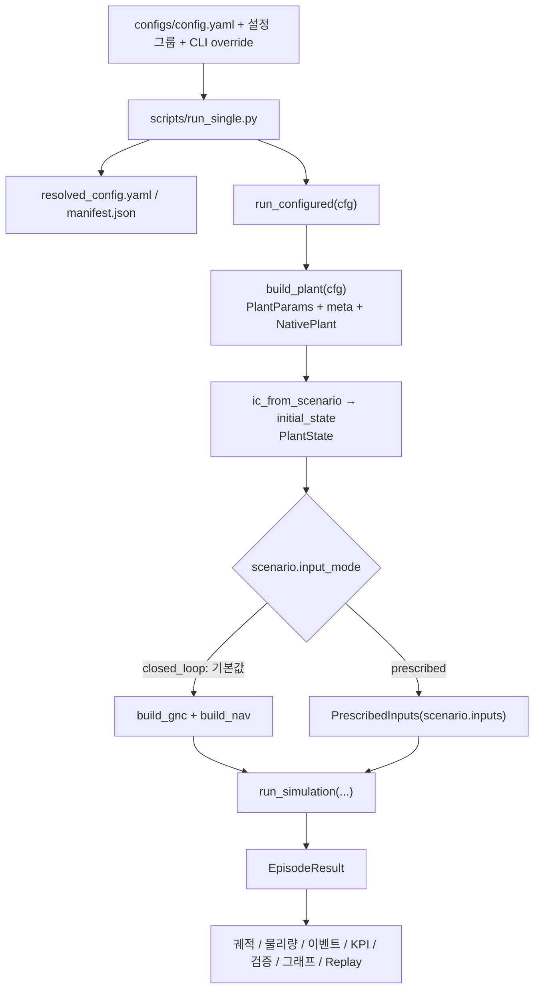
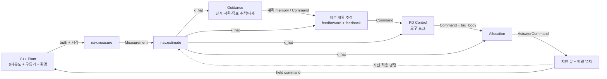
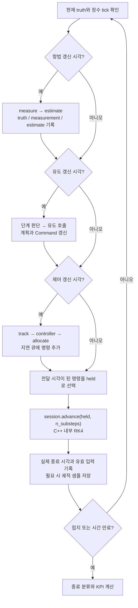
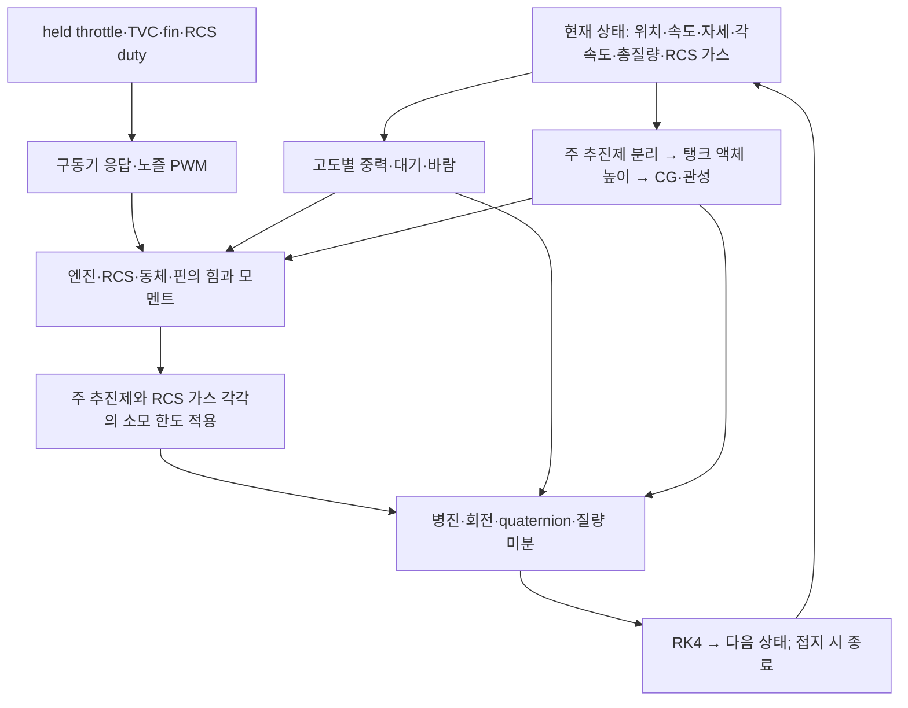
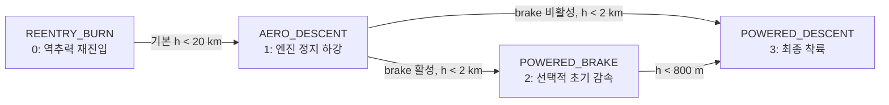
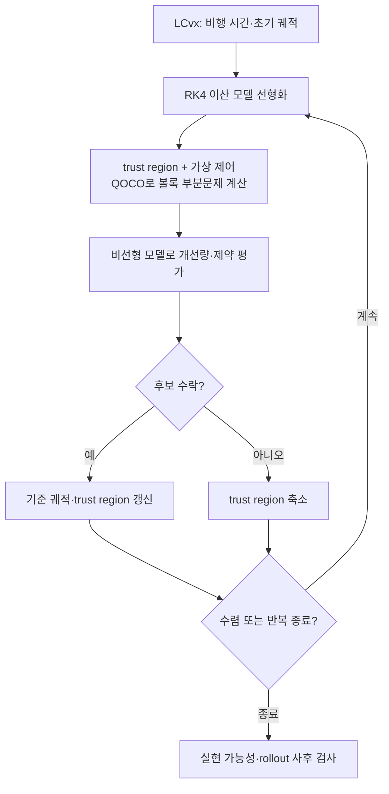

# RLV-Sim 코드 구조와 수학 모델

[English version](3_project_guide_en.md)

RLV-Sim은 Falcon 9 1단의 재진입·하강·착륙을 모사하고 유도·항법·제어 알고리즘을 교체해 실험하는 연구용 시뮬레이터다. Python은 설정, GNC, 실행 일정, 결과 분석을 담당하고 C++은 6자유도 물리 모델과 수치 적분을 담당한다.

이 문서는 2026-10-21의 공통 실행기·지정 입력 개루프 실험·물리 검증 기능까지 반영했다. 기존 폐루프 GNC·Monte Carlo와 함께, 독립적인 초기조건을 쓰는 13개 차량 실험, 핀 전개, 물리량·이벤트 기록, 해석 기준 및 적분 간격 비교를 설명한다. 센서 항법은 아직 구현하지 않았다. 수식은 구현을 설명하기 위한 것이며, 생략한 항이나 공칭 근사를 해당 위치에 명시한다. 수식의 근거는 각 절에 연결한 소스다. Markdown 뷰어에서 수학 표현과 Mermaid 지원을 활성화하면 `$...$`, `$$...$$` 및 흐름도를 렌더링할 수 있다.

## 목차

1. [프로젝트 범위와 구현 현황](#overview)
2. [디렉터리와 실행 진입점](#layout)
3. [전체 코드 흐름](#flow)
4. [데이터 계약과 좌표계](#contracts)
5. [설정에서 모듈이 만들어지는 과정](#configuration)
6. [실행 주기와 명령 전달](#timing)
7. [Plant: 물리 모델과 적분](#plant)
8. [GNC: 항법·단계 전환·제어·할당](#gnc)
9. [LCvx와 SCvx 착륙 궤적 최적화](#optimization)
10. [종료 판정·성능 지표·결과 파일](#results)
11. [실행 명령어와 인자 안내](#examples)
12. [확장 방법과 검증 코드](#extension)
13. [현재 가정과 구현상 제한](#limitations)

차량 물리 실험부터 시작하려면 [개루프 시나리오·초기조건](#prescribed-experiments), [시나리오별 검증 목적](#scenario-verification-purpose), [적분 간격 검사](#convergence-check), [실행 검증 기록](#vehicle-check-records)을 참고한다.

<a id="overview"></a>

## 1. 프로젝트 범위와 구현 현황

핵심 구분은 **6자유도 Plant**, **3자유도 착륙 궤적 최적화**, **별도의 자세 제어·구동기 할당**이다. Plant의 상태를 최적화기가 모두 직접 최적화하는 구조는 아니다.

| 영역 | 구현 내용 | 현재 상태·해석 |
|---|---|---|
| 기체 | `falcon9_stage1` 단일 엔진, `falcon9_octaweb` 9엔진 | 공개 근사값 기반 Falcon 9 1단 모델 |
| 운동 | 병진·회전, quaternion, 연료 소모, 가변 관성 | C++의 단일 물리 구현 |
| 공력 | 선형 모델, 해석식 생성 계수표, 파일 기반 계수표, grid fin | 기본 표는 실측 공력 데이터베이스가 아님 |
| 구동기 | throttle, TVC, fin | 이상·단순화·현실적 모델 선택 |
| RCS | 개별 노즐의 힘·토크·연료 소모, 3축 12노즐 / roll 전용 4노즐 | 독립적인 PWM / 평균 추력 모델; 기본 할당은 비활성 |
| 질량 특성 | LOX/RP-1 액체 높이·CG·관성, 별도 RCS 가스 | O/F 2.56, 설정 가능한 원통 형상 |
| 환경 | 고도별 역제곱 중력, 층별 표준대기, 정상풍·난류, 국소 지구 회전 항 | 고정 원점 NED; `inverse_square`·`ussa_poly` 기본 |
| 연료 출렁임 | 없음, 진자, 스프링–질량 모델 | 2개 횡방향 모드 |
| 고장 | 엔진 정지·추력 저하, TVC 편향, fin 고착, RCS 노즐 성능 저하 | RCS 고장은 `plant.rcs.thrust_scale`로 별도 지정 |
| 항법 | `IdentityNav`, 항법 템플릿 | 실제 상태 전달; 센서·INS·EKF는 미구현 |
| 유도 | 역추력 재진입, 공력 하강 자세, LCvx/SCvx 착륙 | 동력 착륙 유도는 설정으로 교체 |
| 제어 | quaternion 오차 기반 PD | 요구 기체 토크 생성 |
| 할당 | throttle·짐벌·fin·RCS 명령 | 공칭 효과에 따른 배분과 제한 |
| 지정 입력 실행 | 시간표로 구동기 명령을 직접 지정하는 개루프 | GNC·항법을 생성하지 않고 같은 Plant·실행 루프 사용 |
| 구성 변화 | 핀 공력 노출의 0/1 전환 | 순간 전개 근사; 전개 충격·질량·관성 변화 없음 |
| 실험 | 단일 실행, CPU 병렬 Monte Carlo, 명령 지연 | 초기조건 분산 및 시드 재현성 지원 |
| 분석 | 궤적, 힘·모멘트·질량 특성, 이벤트, 착륙 판정, 계산 시간 | CSV·JSON·NPZ·그래프; 항법 기록은 해당 모듈 실행 시 생성 |
| 물리 검증 | 해석 기준 6종, 결정론적 적분 간격 비교 | 구현·수치 일치성 검증; 실비행 데이터 정확도 검증과 구분 |
| 시각화 | 3D Replay, Frame Studio | 결과 재생과 좌표계 탐색 도구 |

`gnc/navigation=ekf`는 `NotImplementedError`를 발생시킨다. `IdentityNav`의 선택적 잡음·편향은 상태에 가하는 합성 교란이며 IMU/GNSS/고도계 모델이 아니다. 기본 생성 함수는 잡음 없는 `IdentityNav()`를 반환한다.

<a id="layout"></a>

## 2. 디렉터리와 실행 진입점

```text
RLV-Sim/
├── configs/                 # Hydra 설정: 기체·환경·GNC·시나리오·실험
├── scripts/
│   ├── run_single.py        # 단일 폐루프/지정 입력 실행과 결과 저장
│   ├── check_convergence.py # 지정 입력의 적분 간격 비교
│   ├── run_montecarlo.py    # 프로세스별 반복 실행과 통계
│   ├── view_replay.py       # 저장된 궤적의 웹 뷰어 실행
│   ├── view_frames.py       # 좌표계 탐색 도구 실행
│   ├── benchmark_native.py  # 네이티브 성능 측정
│   └── paper/              # 문헌 수집·가공 보조 스크립트
├── src/
│   ├── core/               # 자료형·좌표계·난수 시드 계약
│   ├── plant/              # 설정 변환·공력 표 전처리·초기 상태
│   ├── native/             # C++ 물리·좌표 변환·SCvx
│   │   └── vendor/qoco/     # 네이티브 SCvx가 사용하는 최적화기
│   ├── gnc/
│   │   ├── build.py        # GNC 모듈 생성·연결
│   │   ├── context.py      # 생성 시 전달하는 GncContext
│   │   ├── stack.py        # 유도·제어·할당 호출 조합
│   │   ├── navigation/     # 항법
│   │   ├── guidance/       # 단계 전환·유도·볼록 최적화
│   │   ├── control/        # 자세 제어
│   │   └── allocation/     # 구동기 할당
│   ├── validation/         # 해석 기준·적분 간격 비교
│   └── sim/                # 공통 실행·시간 관리·기록·집계·재생 변환
│       ├── run.py          # 설정에 따른 실행 모드 조립
│       ├── loop.py         # 공통 run_simulation 루프
│       └── open_loop.py    # PrescribedInputs 시간표와 smoke test 보조 함수
├── tests/                  # core·plant·gnc·sim 검증
├── viz/                    # Replay와 Frame Studio 웹 코드·모델
├── results/                # 실행별 결과
├── docs/                   # 구조·확장 설명과 문헌 검토
├── materials/              # 참고 PDF
├── pyproject.toml          # Python 의존성·패키지·검사 설정
└── setup.py                # pybind11 C++ 확장 빌드
```

주요 진입점은 [run_single.py](../scripts/run_single.py)다. [setup.py](../setup.py)는 `frames.cpp`, `plant.cpp`, `scvx.cpp`와 QOCO 소스를 `_rlv_sim_native` 확장 모듈로 빌드한다. Python 코드의 `plant/dynamics.py`는 이 확장 모듈을 구성한다. `plant/mass_properties.py`는 생성 시 습윤 질량 특성과 GNC 공칭 CG를 계산하는 보조 함수이며, 시간 적분과 실제 상태의 물리 계산은 C++에서 수행한다.

<a id="flow"></a>

## 3. 전체 코드 흐름

### 3.1 생성과 결과 저장



`build_plant()`는 `PlantBundle(params, make_initial_state, meta, native)`을 반환한다. `params`는 수치 파라미터, `meta`는 모델 이름·구조 정보, `native`는 C++ 모델이다. 에피소드마다 `native.create_session(state0)`로 독립적인 가변 상태를 만든다.

[sim/run.py](../src/sim/run.py)의 `run_configured()`가 설정에 맞춰 실행을 조립한다. 기존 `run_closed_loop` 이름은 공통 `run_simulation`의 호환 별칭으로 유지한다. 지정 입력 실행에서도 같은 물리 적분·종료 판정·기록 경로를 사용하며, 항법·유도·제어·할당은 호출하지 않는다.

### 3.2 폐루프 정보 흐름



유도는 추력·자세 기준을 만들고, 제어기는 `Command.tau_body`를 채우며, 할당기는 이를 `ActuatorCommand`로 바꾼다. **Plant가 받는 입력은 `ActuatorCommand`다.** `phase`는 GNC와 기록에 사용하는 태그이고 Plant 운동 방정식은 단계 태그로 분기하지 않는다.

### 3.3 폐루프의 한 실행 블록 순서



소스: [sim/loop.py](../src/sim/loop.py), [gnc/stack.py](../src/gnc/stack.py).

### 3.4 지정 입력 개루프의 흐름

[PrescribedInputs](../src/sim/open_loop.py)는 시간표에서 현재 구동기 명령과 핀 전개 상태를 선택한다. 루프는 입력·기록 주기의 경계와 시간표 이벤트 시각을 함께 사용해 C++ 적분 블록을 나눈다. 각 입력은 다음 변경 시각까지 유지되며, 기체 상태를 보고 수정하지 않는다. `phase`와 Replay의 단계 이름은 시간표의 구간 번호와 `label`이다.

핀 전개는 구동기 편향 명령과 별도로 네이티브 세션의 `set_fin_deployment()`에 전달한다. 이벤트 시각에 해당하는 물리 기록과 Replay 프레임도 남긴다. 이 경로에는 항법 추정치나 최적화 계획이 필요하지 않다.

<a id="contracts"></a>

## 4. 데이터 계약과 좌표계

### 4.1 상태·명령 자료형

공통 자료형은 [core/interfaces.py](../src/core/interfaces.py)에 정의되어 있다. 여기서 $N_e$는 엔진 수, $N_g$는 짐벌 엔진 수다. 최적화 노드 수 $N$과 구분한다.

| 자료형 | 주요 필드 | 전달 경로 |
|---|---|---|
| `PlantState` | 시간·위치·속도·quaternion·각속도·질량, 구동기 내부 상태, RCS 연료, slosh, 바람 필터, seed, done | 초기화 → C++ 세션; 전체 상태 진단 |
| 공개 snapshot | 시간·강체 상태·질량, 유효 throttle/TVC/fin/RCS, done | C++ → 루프·항법·기록 |
| `Measurement` | `r_ned`, `v_ned`, `q_bn`, `w_body`, `m`, `t` | 측정 함수 → 추정 함수 |
| `x_hat` | 추정 상태와 상태 시각 | 항법 → 유도·제어·할당; 별도 고정 클래스명은 아님 |
| `Command` | `phase`, `mode`, `thrust_vector`, `q_ref`, `tau_body`, `active_engines`, `w_ref` | 유도 → 제어 → 할당 |
| `ActuatorCommand` | `throttle`, `gimbal`, `fin`, `rcs` | 폐루프: 할당 → 지연 큐 → Plant; 개루프: 지정 입력 → Plant |
| `memory` | 단계 인덱스, 계획, 점화 시각, 재계획·제어 상태, 계산 시간 | 모듈 호출 사이에 유지 |
| `EpisodeResult` | 궤적, 단계, 진단, 종료 사유, KPI, 항법·구동기 이력 | 실행 루프 → 분석·저장 |

`Command.mode=0`은 추력 벡터 모드, `mode=1`은 엔진 정지 자세 모드다. `active_engines`는 단계별 엔진 마스크이며, 실제 물리 모델의 `engine_on` 고장 플래그와 별개다.

| 필드 | 크기 | 의미·단위 |
|---|---|---|
| `r_ned`, `v_ned` | `(3,)` | NED 위치 [m], 속도 [m/s] |
| `q_bn`, `q_ref` | `(4,)` | Body → NED quaternion, `[w, x, y, z]` |
| `w_body`, `w_ref` | `(3,)` | Body 각속도 [rad/s] |
| `m` | scalar | 구조 + 주 추진제 + RCS 가스의 총질량 [kg] |
| `thrust_vector` | `(3,)` | NED 요구 추력 [N] |
| `tau_body` | `(3,)` | Body 요구 토크 [N·m] |
| `active_engines` | `(N_e,)` | 0/1 엔진 마스크 |
| `throttle` | `(N_e,)` | 엔진별 명령 비율, 0–1 |
| `gimbal` | `(N_g, 2)` | 엔진별 pitch/yaw 편향 [rad] |
| `fin` | `(4,)` | grid fin 편향 [rad] |
| `rcs` | `(3,)` | roll/pitch/yaw 부호 있는 duty 명령, −1–1; 개별 노즐 명령 배열은 아님 |

### 4.2 좌표계와 기본 기호

NED의 축은 북쪽·동쪽·아래쪽이다. Body의 $+x$는 기수 방향이고, 기체 형상 좌표는 기수 원점에서 후방으로 갈수록 음수다. 형상 좌표와 시뮬레이션의 질량중심 위치를 구분해야 한다.

$$
\mathbf r_n=[r_N,r_E,r_D]^T,\qquad
\mathbf v_n=[v_N,v_E,v_D]^T,\qquad
h=-r_D.
$$

따라서 `[0, 0, -300] m`, `[0, 0, 25] m/s`는 300 m 고도에서 25 m/s로 하강하는 상태다. $C_{bn}(q)$를 Body 벡터를 NED로 바꾸는 회전행렬이라 하면:

$$
\mathbf a_n=C_{bn}(q)\mathbf a_b,\qquad
\mathbf a_b=C_{bn}(q)^T\mathbf a_n.
$$

이후 $\boldsymbol\omega$는 Body 각속도, $\mathbf F_b$와 $\boldsymbol\tau_b$는 Body 힘·토크, $\bar q$는 동압이다. quaternion $q$와 동압 $\bar q$를 구분한다.

### 4.3 Python–C++ 경계

| 시점 | Python → C++ | C++ → Python |
|---|---|---|
| 모델 생성 | `PlantParams`, 모델 선택 `meta` | `NativePlant` |
| 에피소드 생성 | 완전한 `PlantState` | 독립 세션 |
| 관측 | `observe()` | 현재 시각의 snapshot·진단; 시간·난수는 진행하지 않음 |
| 적분 블록 | 유지 명령과 `n_substeps` | 실제 블록 종료 시각의 snapshot·진단 |

서보 속도, slosh, 바람 필터, 난수 상태와 RK4 중간 상태는 세션 내부에 유지된다. 접지가 블록 중간에 일어나면 요청한 블록 끝이 아닌 실제 네이티브 종료 시각을 반환한다. `snapshot(full=True)`는 내부 상태 진단용이고, `rhs()`·`step()`은 개별 물리 검증에 사용한다.

<a id="configuration"></a>

## 5. 설정에서 모듈이 만들어지는 과정

### 5.1 설정 계층

루트 [config.yaml](../configs/config.yaml)은 Hydra 그룹을 조합한다. `group=name`은 구성요소 선택, `key=value`는 필드 변경, `+baseline=pdg`처럼 `+`가 붙는 표현은 새 설정 그룹 추가에 사용한다.

| 설정 | 주요 정보 | 소비하는 코드 |
|---|---|---|
| `plant/vehicle` | 형상, 건조·습윤 질량, 관성, 엔진 배열, 서보 계수 | `plant/dynamics.py`, C++ Plant, GNC 공칭값 |
| `plant/aero` | 공력 모델, 표 생성·파일 입력, fin 형상 | `plant/aero_data.py`, C++ 공력, 할당 |
| `plant/actuator`, `plant/thrust`, `plant/slosh` | 물리 모델 종류 | C++ 모델 선택 |
| `environment/atmosphere` | 밀도, 대기압, 온도 관련 값 | Plant와 GNC의 대기 근사 |
| `environment/gravity`, `plant/rcs` | 중력 상수·반경, RCS 배치·PWM | C++ 물리 모델 |
| `environment/wind`, `environment/earth` | 바람·난류, 위도·회전 설정 | C++ 환경 |
| `fault` | 엔진 정지·추력 배율·짐벌 편향·fin 고착 | Plant 고장 파라미터 |
| `scenario.ic` | 초기 위치·속도·Euler 자세·각속도·질량 | `ic_from_scenario`, `initial_state` |
| `scenario.dispersion` | 분산 활성화, 위치·속도 표준편차 | 초기조건 생성 |
| `scenario.horizon` | 최대 시간, 각 갱신 주기 | `sim/schedule.py` |
| `scenario.input_mode`, `scenario.inputs` | `closed_loop` / `prescribed`, 지정 입력 시간표 | `sim/run.py`, `sim/open_loop.py` |
| `scenario.validation` | 해석 기준 종류와 허용 오차 | `validation/analytical.py` |
| `scenario.success` | 위치·속도·기울기 허용 오차 | KPI 판정 |
| `gnc/guidance` | 목표, 최적화 격자·제약·추적 이득·재계획 | 착륙 유도 |
| `gnc/control` | `wn_axis`, `zeta` | PD 이득 생성 |
| `gnc/allocation` | 분담 방식·가중치, fin 동압 잠금, RCS 활성화 | 구동기 할당 |
| `gnc/scheduler` | 단계 전환 고도·활성 엔진 | 단계 스케줄러 |
| `gnc/navigation` | 항법 생성 함수 | 항법 모듈 |
| `plant_dt`, `gnc.delay_ticks`, `seed`, `run` | 적분 간격, 지연, 재현성, 출력·반복 실행 | 실행 코드 |

`PlantParams`는 `geom`, `mass`, `aero`, `atmosphere`, `wind`, `earth`, `slosh`, `actuator`, `engines`, `gravity`, `rcs`, `g_ned`, `plant_dt`를 묶는다. `default_nominal()`은 여기서 GNC용 추력·질량·모멘트 암·대기 함수·할당 옵션을 추출한다.

루트 설정은 `vehicle_set` 다음에 `scenario`를 합성한다. 새 시나리오는 공통 [_prescribed.yaml](../configs/scenario/_prescribed.yaml)을 재사용하면서 기체·환경·초기조건을 선택한다. `_prescribed`는 공통 설정이며 실행 예제로 직접 선택하는 이름은 아니다. 실제 실행 조건은 `resolved_config.yaml`로 확인한다. 아래 `GncContext`는 폐루프에서만 생성하며, 지정 입력 실행에 설정상의 `gnc` 노드가 남아 있어도 해당 모듈을 실행한다는 의미는 아니다.

### 5.2 GncContext와 생성 함수

```python
# 개념을 보여 주는 생성 경로
ctx = GncContext(
    cfg=cfg.gnc.guidance,
    nominal=nominal,
    params=params,
    active_engines=active,
    phase=phase,
)
guidance = instantiate(cfg.gnc.guidance.law, ctx)
```

| 필드 | 의미 |
|---|---|
| `cfg` | 해당 모듈의 해석된 설정 노드 |
| `nominal` | GNC용 공칭 물리값·할당 옵션 |
| `params` | `PlantParams` 전체 |
| `active_engines` | 해당 유도 단계의 엔진 마스크 |
| `phase` | 해당 유도 단계 태그 |

현재 항법 생성은 `GncContext(cfg=...)`만 전달한다. 유도·항법·제어는 `law._target_`가 가리키는 `build(ctx)`로 교체하지만, 할당 함수와 재진입·공력 하강 유도는 [build.py](../src/gnc/build.py)에서 고정 연결한다.

<a id="timing"></a>

## 6. 실행 주기와 명령 전달

소스: [schedule.py](../src/sim/schedule.py), [loop.py](../src/sim/loop.py).

| 처리 | 기본 `pdg` 주기 | 주파수 | 내용 |
|---|---:|---:|---|
| Plant | 0.001 s | 1,000 Hz | RK4 적분 |
| Navigation | 0.01 s | 100 Hz | 측정·추정 |
| Control + Allocation | 0.02 s | 50 Hz | 계획 추적·자세 제어·할당 |
| Guidance | 1.0 s | 1 Hz | 단계 판단·유도 호출·필요 시 최적화 |
| Trajectory log | 0.1 s | 10 Hz | 궤적 저장 |

폐루프에서 적분 간격을 $\Delta t_p$, 각 작업 주기를 $\Delta t_i$라 하면:

$$
n_i=\frac{\Delta t_i}{\Delta t_p}\in\mathbb Z_{>0},\qquad
n_b=\gcd(n_{nav},n_{guidance},n_{ctrl},n_{log}).
$$

한 네이티브 블록은 보통 $n_b$번의 적분이다. 기본 설정에서는 10 ms마다 Python으로 돌아오며 C++ 안에서 1 ms 적분을 10회 수행한다. 모든 주기와 `t_max`는 양의 정수 tick으로 표현 가능해야 하며, 표현 불가능한 값을 자동 반올림하지 않는다.

명령 지연 $d=$ `gnc.delay_ticks`는 제어 주기 기준이다.

$$
\tau_{delay}=d\Delta t_{ctrl}.
$$

갱신되지 않은 추정 상태와 구동기 명령은 유지한다. 항법은 동기식이며 측정·추정 시각이 truth 시각과 같아야 한다. 항법 갱신 사이의 유지된 추정치를 새 측정으로 기록하지 않는다. 항법 추정 함수에는 해당 시각의 새 제어 출력보다 앞서 유지 중이던 명령이 전달된다.

초기 truth 기록은 첫 제어 명령 적용 전 상태다. 궤적은 초기 시각, 정규 로그 시각, 실제 종료 시각을 포함한다. `convex_replan=false`일 때는 유도를 1 Hz로 호출하더라도 점화 후 최적화를 매번 다시 풀지 않는다.

지정 입력 실행은 `horizon.input_dt`와 `log_dt`의 최대공약수에 해당하는 블록을 사용하되, 입력·구성 이벤트가 중간에 있으면 그 시각에서 추가로 나눈다. 공통 설정은 두 주기 모두 0.02 s다. 이벤트 시각은 시작 시각에 상대적이며 `plant_dt` 격자에 놓여야 한다. `input_dt`의 배수일 필요는 없다. 개루프에는 항법·유도 주기나 GNC 명령 지연을 적용하지 않는다. 궤적에는 정규 로그 외에 지정 입력 이벤트 시각도 포함한다.

<a id="plant"></a>

## 7. Plant: 물리 모델과 적분

주요 소스: [native/plant.cpp](../src/native/plant.cpp)의 `evaluate`, `engines`, `body_aero`, `fin_forces`, `actuator_derivatives`, `slosh`, `integrate_once`.

[Module 4 Simulation Examples](../materials/RSLV_GNC_Module4_Simulation_Examples.pdf)의 요구와 구현 위치는 다음과 같다.

| 자료 | 현재 구현 | 상세 절 |
|---|---|---|
| pp.10–12, 15: 힘·모멘트와 6자유도 적분 | NED 병진, 기체 회전, quaternion, RK4 | 7.1, 7.7 |
| p.11: 고도별 중력 | 역제곱 법칙과 기체 좌표계 중력 힘 | 7.1 |
| p.13: dual tank | O/F 2.56, 액체 높이와 평행축 정리 | 7.2 |
| pp.11–14: 추진·RCS | 엔진별 추력과 개별 RCS 노즐의 힘·토크·유량 | 7.3, 7.5 |
| p.17: 층별 대기 | 기본 `ussa_poly`에서 밀도·음속·배압 계산 | 7.4 |
| pp.18–20, 22–23: 동체·핀 공력 | 상대풍, 국소 핀 유동, 힘·모멘트 및 중립 핀 증분 | 7.4 |
| p.21: 풍동 계수 식별 | 외부 계수표 입력 기능 제공; 기본값은 해석식 근사 | 7.4, 13 |



주 추진제 소진은 엔진 추력·유량을 0으로 만드는 사건이다. 에피소드 종료 사건은 아니며 RCS와 무추력 비행을 계속 계산한다.

### 7.1 병진·회전 운동

강체 부분의 저장 상태는 위치 3개, 속도 3개, quaternion 4개, 각속도 3개, 질량 1개다. 6자유도라는 표현은 운동 자유도를 뜻하며 상태 배열이 6개라는 뜻은 아니다.

$$
\dot{\mathbf r}_n=\mathbf v_n,
\qquad
\dot{\mathbf v}_n=\mathbf g_n+\mathbf a_{rot}
+\frac{C_{bn}(q)\mathbf F_b}{m}.
$$

$$
\mathbf F_b=\mathbf F_{engine}+\mathbf F_{body\ aero}
+\mathbf F_{fin}+\mathbf F_{slosh}+\mathbf F_{RCS}.
$$

중력의 기본 모델은 Module 4 p.11의 역제곱 법칙이다. $h=-r_D$, $\mu=3.986004418\times10^{14}\;\mathrm{m^3/s^2}$, $R_e=6371000\;\mathrm m$를 사용한다.

$$
g(h)=\frac{\mu}{(R_e+h)^2},\qquad
\mathbf g_n(h)=\begin{bmatrix}0&0&g(h)\end{bmatrix}^{T},\qquad
\mathbf F_{g,b}=mC_{bn}^{T}\mathbf g_n(h).
$$

저장 속도가 NED이므로 병진 미분에 $\mathbf g_n(h)$를 직접 더한다. 기체 좌표계에서 $\mathbf F_{g,b}$를 더한 뒤 회전하는 것과 동등하며, 중력의 중복 합산은 하지 않는다. `gravity_ned`, `F_gravity_body` 진단으로 두 표현을 확인할 수 있다. `environment/gravity=uniform`은 해석해 검증용 일정 중력 근사다. 비추력 환산에 사용하는 표준중력 $g_0=9.80665$는 고도별 중력과 독립이다.

RCS도 개별 추력기의 힘을 병진 합에 포함한다. 정상적인 대칭 쌍은 순힘이 상쇄되지만, 한쪽 추력기가 고장 나면 순힘이 남는다. 관성 $I(m,m_{RCS})$와 횡방향 무게중심 편차 $\mathbf r_{lat}=[0,y_{cg},z_{cg}]^T$를 반영한 회전 방정식은 다음과 같다.

$$
I(m,m_{RCS})\dot{\boldsymbol\omega}
=\boldsymbol\tau_{sum}-\mathbf r_{lat}\times\mathbf F_b
-\boldsymbol\omega\times\bigl(I(m,m_{RCS})\boldsymbol\omega\bigr)
-\dot I(m,m_{RCS})\boldsymbol\omega.
$$

$\boldsymbol\tau_{sum}$에는 엔진·기체 공력·fin·slosh·RCS·분사 감쇠 토크가 포함된다. 코드의 분사 감쇠는 주 엔진 질량유량 $\dot m_{out}>0$와 노즐 모멘트 암 $\ell$에 대해:

$$
\boldsymbol\tau_{jet}
=\begin{bmatrix}0&-\dot m_{out}\ell^2\omega_y&-\dot m_{out}\ell^2\omega_z\end{bmatrix}^T.
$$

quaternion은 scalar-first Hamilton 곱을 사용하며:

$$
\dot q_{bn}=\frac12 q_{bn}\otimes
\begin{bmatrix}0\\\boldsymbol\omega\end{bmatrix},
\qquad q_{bn}\leftarrow\frac{q_{bn}}{\lVert q_{bn}\rVert_2}
\quad\text{(각 적분 후)}.
$$

### 7.2 질량·무게중심·관성

`prescribed` 모델은 건조·습윤 끝점 사이를 선형 보간한다.

$$
f=\operatorname{clip}\left(\frac{m-m_{dry}}{m_{wet}-m_{dry}},0,1\right),
\qquad x_{cg}=x_{cg,dry}+f(x_{cg,wet}-x_{cg,dry}),
$$

$$
I_j=I_{j,dry}+f(I_{j,wet}-I_{j,dry}).
$$

기본 `dual_tank`는 Module 4 p.13의 O/F 비와 원통 액체 탱크의 질량분포를 사용한다. `m_dry`는 주 추진제와 RCS 가스를 모두 제외한 구조 질량이며, 초기 `scenario.ic.m`과 `m_wet`는 RCS 가스를 포함한 **총질량**이다. 주 추진제 질량은 다음과 같다.

$$
m_p=\max(m-m_{dry}-m_{RCS},0),\qquad
m_f=\frac{m_p}{1+O/F},\qquad m_{ox}=(O/F)m_f,\qquad O/F=2.56.
$$

각 액체는 탱크의 뒤쪽 경계 $x_{bottom,i}$에서 기체 $+x$ 방향으로 채워진다고 가정한다. 밀도 $\rho_i$, 반경 $R_i$에 대해:

$$
H_i=\frac{m_i}{\rho_i\pi R_i^2},\qquad
x_i=x_{bottom,i}+\frac{H_i}{2},\qquad
x_{cg}=\frac{m_{dry}x_{dry}+\sum_i m_ix_i+m_{RCS}x_{RCS}}{m}.
$$

액체 원통의 자체 관성은 $I_{xx,i}=m_iR_i^2/2$, $I_{yy,i}=I_{zz,i}=m_i(3R_i^2+H_i^2)/12$이며, 건조 구조·액체·RCS 가스의 관성을 현재 CG로 평행 이동하여 합한다. 가스는 고정 형상의 등가 원통에 균일하게 분포한다고 가정한다. 기존 습윤 관성에 맞추는 임의 보정은 없다. `dual_tank`의 습윤 CG·관성은 형상에서 계산되어 `PlantParams.mass`에 저장되며, YAML의 `x_cg_wet`, `I_wet`는 `prescribed` 모델용 입력이다.

주 엔진과 RCS가 모두 총질량을 감소시킨다.

$$
\dot m=-\dot m_{main,out}-\dot m_{RCS,out},\qquad
\dot m_{RCS}=-\dot m_{RCS,out}.
$$

관성 변화율에도 두 추진제의 소모를 반영한다. 할당기의 공칭 CG는 같은 탱크 형상을 사용하지만, 항법에 RCS 잔량 추정치가 없으므로 초기 RCS 가스량을 유지한 근사다.

예를 들어 기본 `pdg` 초기 총질량 29,500 kg은 구조 25,600 kg, RCS 가스 200 kg, 주 추진제 **3,700 kg**으로 나뉜다. RCS를 사용하지 않고 주 추진제만 모두 소모하면 총질량은 25,800 kg이다. 따라서 이 상태를 구조 질량인 `m_dry=25,600 kg`과 혼동하면 안 된다.

탱크 밀도·반경·뒤쪽 경계·길이는 `plant.vehicle.tanks`에서 설정한다. 기본 치수는 **실기체 검증값이 아닌 명시적 가정**이며, 축방향으로 액체가 가라앉은 준정적 모델이다. 무중력 자유표면, 혼합비의 시간 변화, 압력·열역학을 계산하지 않는다. 탱크 용량 초과와 비물리적인 입력은 모델 생성 시 거부한다.

### 7.3 엔진 추력과 질량유량

엔진 $i$의 유효 throttle을 $u_i$, 진공 최대 추력을 $T_{vac,i}$, 노즐 출구 면적을 $A_{e,i}$, 고장 플래그를 $e_i$, 추력 배율을 $s_i$라 하자. 실제 코드에는 최소 throttle 근처에서 연소를 부드럽게 연결하는 $\phi_i$가 있다.

$$
z_i=\operatorname{clip}\left(\frac{u_i-(u_{min,i}-0.1)}{0.1},0,1\right),
\qquad \phi_i=z_i^2(3-2z_i),
$$

$$
T_i=s_ie_i\phi_i\max\left(u_iT_{vac,i}-p_{amb}(h)A_{e,i},0\right).
$$

pitch/yaw 편향을 $\delta_{p,i},\delta_{y,i}$라 하면, 고정 cant와 고장 bias를 합친 노즐 방향은:

$$
\mathbf d_i=
\begin{bmatrix}
\cos\delta_{p,i}\cos\delta_{y,i}\\
\cos\delta_{p,i}\sin\delta_{y,i}\\
-\sin\delta_{p,i}
\end{bmatrix},\qquad
\mathbf F_{engine}=\sum_iT_i\mathbf d_i,
$$

$$
\boldsymbol\tau_{engine}=\sum_i
(\mathbf r_{engine,i}-\mathbf r_{cg})\times(T_i\mathbf d_i).
$$

주 엔진 질량유량은 순추력이 아닌 throttle에 따른 진공 추력으로 계산한다.

$$
\dot m_{main,out}=\sum_i\frac{e_i\phi_i u_iT_{vac,i}}{I_{sp,i}g_0}.
$$

현재 `thrust_scale`은 추력을 줄이지만 이 질량유량 식을 같은 비율로 줄이지 않는다. `engine_on=0`은 해당 엔진의 추력과 연료 소모를 모두 끈다.

### 7.4 대기·바람·공력

상대풍과 기본 공력량은:

$$
\mathbf v_{air,b}=C_{bn}^T(\mathbf v_n-\mathbf v_{wind,n}),\qquad
V=\lVert\mathbf v_{air,b}\rVert_2,
$$

$$
\bar q=\frac12\rho(h)V^2,\qquad M=\frac{V}{a(h)}.
$$

기체 공력의 총 받음각은 엔진 쪽을 향하는 `fwd_axis` $\mathbf e_f=[-1,0,0]^T$와 상대속도 사이의 각이다. 일반적인 기수 전방 기준의 Euler 받음각과 구분한다.

$$
c_\alpha=\mathbf e_f^T\widehat{\mathbf v}_{air,b},\qquad
\alpha=\arccos(c_\alpha),\qquad
\widehat{\mathbf l}=\operatorname{unit}
(\mathbf e_f-c_\alpha\widehat{\mathbf v}_{air,b}).
$$

$$
\mathbf F_{body\ aero}
=-\bar qSC_D\widehat{\mathbf v}_{air,b}
+\bar qSC_L\widehat{\mathbf l}.
$$

계수표는 $\cos\alpha$ 축에서 PCHIP 기반 Hermite 보간, Mach 축에서 선형 보간을 한다. 해석식 표 모델의 기본 모멘트는:

$$
\boldsymbol\tau_{aero}=
\begin{bmatrix}x_{cp}-x_{cg}\\0\\0\end{bmatrix}
\times\mathbf F_{body\ aero}.
$$

표 기반 모델에는 추가 pitch/yaw 감쇠가 있다. 파일 기반 $C_m$ 모드에서는 기준 무게중심에 대한 모멘트를 $\bar qSDC_m$로 직접 구성하고 무게중심 이동을 보정한다. $C_N\approx0$에서 $C_m/C_N$으로 압력중심을 역산하는 불안정성을 피하는 방식이다.

fin은 각 장착 위치의 회전 속도를 포함한 국소 유동을 사용한다.

$$
\mathbf v_{local,i}=\mathbf v_{air,b}
+\boldsymbol\omega\times(\mathbf r_{fin,i}-\mathbf r_{cg}),
\qquad
\boldsymbol\tau_{fin}=\sum_i(\mathbf r_{fin,i}-\mathbf r_{cg})\times\mathbf F_{fin,i}.
$$

핀의 국소 유동각은 축방향·접선방향 속도로 계산한다.

$$
\phi_i=\operatorname{atan2}(\mathbf v_{local,i}\cdot\mathbf e_{tan,i},
|\mathbf v_{local,i}\cdot\mathbf e_{axial}|),\qquad \alpha_i=\delta_i-\phi_i.
$$

작은 각도에서 $L_i=\bar q_i S_i C_{L\alpha}\alpha_i$, $D_i=\bar q_iS_i(C_{D0}+C_{D\alpha^2}\alpha_i^2)$이다. 양력 방향은 국소 속도에 수직이고 항력 방향은 국소 속도의 반대다. `fin_cd_alpha2`가 이차 항력 계수다.

해석식 fin 모델은 실속을 $\alpha_s\tanh(\alpha/\alpha_s)$로 완화하고 천음속 효과를 반영한다. 증분 모델(`fins.incremental=true`)에서는 같은 국소 유속에서 $F(\delta_i)-F(0)$를 계산한다. 기체 표는 정적 중립 핀을 포함하므로, 추가로 $F_{neutral}(v_{local})-F_{neutral}(v_{air})$를 더해 회전 감쇠를 유지한다. 중립 핀 공력을 이중으로 더하지 않는다. 기본 해석식 동체 표에는 핀이 포함되지 않아 `incremental=false`의 독립 구성요소 모델을 사용한다.

기본 계수는 물리 구조를 가진 해석식 근사다. Module 4 p.21의 풍동 데이터 식별을 완료했다는 뜻은 아니며, 검증된 계수표가 있으면 `backend=file`로 연결해야 한다.

| 환경 선택 | 구현 내용 |
|---|---|
| `atmosphere=vacuum` | 밀도 0 |
| `atmosphere=exp` | $\rho=\rho_0e^{-h/H}$, 온도에 따른 음속 |
| `atmosphere=ussa_poly` | 지위고도 기반 층별 표준 대기 |
| `atmosphere=nonstd_day` | 같은 층별 모델에 온도 편차·밀도 배율 적용 |
| `wind=none`, `steady` | 무풍, 일정한 NED 바람 |
| `wind=dryden`, `von_karman` | OU 평균풍과 난류 shaping filter |

지수 대기의 배압 모델은 $p_{amb}=p_{sea}e^{-h/H}$다. 층별 대기는 기압·온도에서 밀도를 계산한다. 난류 필터는 각 물리 substep에서 갱신되고 해당 RK4의 중간 단계 동안 같은 바람을 유지한다.

### 7.5 구동기 모델

`ideal`은 제한을 적용한 명령을 즉시 유효 입력으로 사용한다. `simplified`는 선형 지연·서보, `realistic`은 비선형 변화율 제한·서보를 적용한다. RCS의 펄스/평균 모델은 이 선택과 독립이다.

현실적 throttle 응답은 목표값 $u_{ref}$에 대해:

$$
\dot u=\dot u_{max}\tanh\left(
\frac{u_{ref}-u}{\tau_u\dot u_{max}}\right).
$$

목표 throttle은 0–1로 제한하고 최소 throttle보다 작으면 0으로 처리한다. 단순화 모델에서는 $\dot u=(u_{ref}-u)/\tau_u$다.

짐벌과 fin은 각도 $\delta$, 속도 $v_\delta$에 대해 다음의 포화 속도 명령 구조를 사용한다.

$$
k_p=\frac{\omega_n}{2\zeta},\qquad k_v=2\zeta\omega_n,
$$

$$
v_{ref}=v_{max}\tanh\left(\frac{k_p(\delta_{ref}-\delta)}{v_{max}}\right),
\qquad \dot\delta=v_\delta,\qquad
\dot v_\delta=k_v(v_{ref}-v_\delta).
$$

입력 $\delta_{ref}$에 편향 제한을 적용한다. 단순화 모델에서는 $v_{ref}=k_p(\delta_{ref}-\delta)$로 바뀌어 선형 2차계가 된다. fin 고착은 현실적 구동기에서 해당 fin 상태의 미분을 막는다.

#### RCS: 개별 추력기와 펄스

`plant/rcs=paired`는 양·음의 3축 토크를 위한 12개 노즐(축별 4개), `plant/rcs=roll_four`는 Module 4 p.14 형태의 roll 전용 4개 노즐이다. 후자는 독립적인 pitch/yaw 제어 능력이 없다. 두 배치 모두 실기체 장착도 대신 명시적으로 가정한 대칭 배치다.

$$
\mathbf F_{RCS}=\sum_j u_j T_js_j\widehat{\mathbf d}_j,\qquad
\mathbf M_{RCS}=\sum_j(\mathbf r_j-\mathbf r_{cg})\times u_jT_js_j\widehat{\mathbf d}_j,
\qquad
\dot m_{RCS,out}=\sum_j\frac{u_jT_js_j}{I_{sp,RCS}g_0}.
$$

$\widehat{\mathbf d}_j$는 분사 반대 방향인 **기체가 받는 힘의 방향**이다. 대칭 쌍의 최대 토크는 $2T\ell$, 연료 소모는 두 노즐의 합이다. `thrust_scale`은 scalar 또는 노즐별 배열이며, 0은 닫힌 상태의 고장이다.

`plant.rcs.mode=pulsed`는 기본 20 ms PWM 주기에서 노즐을 실제 0/1로 작동시킨다. 명령은 축별 부호 있는 duty이며 on tick 수로 반올림하므로 기본 1 ms 적분에서 duty 분해능은 0.05다. 노즐 상태는 RK4 한 스텝 동안 유지된다. `mode=averaged`는 평균 추력 근사다. RCS 할당을 사용하려면 `gnc.allocation.rcs_enabled=true`도 지정한다.

`rcs_thruster_on`, `F_rcs_body`, `M_rcs_body`, `rcs_mdot`, `main_propellant` 진단을 제공한다. 추진제 소진이 스텝 도중 발생하는 마지막 부분 스텝은 남은 질량에 맞는 평균 힘·유량을 적용하여 음의 잔량과 초과 충격량을 방지한다.

### 7.6 Slosh와 지구 회전

slosh는 두 횡방향의 내부 좌표 $\xi_j$를 사용한다. 코드 연산 기준으로 가속도 입력에 대응하는 변위형 좌표이며, `PlantState` 주석의 angle 표현만 보고 단위를 해석하지 않도록 주의한다.

$$
\ddot\xi_j+2\zeta\omega_d\dot\xi_j+\omega_s^2\xi_j
=-a_{attach,j},\qquad
F_{slosh,j}=m_s(\omega_s^2\xi_j+2\zeta\omega_d\dot\xi_j).
$$

스프링–질량 모델은 고정 $\omega_s=\omega_d=\omega$를 사용한다. 진자 모델은 부착점 축방향 가속도 $a_{attach,x}$로 $\omega_s^2=a_{attach,x}/L$, $\omega_d=\sqrt{|a_{attach,x}|/L+\epsilon}$을 계산한다. 부착점 가속도에는 병진 힘과 회전 가속도·구심 가속도가 포함된다.

`earth=rotating`에서는:

$$
\mathbf a_{rot}=-2\boldsymbol\Omega_n\times\mathbf v_n
-\boldsymbol\Omega_n\times\left[\boldsymbol\Omega_n\times(\mathbf R_{origin}+\chi\mathbf r_n)\right].
$$

$\chi$는 차등 원심 가속도 활성화 값이고 $\mathbf R_{origin}=[0,0,-R_e]^T$다. 역제곱 중력은 순수 인력이므로 원점 원심 가속도도 별도로 더한다. 이 모델은 고정 국소 NED 모델이며 구면·타원체 지구의 ECEF/LLA 전파를 구현한 것은 아니다.

### 7.7 RK4와 종료

유지된 구동기 명령을 $u$라 하고 전체 미분을 $f(x,u)$라 하면:

$$
\begin{aligned}
k_1&=f(x_k,u),\\
k_2&=f(x_k+\tfrac12\Delta t_pk_1,u),\\
k_3&=f(x_k+\tfrac12\Delta t_pk_2,u),\\
k_4&=f(x_k+\Delta t_pk_3,u),\\
x_{k+1}&=x_k+\frac{\Delta t_p}{6}(k_1+2k_2+2k_3+k_4).
\end{aligned}
$$

적분 후 quaternion을 정규화한다. 매 스텝의 주 추진제·RCS 질량 예산으로 힘과 유량을 함께 제한한다. 주 추진제가 고갈되면 엔진만 꺼지고 남은 RCS와 탄도 비행은 계속 적분한다. 네이티브 종료 조건은 고도 0 이하이며 전체 실행은 시간 한도에서도 종료된다. 접촉 후 착륙 다리의 변형·반발을 계속 적분하는 접촉 동역학은 없다.

### 7.8 핀 전개에 따른 구성 변화

네이티브 세션의 `set_fin_deployment(d)`는 $d\in\{0,1\}$에 따라 핀 힘과 모멘트의 공력 노출을 전환한다.

$$
\mathbf F_{fin,applied}=d\mathbf F_{fin},\qquad
\mathbf M_{fin,applied}=d\mathbf M_{fin}.
$$

세션 생성·초기화 시 기본값은 전개 상태 `1`이다. 지정 입력의 `fin_deployment: 0`으로 수납 상태에서 시작할 수 있다. 중립 핀 공력이 이미 동체 계수표에 포함된 증분 모델에서는 수납을 거부한다. 핀 효과를 따로 제거할 수 없는 계수표에 전개 계수를 중복 적용하지 않기 위해서다.

이 모델은 **순간적인 공력 노출 변화**만 나타낸다. 수납 핀 항력, 힌지 운동, 전개 충격, 구조 진동, 전개에 따른 질량·관성 변화는 포함하지 않는다. 주·RCS 연료 소모에 따른 질량 특성 변화는 기존 모델대로 계산한다. 진단에는 `fin_deployment`와 `M_fin_body`를 기록하며, 같은 전개 상태를 Replay에도 전달한다. 착륙 다리의 시각적 전개와는 별개다.

소스: [plant.cpp](../src/native/plant.cpp), [open_loop.py](../src/sim/open_loop.py).

<a id="gnc"></a>

## 8. GNC: 항법·단계 전환·제어·할당

이 절은 `scenario.input_mode=closed_loop`인 실행에 적용한다. `prescribed` 실행은 아래 모듈을 생성하지 않는다.

### 8.1 항법

소스: [navigation/identity.py](../src/gnc/navigation/identity.py), [navigation/ekf_stub.py](../src/gnc/navigation/ekf_stub.py).

```python
measurement = nav.measure(truth, seed)
x_hat, nav_memory = nav.estimate(measurement, held_actuator, nav_memory)
```

기본 항법은 $\widehat x(t_k)=x_{truth}(t_k)$다. `IdentityNav`를 직접 구성하면 위치 등에서 $y=x+b+\sigma\epsilon$, $\epsilon\sim\mathcal N(0,I)$ 형태의 교란을 줄 수 있다. 자세 교란은 작은 회전 quaternion을 곱하고 정규화한다. 일반 센서 관측식이나 필터의 예측·갱신은 아직 없다.

### 8.2 비행 단계와 유도

소스: [phase.py](../src/gnc/guidance/phase.py), [scheduled.py](../src/gnc/guidance/scheduled.py).



고도 스케줄러는 임계값보다 낮아지면 앞으로만 진행한다. 일반 guard는 $\psi(\widehat x,t;\theta)\ge0$으로 표현한다. 현재 `guard` 설정도 고도 기반 함수를 구성한다. 단계 갱신은 유도 주기에 일어나고 빠른 `track()`은 마지막으로 선택한 단계를 따른다.

| 단계 | 유도 내용 | 기본 엔진 선택 |
|---|---|---|
| 재진입 | $\mathbf T_{ref}=-T_{max}\widehat{\mathbf v}$, 속도 반대 방향 역추력 | 9엔진 구성에서 `[0, 1, 5]` |
| 공력 하강 | 기본 직립 자세 유지; 선택적으로 수평속도 반대 방향 기울임 | 모두 정지 |
| 동력 초기 감속 | 선택한 LCvx/SCvx를 다중 엔진으로 구성 | `[0, 1, 5]` |
| 최종 착륙 | 선택한 LCvx/SCvx 계획·추적 | `[0]` |

`pdg`는 최종 착륙부터 시작한다. 단일 엔진 구성에서는 도달하지 않는 이전 단계의 엔진 목록을 사용하지 않는다. `reentry_to_landing`은 뒤집기 완료 후 60 km 하강 상태부터 시작한다.

### 8.3 계획 추적과 목표 자세

소스: [convex/guidance.py](../src/gnc/guidance/convex/guidance.py)의 `_ref`, `_track`, `_project_achievable`; [base.py](../src/gnc/guidance/base.py).

저장된 계획 노드 사이의 기준 위치·속도는 cubic Hermite 보간으로 구한다. 위치·속도 피드백은:

$$
\mathbf a_{fb}=k_r(\mathbf r_{ref}-\widehat{\mathbf r})
+k_v(\mathbf v_{ref}-\widehat{\mathbf v}).
$$

LCvx는 질량당 추력 $\mathbf u_{ff}$, SCvx는 물리 추력 $\mathbf T_{ff}$를 유지한다.

$$
\mathbf T_{raw}=
\begin{cases}
\widehat m(\mathbf u_{ff}+\mathbf a_{fb}),&\text{LCvx},\\
\mathbf T_{ff}+\widehat m\mathbf a_{fb},&\text{SCvx}.
\end{cases}
$$

이후 추력 크기를 배압 보정된 가용 범위로 제한하고 방향을 최대 기울기 원뿔 안으로 제한한다. 위쪽 성분이 없는 요구는 최소 추력의 수직 상승 방향으로 제한하며 횟수를 기록한다. 기체 $+x$축이 이 추력 방향을 향하도록 `q_ref`를 만든다.

계획이 없으면 coast하며, 기본 설정은 가능한 연속 연소 계획을 찾으면 점화 시각과 계획을 고정한다. 계획 시간이 끝나면 엔진을 끄고 만료 횟수를 기록한다. 계획 종료를 임의의 추가 최소추력 구간으로 연장하지 않는다.

### 8.4 PD 자세 제어

소스: [control/pd.py](../src/gnc/control/pd.py).

$$
q_e=\widehat q_{bn}^{*}\otimes q_{ref},\qquad
\mathbf e_q=\operatorname{sign}(q_{e,w}+10^{-12})\mathbf q_{e,xyz},
$$

$$
\boldsymbol\tau_{cmd}
=K_p\odot\mathbf e_q-K_d\odot(\widehat{\boldsymbol\omega}-\boldsymbol\omega_{ref}).
$$

$\odot$는 축별 곱이다. 코드에서는 quaternion 벡터부에 별도 계수 2를 곱하지 않는다. 생성 시 설정된 축별 $\omega_{n,j}$와 감쇠비 $\zeta$로:

$$
K_{p,j}=I_{wet,j}\omega_{n,j}^2,\qquad
K_{d,j}=2\zeta I_{wet,j}\omega_{n,j}.
$$

이 이득은 습윤 관성으로 계산한 고정값이다. 현재 질량에 따른 실시간 이득 스케줄링은 아니다. 기본 `wn_axis=[1.0, 1.4, 1.4] rad/s`, `zeta=0.7`을 사용한다.

### 8.5 제어 할당

소스: [allocation/default.py](../src/gnc/allocation/default.py).

동일 엔진의 활성 개수를 $n_a$라 하면 요구 추력 크기를 균등 분배하고, 배압을 역보상해 throttle을 구한다.

$$
u_{each}=\operatorname{clip}\left(
\frac{\lVert\mathbf T_{cmd}\rVert_2/n_a+p_{amb}A_e}{T_{vac}},0,1\right).
$$

양수이면서 최소 throttle보다 작으면 최소값으로 올리고 엔진 마스크를 곱한다. 짐벌 명령은 `q_ref` 좌표계에서 계산한 추력 방향 성분에 자세 토크용 편향을 더한다. 현재 모든 짐벌에 같은 pitch/yaw 명령을 복제한다.

`blended` 모드의 대표 효과를 $g_e$와 $g_f$, 비용 가중치를 $w_e,w_f$라 하면:

$$
g_e=T_{each}|x_{eng}-x_{cg}|,\qquad
g_f=2\bar q|x_{fin}-x_{cg}|S_{fin}C_{L_\alpha,fin},
$$

$$
s_{fin}=\frac{g_f^2/w_f}{g_e^2/w_e+g_f^2/w_f},\qquad
s_{gimbal}=1-s_{fin}.
$$

분모가 0에 가까운 경우 보호 처리를 한다. 기본값은 $\bar q<1000\,\mathrm{Pa}$에서 fin 분담을 0으로 한다. `phase_gated` 모드는 동력 비행에서 짐벌, 엔진 정지에서 fin을 선택한다.

파일 기반 증분 fin 모델에서는 각 fin의 단위 편향 토크를 열벡터로 갖는 $B$를 만들고 감쇠 의사역행렬을 사용한다.

$$
\boldsymbol\delta_{fin}
=\operatorname{sat}_{smooth}
\left[B^T(BB^T+\lambda^2I)^{-1}\boldsymbol\tau_{fin,des}\right],
\qquad \operatorname{sat}_{smooth}(x,L)=L\tanh(x/L).
$$

RCS를 활성화하면 주 제어기의 실현 토크를 제외한 잔여 토크를 처리한다. 기본 `rcs_enabled=false`와 해석식 fin 할당에서는 roll 제어가 없다. 형상 기반 fin 할당은 형상이 제공하는 roll 효과를 사용할 수 있다.

할당기는 truth 바람을 받지 않으므로 동압에 지상 상대 추정 속도를 사용한다. 밀도·음속은 선택한 대기 모델을 따르지만 배압 역보상은 지수 근사를 사용한다. 엔진별 고장 식별과 개별 최적 재할당은 구현되어 있지 않다.

<a id="optimization"></a>

## 9. LCvx와 SCvx 착륙 궤적 최적화

### 9.1 공통 문제와 계획 데이터

입력은 현재 위치·속도·총질량, 목표 위치, 공칭 중력, 엔진 능력, 주 추진제 소진 후 남는 공칭 질량, 최대 기울기, 접근 원뿔, 비행 시간 후보와 노드 수다. `nominal["m_dry"]`는 구조 질량에 초기 RCS 가스를 더한 계획용 하한이며, `params.mass.m_dry`와 의미가 다르다. Plant는 고도별 중력을 사용하지만 현재 볼록 유도는 `nominal["gravity_ned"]`의 지표면 중력을 고정값으로 사용한다. 기본 목표는 NED 원점이며, 기본 종단 조건은 목표 위치와 정지다.

$$
\mathbf r_N=\mathbf r_{target},\qquad
\mathbf v_N=\mathbf0,\qquad m_N\ge m_{dry}.
$$

계획은 `r`, `v`, `m`, `u`, `sigma`, `thrust`, `tf`, `N`, `fuel`, `status` 등을 dict에 담아 반환한다. 가능한 계획은 유도 `memory`에 저장한다. `feasible`은 솔버 상태에 더해 추력 범위·완화 간극 등 사후 검사를 반영한다.

| 설정 | 의미 | 기본 LCvx / SCvx |
|---|---|---|
| `convex_nodes` | 제어 구간 수 $N$ | 20 / 60 |
| `convex_dt` | 고정 구간 길이; null이면 고정 $N$ | null / null |
| `convex_target_ned` | 목표 위치 | `[0,0,0]` |
| `attitude_tilt_max_deg` | 추력 방향·자세 기울기 제한 | 15° |
| `convex_glideslope_deg` | 수평면 기준 접근 원뿔 각도 | 20° |
| `convex_thrust_rate_max_nps` | 구간 간 추력 크기 변화율 제한 | 981,000 N/s |
| `convex_replan` | 점화 후 재계획 | false |
| `convex_tracking_k_r`, `convex_tracking_k_v` | 위치·속도 추적 이득 | 1.0, 4.0 |
| `convex_terminal_slack` | 종단 오차 완화 | false; SCvx는 true 미지원 |
| `convex_terminal_vz_max_mps` | 정지 대신 허용 하강 속도 창 | null |
| `scvx_iters`, `scvx_tolerance` | SCvx 반복 제한·수렴 허용치 | 12, 0.01 |

기울기와 접근 원뿔은 각각 추력과 위치에 대한 서로 다른 제약이다. 아래 식은 LCvx 변수로 쓴 표현이다.

$$
-u_{D,k}\ge\cos\theta_{max}\,\sigma_k,
$$

$$
-(r_{D,k}-r_{D,target})\ge
\tan\gamma_{gs}\,
\left\|\begin{bmatrix}r_{N,k}-r_{N,target}\\r_{E,k}-r_{E,target}\end{bmatrix}\right\|_2.
$$

`convex_terminal_upright=true`는 마지막 추력의 수평 성분을 0으로 만든다. 3자유도 계획에서 quaternion이나 각속도의 종단 조건을 직접 제한하는 것은 아니다.

### 9.2 LCvx

소스: [lcvx.py](../src/gnc/guidance/convex/lcvx.py), [qoco_direct.py](../src/gnc/guidance/convex/qoco_direct.py), [clarabel_direct.py](../src/gnc/guidance/convex/clarabel_direct.py).

질량의 로그와 질량당 추력을 도입한다.

$$
z_k=\log m_k,\qquad \mathbf u_k=\frac{\mathbf T_k}{m_k},\qquad
\lVert\mathbf u_k\rVert_2\le\sigma_k.
$$

$\sigma_k$는 추력 크기 완화 변수다. 고정한 항력 계수 $d_k^*$를 사용하는 이산 병진식은:

$$
\mathbf a_k=\mathbf g+\mathbf u_k-d_k^*\mathbf v_k,
\qquad
\mathbf v_{k+1}=\mathbf v_k+\Delta t\mathbf a_k,
$$

$$
\mathbf r_{k+1}=\mathbf r_k+\Delta t\mathbf v_k
+\tfrac12\Delta t^2\mathbf a_k.
$$

$d_k^*=0$이면 상수 입력 이중 적분기 형태다. 항력 사용 시 이전 계획에서 얻은 계수를 고정하며, 이는 비선형 항력의 정확한 연속시간 해가 아니다.

$\alpha_m=1/(I_{sp}g_0)$, 기준 로그 질량 $z_k^*$, $\Delta z_k=z_k-z_k^*$, 한 solve 동안 고정한 배압 추력 차감 $B=n_ap_{amb}A_e$에 대해:

$$
z_{k+1}=z_k-\alpha_m\Delta t\sigma_k
-\alpha_m\Delta t B e^{-z_k^*}(1-\Delta z_k).
$$

배압을 뺀 순추력 범위 $T_{min,net},T_{max,net}$에서 다음 근사를 사용한다.

$$
\mu_{min,k}=T_{min,net}e^{-z_k^*},\qquad
\mu_{max,k}=T_{max,net}e^{-z_k^*},
$$

$$
\mu_{min,k}\left(1-\Delta z_k+\tfrac12\Delta z_k^2\right)
\le\sigma_k\le\mu_{max,k}(1-\Delta z_k).
$$

유효한 양의 최소 순추력이 없으면 하한 제약을 생략한다. 기본 목적함수는:

$$
\min\sum_{k=0}^{N-1}\sigma_k\Delta t.
$$

종단 slack 선택 시 위치·속도 오차 벌점을 추가한다. 외부 비행 시간 탐색은 반환된 연료 소모로 후보를 비교한다. `convex_dt=null`에서는 고정 $N$으로 비행 시간을 탐색하고, 값이 있으면 고정 $\Delta t$에서 정수 구간 수를 탐색한다.

기본 CLARABEL 경로와 선택 가능한 QOCO 경로는 공통 SOCP 행렬 생성기를 사용한다. 기본 경로는 매번 CVXPY canonicalization을 거치지 않는다. 다른 solver 경로를 위한 CVXPY 구성도 존재한다. LCvx라는 이름만으로 모든 추가 제약에서 완화의 정확성이 보장되는 것은 아니므로 구현은 완화 간극과 추력 실현 가능성을 확인한다.

### 9.3 SCvx

소스: [scvx.py](../src/gnc/guidance/convex/scvx.py), [native/scvx.cpp](../src/native/scvx.cpp).

SCvx의 상태는 $x=[\mathbf r,\mathbf v,z]$의 7개 성분이고 입력은 $w=[T_N,T_E,T_D,\Gamma]$다. $\Gamma$는 물리 추력 크기 완화 변수이며 $\lVert\mathbf T\rVert_2\le\Gamma$다. 구간 내에서 **물리 추력을 일정하게 유지**한다.

$\beta(M)=\tfrac12\rho_0(C_DS)_{effective}(M)$, $f_h=e^{-\max(h,0)/H}$라 하면 계획 모델은:

$$
\dot{\mathbf r}=\mathbf v,
\qquad
\dot{\mathbf v}=\mathbf g+e^{-z}\mathbf T
-\beta(M)f_he^{-z}\lVert\mathbf v\rVert_2\mathbf v,
$$

$$
\dot z=-\alpha_m(\Gamma+B_0f_h)e^{-z},\qquad
B_0=n_ap_{sea}A_e.
$$

이 항력은 기체 표의 축방향 항력과 영편향 fin 효과에서 구성하는 계획용 근사다. Plant 전체의 회전·상대풍·횡공력을 그대로 복제하지 않는다. 계획 음속은 기준값, 밀도·배압은 지수 고도 근사를 사용한다.

RK4 이산 전파 $F$를 기준 궤적 주변에서 선형화한다. 아래는 스케일링된 변수 기준의 구조다.

$$
x_{k+1}=A_kx_k+B_kw_k+c_k+\nu_k.
$$

$\nu_k$는 가상 제어로, 선형화 때문에 생긴 인공적 불가능성을 완화한다. 상태·입력 변화에는 성분별 trust region을 적용하고 가상 제어와 경로 완화 변수 $s_k$에 벌점을 준다.

$$
\min -z_N+\lambda\sum_k(\eta_k+s_k),\qquad
\lVert\nu_k\rVert_2\le\eta_k.
$$

실제 비선형 모델과 선형화 모델의 개선량 비율을 비교해 후보를 수락하거나 trust region을 줄이거나 넓힌다. 최종적으로 동역학 불일치·추력 제약·비선형 rollout의 종단 상태를 검사한다.



SCvx에서 `convex_solver`는 LCvx 초기화 solver를 선택한다. SCvx 부분문제는 C++에 포함된 QOCO가 푼다. 종단 slack과 질량당 추력 벡터 slew 제한은 현재 지원하지 않으며 선택 시 예외를 낸다.

<a id="results"></a>

## 10. 종료 판정·성능 지표·결과 파일

### 10.1 접지와 성공 판정

소스: [loop.py](../src/sim/loop.py)의 `_finalize`, [plant/dynamics.py](../src/plant/dynamics.py)의 `termination_reason`.

현재 실행의 종료 사유는 `TOUCHDOWN`, `MAX_STEPS`, `CRASH` 등이다. `FUEL_DEPLETED` enum은 이전 결과와의 호환을 위해 유지하지만, 현재 Plant는 주 연료 고갈 후에도 비행을 계속한다. `fuel_margin`은 RCS 가스를 제외한 주 추진제 잔량이다. 지면 통과 전후 로그 상태를 보간해 접지 성능을 구한다. 이는 물리 적분 자체를 정확한 접촉 사건 시각에서 다시 푸는 것과는 다르다.

기본 목표가 원점일 때 착륙 지표는:

$$
e_{pos}=\sqrt{r_N^2+r_E^2},\quad
v_{vertical}=|v_D|,\quad
v_{horizontal}=\sqrt{v_N^2+v_E^2},
$$

$$
\theta_{tilt}=\arccos\left(-[C_{bn}(q)]_{3,1}\right),\qquad
\omega_{landing}=\lVert\boldsymbol\omega\rVert_2,\qquad
m_{margin}=\max(m-m_{dry}-m_{RCS},0).
$$

연료 여유량은 네이티브 진단의 `main_propellant`를 접지 시각에 보간한 값이다. RCS 가스만 남은 경우 `fuel_margin=0`이며 연료 조건을 충족하지 않는다.

현재 KPI의 위치 오차는 원점 기준이다. `convex_target_ned`를 다른 위치로 바꾸더라도 KPI 목표가 자동 변경되는 것은 아니다.

| 지표 | soft 상한 | crash 판정: 이 값 초과 |
|---|---:|---:|
| 수직 속도 | 2 m/s | 6 m/s |
| 수평 속도 | 1 m/s | 4 m/s |
| 기울기 | 5° | 15° |
| 각속도 크기 | 0.1 rad/s | 0.35 rad/s |

접지했고 crash 한계 이내지만 soft 한계를 넘으면 `hard`다. 이 상수들은 코드의 평가 기준이며 상세 착륙 다리 구조 모델의 결과가 아니다.

$$
\text{success}=(\text{landing\_class}=\text{soft})
\land\text{설정된 위치·속도·기울기 등 위반 없음}
\land(m_{margin}>0).
$$

시간 만료로 공중 종료한 에피소드의 마지막 상태를 실제 착륙으로 해석하면 안 된다. 주 연료 고갈 자체는 이제 적분 종료 조건이 아니다.

실행 종료, 착륙 성능, 물리 검증을 각각 확인한다. `metrics.json`은 종료 상태와 물리량 요약, `kpi.json`은 착륙 평가, `validation.json`은 요청한 해석 기준의 `passed` / `failed` / `not_requested`를 담는다. 자유낙하·자유회전 실험의 `kpi.success=false`는 물리 검증 실패가 아니다. 접지하지 않은 실행은 내보낸 KPI·Replay의 착륙 위치 오차·속도·기울기를 `null`로 기록한다. 내부 `EpisodeResult`의 호환 필드와 구분한다.

### 10.2 출력과 기록 시각

| 파일 | 내용 |
|---|---|
| `resolved_config.yaml` | 적용된 Hydra 설정 |
| `manifest.json` | 시드와 설정 등 재현 정보 |
| `trajectory.csv` | 초기·정규 로그·지정 입력 이벤트·종료 시각의 상태·단계·구동기·스칼라 물리량 |
| `kpi.json` | 종료·접지 등급·착륙 오차·연료·성공·위반 |
| `navigation.npz` | 항법 실행 시 갱신별 `truth_*`, `measurement_*`, `estimate_*`, `error_*` |
| `navigation_stats.json` | 항법 실행 시 오차 RMSE와 최대 크기 |
| `actuators.npz` | `commanded_*`, `held_*`, `effective_*` 및 관련 시각 |
| `physics.npz` | 궤적 시각의 truth, 힘·모멘트, 동압·Mach·받음각, CG·관성 대각 성분, 주/RCS 연료, 핀 전개 상태 |
| `events.json` | 지정 입력·구성 변경, 관측된 주 연료 소진·지면 통과 이벤트 |
| `metrics.json` | 실행 종료와 착륙 평가의 구분, 물리량 극값·최종 상태 |
| `validation.json` | 해석 기준별 오차·단위·허용 오차·판정; 미요청 시 `not_requested` |
| `reference.npz` | 해석 기준을 요청한 경우 기준 이력·보존량 비교 데이터 |
| `timing.json` | 실제 작업 시각·주기·지연·시작·종료 |
| `telemetry_schema.json` | 좌표계·단위·샘플·타임스탬프 의미 |
| `solver_stats.json` | 해당 모듈 실행 시 최적화 시도·상태·시간 통계 |
| `control_stats.json` | 해당 모듈 실행 시 제어 법칙 계산 시간; 할당 계산 시간 제외 |
| `plots/` | 저장 옵션에 따라 에피소드·물리량·계획 추적·검증 그래프 |
| `replay.json` | 웹 뷰어용 변환된 상태·기체·구동기 정보 |
| `convergence.json`, `convergence.png` | 별도 `check_convergence.py` 실행의 간격별 비교·설정과 그래프 |

`commanded`는 최근 요청 명령, `held`는 지연 후 전달된 명령, `effective`는 제한·지연·RCS 응답을 거친 구간 끝 유효 입력이다. 엔진 추력 저하와 고정 cant/bias는 그 이후 힘·토크 계산에 작용한다. 이상 구동기에서도 throttle·TVC·fin은 제한 후 명령 추종값을 보여 준다. RCS는 독립 설정을 따르므로 `pulsed`일 때 `effective.rcs`는 명령 duty의 평균값이 아니라 구간 끝의 축별 펄스 상태다. 노즐별 상태는 `rcs_thruster_on` 진단에서 확인한다.

입력·구성 이벤트 시각은 지정된 적분 격자 시각이다. 연료 소진 이벤트는 관측 블록 끝에서 검출하므로 블록 크기에 따른 불확실성을 함께 기록하며, 지면 통과 검출에는 `plant_dt` 수준의 불확실성이 있다. 구성 이벤트의 물리 진단은 전환 후 상태를 나타내고, 구동기 기록은 다음 명령이 작용하기 전 구간 끝 값이다. 각 배열의 시각 의미는 `telemetry_schema.json`을 따른다.

`downrange`는 초기 위치부터의 수평 거리 $\sqrt{(r_N-r_{N,0})^2+(r_E-r_{E,0})^2}$이며 누적 이동 거리가 아니다. 지상 상대 비행경로각은 $\gamma=\operatorname{atan2}(-v_D,\sqrt{v_N^2+v_E^2})$로 상승을 양수로 두고 정지 상태에서는 `NaN`이다. `plots/physics.png`에는 고도·수평 거리·비행경로각·받음각·동압·연료·CG·관성이 표시된다. 해석 기준이 있으면 `plots/validation.png`와 적용 가능한 해석해 비교 그래프도 생성한다. 검증 실패 시 결과 저장 후 종료 코드 `2`를 반환한다.

소스: [telemetry.py](../src/sim/telemetry.py), [analytical.py](../src/validation/analytical.py), [_plotting.py](../scripts/_plotting.py).

### 10.3 Monte Carlo와 시각화

현재 Monte Carlo 실행기는 폐루프 경로를 사용한다. 새 지정 입력 시나리오를 반복하려면 `run_single.py -m scenario=...`의 Hydra 순차 sweep을 사용한다. 이는 확률적 Monte Carlo 실험과 다르다.

[run_montecarlo.py](../scripts/run_montecarlo.py)는 CPU multiprocessing으로 에피소드를 실행하고 `seed+i`를 배정한다. **현재 worker 초기화에서 `scenario.dispersion.enable=True`로 덮어쓴다.** 따라서 단일 실행의 분산 비활성화와 Monte Carlo의 동작은 다르며, 루트에서 저장한 설정 파일과 worker가 적용한 이 변경도 구분해야 한다.

worker는 `record_telemetry=False`로 상세 항법·구동기 이력을 생략한다. 결과는 `mc_episodes.csv`, `mc_summary.json`이다. [aggregate.py](../src/sim/aggregate.py)는 성공률·접지 생존율·추락률·공중 종료율을 전체 에피소드로 계산하고, 착륙 오차 통계는 실제 지면에 도달한 에피소드만으로 계산한다.

[replay.py](../src/sim/replay.py)는 NED를 뷰어 좌표로 한 번 변환한다.

$$
\mathbf r_{world}=[r_N,-r_D,r_E]^T.
$$

뷰어 quaternion은 three.js의 `[x,y,z,w]` 순서다. `viz/index.html`은 저장된 결과를 재생하며, 착륙 다리 배치·해상 바지선 등 시각적 표현을 포함한다. [Frame Studio](../viz/README.md)는 궤적 없이 NED·ENU·Body·속도·LOS 좌표와 벡터 투영을 탐색한다. 시각적 착륙 다리 전개는 Plant의 접촉 모델을 추가하지 않는다.

착륙 다리는 `meta.leg_deploy.enabled`와 기록된 `meta.leg_deploy.t`로 표시를 결정한다. 전개 고도에 도달하지 않아 시각이 `null`이거나 메타데이터가 없으면 계속 수납 상태다. 실행 종료 시각을 착륙 시각으로 간주하지 않는다. 이전의 “종료 5초 전” 대체 조건은 짧은 공력 실험에서 다리를 펴는 오류를 일으켜 제거했다. GLB와 기본 동체 모두 같은 전개 이벤트를 따르며, 전개 운동·충격·접촉 동역학은 계산하지 않는다.

지정 입력 Replay는 시간표의 `label`을 단계 이름으로 표시한다. 다운샘플링해도 이벤트와 직전 프레임을 보존하며 핀 전개 상태를 이벤트 전에 보간하지 않는다. GLB 동체와 기본 동체 모두 같은 동적 핀을 사용한다. 번들 GLB의 고정 수납 핀은 숨기고, 기록된 유효 편향각을 별도 핀 형상에 적용한다. 수납 상태도 핀을 숨기지 않고 동체 옆으로 접어 표시하며, 전개 이벤트 시각에 펼친 자세로 순간 전환한다. 물리 모델에 전개 소요 시간이 없으므로 임의의 전개 애니메이션은 추가하지 않는다. 격자와 접힘 형상은 시각적 근사이며 힌지·구조 동역학을 뜻하지 않는다. HUD는 `STOWED` / `DEPLOYED`를 표시하고 핀 막대에 마우스를 올리면 유효 편향각을 보여 준다. 지정 입력 실험에서는 시각적 착륙 다리 전개를 비활성화한다.

`fin_response`는 처음부터 전개 상태이고 첫 핀에만 1–2 s 동안 0.01 rad(약 0.573°)를 명령한다. 작은 편향이므로 전체 기체 화면에서 움직임이 미세할 수 있다. `fin_deployment`는 편향각 0을 유지하면서 1 s에 수납에서 전개로 전환한다. 이전 뷰어에는 GLB의 고정 핀이 동적 핀을 가리고, 수납을 핀 숨김으로 처리하는 표시 불일치가 있었으며 이를 수정했다. 기존 Replay 데이터에도 새 뷰어를 다시 불러오면 수정된 표시를 적용할 수 있다.

<a id="examples"></a>

## 11. 실행 명령어와 인자 안내

이 절의 명령어는 Linux/Bash에서 프로젝트 루트 `RLV-Sim/`를 작업 디렉터리로 사용한다. 시뮬레이션이 실행된다는 것과 주어진 조건에서 착륙에 성공한다는 것은 구분한다. 바람·고장·구동기 지연·초기조건을 변경한 예시는 성능을 평가하는 실험이며 성공을 보장하지 않는다.

### 11.1 실행 환경 준비와 가장 빠른 시작

Python 3.10 이상과 C++ 컴파일러가 필요하다. 현재 작업 공간에서는 다음과 같이 시작한다.

```bash
cd /home/smrl-gpu-003/2_Individual/SJK/RLV-Sim
source .venv/bin/activate

# 최초 설치 또는 Python/C++ 소스 변경을 설치에 반영할 때
python -m pip install -e ".[dev]"

# GNC·항법 없이 지정 입력으로 차량 물리 실행
python scripts/run_single.py scenario=entry_burn

# 생성된 결과 중 가장 최근 replay.json 재생
python scripts/view_replay.py
```

`.venv`가 없는 환경에서는 활성화 전에 `python3 -m venv .venv`로 만든다. 가상환경을 활성화하면 아래의 `python`은 프로젝트 가상환경의 Python을 뜻한다. 활성화 없이 실행하려면 `python`을 `./.venv/bin/python`으로 바꾼다. `[dev]`는 pytest·ruff를 포함하며 일반 실행만 필요하면 `python -m pip install -e .`도 가능하다. LCvx의 Python QOCO 비교 경로까지 사용할 때는 `python -m pip install -e ".[dev,qoco]"`를 사용한다. 네이티브 SCvx용 QOCO는 C++ 확장에 포함된다.

| 목적 | 명령어 |
|---|---|
| 지정 입력 재진입 연소 구간 | `python scripts/run_single.py scenario=entry_burn` |
| 핀 전개 구성 변화 | `python scripts/run_single.py scenario=fin_deployment` |
| 진공 연소 해석 기준 검증 | `python scripts/run_single.py scenario=vacuum_burn` |
| 적분 간격 비교 | `python scripts/check_convergence.py scenario=coupled_6dof` |
| 재현 가능한 착륙 기준 사례 | `python scripts/run_single.py +baseline=pdg` |
| 일반 기본 설정 실행 | `python scripts/run_single.py` |
| 이상 구동기 + LCvx | `python scripts/run_single.py plant/actuator=ideal gnc/guidance=lcvx` |
| 이상 구동기 + SCvx | `python scripts/run_single.py plant/actuator=ideal gnc/guidance=scvx` |
| Monte Carlo | `python scripts/run_montecarlo.py run=montecarlo plant/actuator=ideal` |
| 저장된 결과 재생 | `python scripts/view_replay.py` |
| 좌표계 탐색 | `python scripts/view_frames.py` |
| 네이티브 적분 성능 측정 | `python scripts/benchmark_native.py --steps 2000 --repeats 7` |

[baseline/pdg.yaml](../configs/baseline/pdg.yaml)의 `falcon9_pdg_v2`는 다음 조건을 선택한다.

| 항목 | 기준 사례 값 |
|---|---|
| 초기 고도·하강 속도 | 300 m, 25 m/s |
| 초기 질량 | 29,500 kg (RCS 가스 200 kg 포함) |
| 환경·질량 모델 | 역제곱 중력, 층별 USSA 대기, 원통 dual_tank |
| 기체 | 단일 중앙 엔진 Falcon 9 근사 |
| 유도·항법·제어 | LCvx·IdentityNav·PD |
| 구동기 | ideal |
| 바람·고장·slosh·초기 분산 | 없음 |
| 난수 시드·명령 지연 | 0, 0 tick |
| 최대 시간 | 40 s |
| Plant/Nav/Control/Guidance/Log 주기 | 1/10/20/1000/100 ms |

**v2 변경:** 역제곱 중력·층별 대기·물리 탱크 형상·RCS 질량 분리를 적용했으므로 v1 결과와 수치적으로 동일하지 않다.

일반 기본 실행도 같은 착륙 시나리오를 사용하지만 구동기는 `realistic`이다. convex 유도와 일치하는 기준 동작을 먼저 확인하려면 `+baseline=pdg` 또는 `plant/actuator=ideal`로 시작한다. 기준 사례도 CLI 인자로 변경할 수 있으므로 정확한 비교에는 저장된 `resolved_config.yaml`을 확인한다.

### 11.2 인자를 쓰는 방식: Hydra와 일반 CLI

`run_single.py`, `run_montecarlo.py`, `check_convergence.py`는 Hydra 설정을 받는다. `view_replay.py`, `view_frames.py`, `benchmark_native.py`는 argparse의 일반 CLI 옵션을 받는다.

| 문법 | 예시 | 의미 |
|---|---|---|
| `group=name` | `gnc/guidance=scvx` | `configs/gnc/guidance/scvx.yaml` 선택 |
| `key=value` | `seed=42` | 기존 필드 값 변경 |
| 중첩 필드 | `scenario.horizon.t_max=20.0` | YAML 계층을 점으로 연결 |
| 리스트 | `'scenario.ic.r_ned=[20.0,-10.0,-300.0]'` | 리스트 전체 변경; Bash에서 인자 전체를 작은따옴표로 보호 |
| bool / null | `run.save_plots=false`, `gnc.guidance.convex_dt=null` | 소문자 불리언과 null 사용 |
| `+group=name` | `+baseline=pdg`, `+fidelity=real` | 루트 기본 목록에 없는 preset 추가 |
| Hydra 옵션 | `--cfg job --resolve`, `--multirun` | 설정 확인 또는 설정 조합 반복 실행 |
| 일반 CLI 옵션 | `--port 8001`, `--steps 2000` | 뷰어·벤치마크 전용; 공백으로 값 전달 |

예를 들어 `--seed 42`, `--guidance scvx` 대신 `seed=42`, `gnc/guidance=scvx`를 사용한다. 이미 존재하는 값을 변경할 때 무조건 `+`를 붙이지 않는다.

```bash
# 도움말: 설정 그룹과 현재 설정 표시
python scripts/run_single.py --help

# 시뮬레이션을 수행하지 않고 최종 적용 설정만 확인
python scripts/run_single.py +baseline=pdg --cfg job --resolve

# SCvx와 바람 설정을 조합한 최종 설정 확인
python scripts/run_single.py plant/actuator=ideal gnc/guidance=scvx \
  environment/wind=steady 'environment.wind.mean0=[10.0,0.0,0.0]' \
  --cfg job --resolve
```

### 11.3 선택 가능한 설정 그룹

아래 기본값은 `+baseline`·`+fidelity` 및 별도 CLI override를 적용하기 전의 루트 설정이다.

| 그룹 인자 | 선택 가능한 이름 | 기본값 | 사용 시 확인할 점 |
|---|---|---|---|
| `plant/vehicle` | `falcon9_stage1`, `falcon9_octaweb` | `falcon9_stage1` | 단일 엔진 / 9엔진 |
| `scenario` | `pdg`, `reentry_to_landing`, [개루프 13종](#prescribed-experiments) | `pdg` | 앞의 두 개는 폐루프; 새 시나리오는 지정 입력·물리 설정을 함께 선택 |
| `plant/aero` | `table`, `linear` | `table` | 기본 table은 해석식 생성 표 |
| `plant/actuator` | `ideal`, `simplified`, `realistic` | `realistic` | 이상 응답 / 선형 지연 / 비선형 제한 포함 |
| `plant/thrust` | `vacuum`, `sea_level`, `backpressure` | `backpressure` | Plant의 추력 배압 모델 |
| `plant/slosh` | `none`, `pendulum`, `springmass` | `none` | 출렁임 모델 |
| `environment/atmosphere` | `vacuum`, `exp`, `ussa_poly`, `nonstd_day` | `ussa_poly` | 기본값은 Module 4 p.17의 층별 표준대기 |
| `environment/gravity` | `inverse_square`, `uniform` | `inverse_square` | 고도별 중력 / 해석해 검증용 일정 중력 |
| `plant/rcs` | `paired`, `roll_four` | `paired` | 3축 12노즐 / roll 전용 4노즐 |
| `environment/wind` | `none`, `steady`, `dryden`, `von_karman` | `none` | 무풍 / 일정풍 / 난류 |
| `environment/earth` | `fixed`, `rotating` | `fixed` | `rotating`은 `environment.earth.latitude_deg` 필수 |
| `fault` | `none`, `engine_out`, `engine_underperform`, `tvc_bias`, `fin_lock` | `none` | 엔진 인덱스·구동기 모델과 함께 확인 |
| `gnc/guidance` | `lcvx`, `scvx`, `template` | `lcvx` | `template`은 확장용 예제 유도 |
| `gnc/control` | `pd`, `template` | `pd` | `template`은 확장용 예제 제어 |
| `gnc/navigation` | `identity`, `template`, `ekf` | `identity` | identity/template은 truth 전달; **ekf는 미구현 예외** |
| `gnc/scheduler` | `altitude`, `guard` | `altitude` | 둘 다 현재 설정에서는 고도 기반 전환 |
| `gnc/allocation` | `default` | `default` | 세부 필드로 분담 동작 변경 |
| `run` | `single`, `montecarlo` | `single` | 실행 스크립트와 일치시킬 것 |
| `vehicle_set` | `falcon9` | `falcon9` | 여러 그룹을 함께 선택하는 기체 preset |
| `+baseline` | `pdg` | 미적용 | 버전이 붙은 기준 사례 |
| `+fidelity` | `ideal`, `simplified`, `real` | 미적용 | 여러 물리 그룹을 함께 선택 |

`run=montecarlo`만으로 `run_single.py`가 Monte Carlo 실행기로 바뀌지는 않는다. 반복 실행에는 `run_montecarlo.py run=montecarlo`를 함께 사용한다. 그룹 조합은 먼저 `--cfg job --resolve`로 확인할 수 있지만, 이 옵션만으로 물리 모델·GNC의 런타임 검증까지 수행하는 것은 아니다.

### 11.4 자주 바꾸는 수치 인자

다음 기본값은 일반 `pdg` 기준이다. `reentry_to_landing`에서는 초기조건·주기·분산 크기가 달라진다.

| 인자 | `pdg` 기본값 | 의미·단위 |
|---|---|---|
| `seed` | `0` | 난수 시드 |
| `scenario.ic.r_ned` | `[0,0,-300]` | 초기 NED 위치 [m]; 고도는 세 번째 값의 음수 |
| `scenario.ic.v_ned` | `[0,0,25]` | 초기 NED 속도 [m/s]; 양의 세 번째 값은 하강 |
| `scenario.ic.roll_deg` | `0.0` | 초기 roll [deg] |
| `scenario.ic.pitch_deg` | `90.0` | 초기 pitch [deg]; 90°는 기수 위쪽 |
| `scenario.ic.yaw_deg` | `0.0` | 초기 yaw [deg] |
| `scenario.ic.w_body` | `[0,0,0]` | 초기 Body 각속도 [rad/s] |
| `scenario.ic.m` | `29500.0` | 초기 질량 [kg]; 건조·습윤 기준은 7.2절 참고 |
| `scenario.ic.throttle0` | `0.0` | 초기 throttle 상태 비율 |
| `scenario.start_phase` | `powered` | `reentry`, `aero`, `brake`, `powered`; brake는 scheduler 활성화 필요 |
| `scenario.dispersion.enable` | `false` | 단일 실행의 위치·속도 초기 분산 활성화 |
| `scenario.dispersion.pos_sigma` | `[50,50,50]` | 축별 위치 표준편차 [m] |
| `scenario.dispersion.vel_sigma` | `[5,5,5]` | 축별 속도 표준편차 [m/s] |
| `plant_dt` | `0.001` | RK4 물리 적분 간격 [s] |
| `scenario.horizon.t_max` | `40.0` | 최대 시뮬레이션 시간 [s] |
| `scenario.horizon.nav_dt` | `0.01` | 항법 갱신 간격 [s] |
| `scenario.horizon.ctrl_dt` | `0.02` | 추적·자세 제어·할당 간격 [s] |
| `scenario.horizon.guidance_dt` | `1.0` | 유도 호출 간격 [s] |
| `scenario.horizon.log_dt` | `0.1` | 궤적 저장 간격 [s] |
| `gnc.delay_ticks` | `0` | 명령 전달 지연 [제어 주기 수] |
| `scenario.success.pos_tol` | `10.0` | 수평 위치 오차 허용치 [m] |
| `scenario.success.speed_tol` | `5.0` | 속도 크기 허용치 [m/s] |
| `scenario.success.tilt_tol_deg` | `15.0` | 기울기 허용치 [deg] |

모든 갱신 간격과 `t_max`는 `plant_dt`의 양의 정수배여야 한다. `plant_dt`를 키워 계산을 빠르게 할 때는 적분 간격 수렴성을 따로 확인한다. 성공 판정은 위 허용치에 더해 10.1절의 soft 착륙 조건을 요구한다.

| 환경·고장 인자 | 의미·예시 |
|---|---|
| `environment.wind.mean0` | NED 평균풍 [m/s]; 일정풍은 `steady` 선택 후 변경 |
| `environment.wind.ou_sigma` | OU 평균풍의 축별 표준편차 [m/s]; 난류 그룹에서 사용 |
| `environment.wind.turb_sigma` | 난류 세기 [m/s] |
| `environment.wind.turb_L` | 난류 길이 척도 [m] |
| `environment.atmosphere.delta_T` | 층별 대기의 온도 편차 [K]; `nonstd_day` 기본값 +20 |
| `environment.atmosphere.density_scale` | 층별 대기 밀도 배율; 1.1은 10% 증가 |
| `environment.earth.latitude_deg` | 지구 회전 계산에 사용할 기준점 위도 [deg] |
| `fault.thrust_scale` | 전체 엔진에 적용할 추력 배율; `engine_underperform` 기본 0.85 |
| `fault.engine_out_idx` | 정지 엔진 인덱스 또는 null; `[0,N_e-1]` 범위 |
| `fault.tvc_bias` | 짐벌 pitch/yaw 편향 [rad]; `tvc_bias` 기본 `[0.035,0]` |
| `fault.fin_lock` | 4개 fin 잠금 플래그; 현실적 구동기에서 적용 |
| `plant.slosh.slosh_mass` | 출렁임 참여 질량 [kg]; 모델 그룹을 먼저 선택 |
| `plant.vehicle.actuator.throttle_tau` | throttle 시정수 [s]; 구동기 계수는 `plant.vehicle.actuator` 아래에 있음 |
| `plant.vehicle.actuator.tvc_deflection_max_rad` | TVC 최대 편향 [rad] |

유도·제어의 대표 인자는 아래와 같다. 추가 최적화 인자와 의미는 9절 및 해당 YAML에 정리되어 있다.

| GNC 인자 | 기본값 | 의미 |
|---|---|---|
| `gnc.guidance.convex_nodes` | LCvx 20 / SCvx 60 | 최적화 구간 수 |
| `gnc.guidance.convex_dt` | `null` | null이면 고정 노드 수; 양수이면 고정 구간 길이 [s] |
| `gnc.guidance.convex_nodes_max` | `120` | 고정 간격 모드의 구간 수 상한 |
| `gnc.guidance.convex_solver` | `CLARABEL` | LCvx solver; SCvx에서는 LCvx 초기화에만 적용 |
| `gnc.guidance.convex_target_ned` | `[0,0,0]` | 목표 위치 [m]; KPI 위치 오차는 현재 원점 기준 |
| `gnc.guidance.attitude_tilt_max_deg` | `15.0` | 추력 방향·목표 자세의 기울기 제한 [deg] |
| `gnc.guidance.convex_glideslope_deg` | `20.0` | 수평면 기준 접근 원뿔 각도 [deg] |
| `gnc.guidance.convex_replan` | `false` | 점화 후 유도 호출에서 재계획 허용 |
| `gnc.guidance.convex_thrust_rate_max_nps` | `981000.0` | 노드 간 추력 크기 변화율 상한 [N/s]; null로 해제 |
| `gnc.guidance.convex_tracking_k_r` | `1.0` | 위치 추적 피드백 이득 |
| `gnc.guidance.convex_tracking_k_v` | `4.0` | 속도 추적 피드백 이득 |
| `gnc.guidance.convex_drag_cd` | LCvx `1.0` | LCvx 계획용 항력 계수; SCvx 그룹에는 없음 |
| `gnc.guidance.convex_drag_scale` | SCvx `1.0` | SCvx 계획 항력 배율; LCvx 그룹에는 없음 |
| `gnc.guidance.scvx_iters` | SCvx `12` | SCvx 반복 제한 |
| `gnc.guidance.scvx_tolerance` | SCvx `0.01` | SCvx 수렴 허용치 |
| `gnc.control.wn_axis` | `[1.0,1.4,1.4]` | 축별 PD 목표 대역폭 [rad/s] |
| `gnc.control.zeta` | `0.7` | PD 감쇠비 |
| `gnc.allocation.powered_fin_mode` | `blended` | `blended` 또는 `phase_gated` |
| `gnc.allocation.blend_w_gimbal` | `1.0` | 짐벌 편향 비용 가중치 |
| `gnc.allocation.blend_w_fin` | `1.0` | fin 편향 비용 가중치 |
| `gnc.allocation.fin_qbar_lockout_pa` | `1000.0` | 이 동압 아래에서 fin 분담 억제 [Pa]; null은 비활성 |
| `gnc.allocation.rcs_enabled` | `false` | RCS 할당 활성화 |
| `gnc.scheduler.powered_brake` | `false` | 선택적 다중 엔진 감속 단계 |
| `gnc.scheduler.reentry_end_altitude` | `20000.0` | 재진입 연소 종료 기준 고도 [m] |
| `gnc.scheduler.switch_altitude` | `2000.0` | 공력 하강 종료 기준 고도 [m] |
| `gnc.scheduler.brake_end_altitude` | `800.0` | 선택적 감속 단계 종료 고도 [m] |
| `gnc.scheduler.landing_engines` | `[0]` | 최종 착륙 활성 엔진 인덱스 |

추가 물리 모델 인자:

| 인자 | 기본값 | 의미 |
|---|---|---|
| `environment.gravity.mu` | `3.986004418e14` | 중력상수 [m³/s²] |
| `environment.gravity.radius` | `6371000.0` | 구형 지구 반경 [m] |
| `plant.vehicle.tanks.of_ratio` | `2.56` | 산화제/연료 질량비 |
| `plant.vehicle.tanks.density` | `[1141,810]` | LOX/RP-1 밀도 [kg/m³], 가정값 |
| `plant.vehicle.tanks.radius` | `[1.7,1.7]` | 액체 탱크 반경 [m], 가정값 |
| `plant.vehicle.tanks.bottom` | `[-22,-33]` | 액체 뒤쪽 경계의 기체 x 좌표 [m] |
| `plant.rcs.mode` | `pulsed` | `pulsed` 또는 `averaged` |
| `plant.rcs.pulse_period` | `0.02` | PWM 주기 [s]; pulsed에서는 plant_dt의 정수배 |
| `plant.rcs.thrust_scale` | `1.0` | 전체 또는 노즐별 성능 배율 [0,1] |
| `plant.aero.fins.fin_cd_alpha2` | `2.0` | 국소 받음각 제곱에 대한 항력 계수 |

```bash
python scripts/run_single.py plant/rcs=paired gnc.allocation.rcs_enabled=true
python scripts/run_single.py plant/rcs=roll_four gnc.allocation.rcs_enabled=true
python scripts/run_single.py plant.rcs.mode=averaged
```

### 11.5 목적별 단일 실행 예시

**초기조건 변경:** 고도 500 m, 하강 속도 40 m/s, 북·동쪽 오프셋을 준다. NED 부호와 초기 질량을 함께 확인한다.

```bash
python scripts/run_single.py plant/actuator=ideal \
  'scenario.ic.r_ned=[20.0,-10.0,-500.0]' \
  'scenario.ic.v_ned=[0.0,0.0,40.0]' \
  scenario.ic.m=30000.0 seed=42
```

**초기조건 분산:** 지정한 시드로 한 번만 샘플링한다. 동일 조건의 재현에는 시드도 보존한다.

```bash
python scripts/run_single.py plant/actuator=ideal seed=42 \
  scenario.dispersion.enable=true \
  'scenario.dispersion.pos_sigma=[10.0,10.0,5.0]' \
  'scenario.dispersion.vel_sigma=[1.0,1.0,1.0]'
```

**일정풍과 난류:** 풍속 필드만 바꿔도 `wind=none`이면 바람은 생성되지 않는다. 모델 그룹을 함께 선택한다.

```bash
python scripts/run_single.py plant/actuator=ideal \
  environment/wind=steady 'environment.wind.mean0=[10.0,0.0,0.0]'

python scripts/run_single.py plant/actuator=ideal \
  environment/wind=dryden seed=42
```

**구동기 지연과 명령 전달 지연:** 아래 2 tick은 제어 주기 0.02 s 기준 0.04 s 전달 지연이다. 물리 throttle 시정수 0.25 s와는 별도다.

```bash
python scripts/run_single.py plant/actuator=realistic \
  plant.vehicle.actuator.throttle_tau=0.25 gnc.delay_ticks=2
```

**재진입 이후 단계 연결:** 9엔진, 60 km 초기조건, 층별 대기를 함께 선택한다. 이 시나리오는 재진입·하강 실험이며 전체 착륙 성공이 검증된 기준 사례는 아니다.

```bash
python scripts/run_single.py plant/vehicle=falcon9_octaweb \
  scenario=reentry_to_landing environment/atmosphere=ussa_poly

# 선택적 3엔진 감속 단계를 추가
python scripts/run_single.py plant/vehicle=falcon9_octaweb \
  scenario=reentry_to_landing environment/atmosphere=ussa_poly \
  gnc.scheduler.powered_brake=true
```

**고장 주입:** 추력 저하·TVC bias는 truth에 작용하고 GNC의 공칭 능력은 그대로다. 아래 엔진 정지 예시는 9엔진 중 재진입 때 활성화되는 중앙 엔진 0을 끈다.

```bash
python scripts/run_single.py plant/actuator=ideal \
  fault=engine_underperform fault.thrust_scale=0.85

python scripts/run_single.py plant/actuator=ideal fault=tvc_bias

python scripts/run_single.py plant/actuator=realistic fault=fin_lock

python scripts/run_single.py plant/vehicle=falcon9_octaweb \
  scenario=reentry_to_landing environment/atmosphere=ussa_poly \
  fault=engine_out fault.engine_out_idx=0
```

`fault=engine_out` 파일의 기본 인덱스는 7이다. 단일 엔진에서 이 그룹만 선택하면 범위를 벗어난다. 단일 엔진을 의도적으로 끄려면 `fault.engine_out_idx=0`을 함께 지정하지만, 그 경우 착륙용 추력이 사라진다. `fin_lock`은 `realistic` 구동기와 함께 사용한다.

**지구 회전·출렁임·비표준 대기:** 회전 모델에는 위도를 반드시 준다.

```bash
python scripts/run_single.py plant/actuator=ideal \
  environment/earth=rotating environment.earth.latitude_deg=34.7

python scripts/run_single.py plant/actuator=ideal \
  plant/slosh=springmass plant.slosh.slosh_mass=300.0

python scripts/run_single.py plant/actuator=ideal \
  environment/atmosphere=nonstd_day \
  environment.atmosphere.delta_T=20.0 \
  environment.atmosphere.density_scale=1.1
```

**SCvx 설정·재계획 변경:** 유도 호출 간격 0.5 s로 변경하고 재계획을 허용한다. 최적화 노드 수를 늘리면 계산량도 늘어난다.

```bash
python scripts/run_single.py plant/actuator=ideal gnc/guidance=scvx \
  gnc.guidance.convex_nodes=60 gnc.guidance.scvx_iters=12 \
  gnc.guidance.convex_replan=true scenario.horizon.guidance_dt=0.5
```

### 11.6 Monte Carlo와 설정 조합 반복

```bash
# 32개 에피소드, 4개 worker, 시드 100부터 131까지
python scripts/run_montecarlo.py run=montecarlo plant/actuator=ideal \
  run.n_episodes=32 run.n_workers=4 seed=100

# 난류와 더 작은 초기 분산으로 8개 에피소드
python scripts/run_montecarlo.py run=montecarlo plant/actuator=ideal \
  environment/wind=dryden run.n_episodes=8 run.n_workers=2 \
  'scenario.dispersion.pos_sigma=[10.0,10.0,5.0]' \
  'scenario.dispersion.vel_sigma=[1.0,1.0,1.0]'

# Hydra sweep: LCvx/SCvx 각각에 seed 0/1을 조합하여 총 4개 단일 실행
python scripts/run_single.py --multirun plant/actuator=ideal \
  gnc/guidance=lcvx,scvx seed=0,1
```

| 인자·동작 | 의미 |
|---|---|
| `run.n_episodes` | 에피소드 수; 양의 정수 사용 |
| `run.n_workers` | CPU worker 프로세스 수; 양의 정수 사용 |
| `seed` | 첫 에피소드 시드; 다음 에피소드는 1씩 증가 |
| 분산 활성화 | worker에서 항상 true로 덮어씀. `scenario.dispersion.enable=false`로 끌 수 없음 |
| 분산 크기 | `pos_sigma`, `vel_sigma`로 변경. 초기조건 분산만 없애려면 두 벡터를 모두 0으로 설정 |
| Monte Carlo 출력 | `mc_episodes.csv`, `mc_summary.json`, 설정·manifest; 에피소드별 replay와 상세 NPZ는 저장하지 않음 |
| `--multirun` | 설정 조합별 전체 단일 실행. 각 실행에 궤적·replay·상세 기록을 남길 수 있음 |

`run.n_episodes`는 `run=montecarlo` 설정에 있는 필드다. 같은 시드·분산 비활성의 단일 실행을 단순 반복해도 초기조건 표본은 달라지지 않는다. Monte Carlo의 분산 강제 활성화와 저장 설정의 차이는 10.3절을 참고한다.

### 11.7 Fidelity preset

| 추가 인자 | 바람 | 대기 | 추력 | 구동기 | Slosh |
|---|---|---|---|---|---|
| `+fidelity=ideal` | none | vacuum | vacuum | ideal | none |
| `+fidelity=simplified` | steady | exp | sea_level | simplified | pendulum |
| `+fidelity=real` | dryden | ussa_poly | backpressure | realistic | springmass |

```bash
python scripts/run_single.py +fidelity=ideal
python scripts/run_single.py +fidelity=simplified
python scripts/run_single.py +fidelity=real
```

`+fidelity=ideal`은 공기와 배압까지 제거한다. `plant/actuator=ideal`은 구동기 응답만 바꾼다. preset 선택 후 개별 그룹으로 덮어쓸 수 있으며 최종 조합은 `--cfg job --resolve`로 확인한다. 각 단계가 기존 착륙 유도와 모델을 자동으로 일치시키지는 않는다.

### 11.8 출력 위치·저장 옵션과 결과 확인

| 인자 | 기본값 | 의미 |
|---|---|---|
| `hydra.run.dir` | `results/<script>/<date>/<time>` | 단일 실행·Monte Carlo의 출력 폴더 |
| `hydra.sweep.dir` | `results/<script>/<date>/<time>` | Hydra multirun의 상위 출력 폴더 |
| `hydra.sweep.subdir` | `${hydra.job.num}` | multirun의 조합별 하위 폴더 |
| `run.save_plots` | `true` | 단일 실행의 PNG 그래프 생성 |
| `run.save_replay` | `true` | 단일 실행의 `replay.json` 생성 |
| `run.leg_deploy_alt_m` | `60.0` | 뷰어용 착륙 다리 전개 고도 [m]; Plant 접촉 모델과 별개 |
| `run.run_id` | 시간 기반 이름 | 그래프 제목 등에 쓰는 식별자; 출력 경로 자체를 바꾸지는 않음 |

```bash
# 알아보기 쉬운 이름과 출력 위치 지정
python scripts/run_single.py +baseline=pdg \
  run.run_id=baseline_demo hydra.run.dir=results/manual/baseline_demo

# 그래프·3D 파일 생성을 생략; CSV·KPI·상세 telemetry는 계속 저장
python scripts/run_single.py plant/actuator=ideal \
  run.save_plots=false run.save_replay=false

# 출력 파일을 직접 확인
cat results/manual/baseline_demo/kpi.json
cat results/manual/baseline_demo/resolved_config.yaml
```

동일한 `hydra.run.dir`로 재실행하면 같은 파일을 덮어쓸 수 있으므로 비교할 실행에는 서로 다른 경로를 쓴다. 기본 시간 기반 폴더도 같은 초에 같은 스크립트를 여러 번 시작할 경우 겹칠 수 있다. 터미널 마지막의 `output:` 경로를 확인하면 해당 실행의 파일을 찾을 수 있다. 파일별 의미는 10.2절을 참고한다.

### 11.9 Replay와 Frame Studio 인자

```bash
# 가장 최근 수정된 results/**/replay.json
python scripts/view_replay.py

# 특정 실행 폴더 또는 replay 파일 지정
python scripts/view_replay.py results/manual/baseline_demo
python scripts/view_replay.py results/manual/baseline_demo/replay.json

# 외부 브라우저 실행 또는 URL만 출력
python scripts/view_replay.py --port 8001 --system
python scripts/view_replay.py results/manual/baseline_demo --port 8001 --no-open

# 시뮬레이션 파일 없이 좌표계만 탐색
python scripts/view_frames.py --system
python scripts/view_frames.py --port 8002 --no-open

# 사용 가능한 전체 옵션 확인
python scripts/view_replay.py --help
python scripts/view_frames.py --help
```

| 인자 | 적용 대상 | 기본값·동작 |
|---|---|---|
| 위치 인자 `run` | Replay | 생략하면 최신 결과. 실행 폴더 또는 `replay.json` 경로 |
| `--port INT` | 두 뷰어 | 8000. 사용 중이면 다음 빈 포트로 이동하며 최대 20개 포트 시도 |
| `--host TEXT` | 두 뷰어 | 출력 URL의 호스트명, 기본 `127.0.0.1`; 서버 바인딩 주소를 바꾸는 옵션은 아님 |
| `--system` | 두 뷰어 | VS Code 터미널에서도 외부 브라우저 열기 |
| `--no-open` | 두 뷰어 | 브라우저를 열지 않고 서버·URL만 제공 |
| `--verbose` | 두 뷰어 | HTTP 요청 로그 표시 |
| `--help` | 두 뷰어 | 도움말만 표시하고 종료 |

서버는 `Ctrl+C`로 종료한다. VS Code 터미널에서는 출력 URL을 Simple Browser에 붙여 넣어 연다. 원격 SSH 환경에서는 출력된 포트를 전달한 뒤 로컬 브라우저로 접속한다. Replay 파일은 프로젝트 루트 내부에 있어야 제공할 수 있다. 기본 선택은 폴더 이름 순서가 아니라 `replay.json`의 수정 시각 기준이다.

### 11.10 성능 측정과 자주 만나는 실행 문제

```bash
python scripts/benchmark_native.py --steps 2000 --repeats 7
python scripts/benchmark_native.py --help
```

`--steps`는 한 번의 네이티브 적분 요청 횟수, `--repeats`는 반복 측정 횟수이며 둘 다 양수여야 한다. 결과 JSON은 세션 생성 시간, 적분 시간의 중앙값·최솟값·p95 및 step당 시간을 출력한다. 기본 설정에서 2,000 step은 2초 요청에 해당한다. 이 스크립트는 자체 기본 모델과 0 throttle 명령으로 적분 성능을 측정하며 Hydra override나 전체 GNC 성능 측정용 인자를 받지 않는다. 요청 도중 접지로 조기 종료되는 긴 `--steps`는 실제 수행 적분 횟수와 요청 횟수가 달라질 수 있다.

| 증상·선택 | 원인과 조치 |
|---|---|
| `python: command not found` | `.venv` 활성화 또는 `./.venv/bin/python` 사용; 가상환경 생성에는 `python3` 사용 |
| `_rlv_sim_native` 또는 `core` import 실패 | 프로젝트 가상환경에서 `python -m pip install -e ".[dev]"`로 설치·C++ 빌드 |
| Hydra의 `Could not override` | 그룹 선택의 `/`와 필드 변경의 `.` 구분. 해당 그룹에 실제 있는 필드인지 YAML/`--cfg job` 확인 |
| `run.n_episodes` 필드가 없음 | `run_montecarlo.py run=montecarlo`를 함께 사용 |
| `MissingMandatoryValue`와 위도 | `environment/earth=rotating`에 `environment.earth.latitude_deg` 추가 |
| 엔진 인덱스 오류 | `engine_out` 기본 인덱스 7은 단일 엔진에 없음. 기체와 `fault.engine_out_idx`를 함께 설정 |
| 주기가 적분 간격의 정수배가 아님 | 실행 모드에 해당하는 주기·`t_max`·지정 입력 이벤트를 `plant_dt` 격자에 맞춤 |
| `gnc/navigation=ekf` 예외 | EKF 미구현. 폐루프에서는 `identity` 또는 확장용 `template` 사용; 지정 입력 실행은 항법을 생성하지 않음 |
| 네이티브 세션에 `set_fin_deployment`가 없음 | 이전 C++ 확장일 수 있음. 프로젝트 가상환경에서 `python -m pip install -e .`로 다시 빌드 |
| SCvx의 종단 slack·specific-thrust slew 예외 | `gnc.guidance.convex_terminal_slack=false`, `gnc.guidance.convex_slew_rate_max_mps3=null` 유지 |
| Replay 파일 없음 | 단일 실행에서 `run.save_replay=true` 사용. Monte Carlo는 replay를 만들지 않음 |
| 명령은 끝났지만 `success=false` | 착륙 KPI와 물리 검증을 구분. `metrics.json`의 종료 상태, `kpi.json`의 접지 판정, `validation.json`의 해석 기준 결과를 각각 확인 |

기존 폐루프 예제의 2026-10-21 확인 기록: 예제와 sweep에서 나온 29개 설정 조합의 CLI 해석·Plant/GNC/항법 생성·시간 격자를 확인했다. 기준 사례는 그래프·NPZ·Replay 저장과 soft 착륙을 확인했고, Monte Carlo는 2개 worker·2개 에피소드·0.1 s의 짧은 실행으로 집계 파일 생성을 확인했다. 벤치마크 명령과 뷰어 도움말도 확인했다. 환경·고장·재진입 예제 전체를 끝까지 실행하거나 브라우저 화면을 검사한 범위는 아니다. 이후 추가한 지정 입력 실험의 실행 기록은 12.4절에 구분해 정리했다.

<a id="prescribed-experiments"></a>

### 11.11 지정 입력 시나리오와 초기조건

새 시나리오는 실제 비행을 복원한 자료가 아니라 차량 물리를 관찰하기 위해 설정한 독립 실험이다. 기존 PDG·재진입 사례를 시작 조건으로 사용하지 않는다. 모두 같은 9엔진 기체를 사용하며 구조 질량 25,000 kg, 초기 RCS 가스 200 kg을 총질량에 포함한다. 초기 주 추진제는 `m - 25,200 kg`이다. 엔진을 일부만 켜더라도 기체의 구조 질량을 단일 엔진 모델로 바꾸지 않는다.

초기 위치는 모두 `r_N=r_E=0`, `r_D=-고도`다. 아래 속도는 NED [m/s], Euler 자세는 roll/pitch/yaw [deg]다. 표의 시간은 접지하지 않았을 때의 최대 실행 시간이다.

| 시나리오 | 고도 [m] | 속도 N/E/D | 질량 [kg] | 자세 | 시간 [s] | 입력·확인 목적 |
|---|---:|---|---:|---|---:|---|
| `entry_burn` | 40,000 | 600 / 0 / 1,200 | 45,000 | 0 / 63.435 / 180 | 20 | 2–12 s에 엔진 0·1·5를 0.65로 연소 |
| `aero_descent` | 8,000 | 80 / 20 / 200 | 35,000 | 0 / 72 / −165.964 | 5 | 엔진 정지 공력 하강 |
| `fin_response` | 8,000 | 80 / 20 / 200 | 35,000 | 0 / 72 / −165.964 | 5 | 1–2 s에 첫 번째 핀 0.01 rad 편향 |
| `fin_deployment` | 8,000 | 80 / 20 / 200 | 35,000 | 0 / 72 / −165.964 | 5 | 수납으로 시작, 1 s에 핀 전개 |
| `powered_descent` | 1,500 | 0 / 0 / 100 | 30,000 | 0 / 90 / 0 | 15 | 1–7 s에 중앙 엔진 0.55로 연소 |
| `freefall_uniform` | 10,000 | 0 / 0 / 0 | 40,000 | 0 / 90 / 0 | 20 | 진공·일정 중력의 위치·속도 해석해 |
| `freefall_inverse_square` | 10,000 | 0 / 0 / 0 | 40,000 | 0 / 90 / 0 | 20 | 진공·역제곱 중력의 비에너지 보존 |
| `free_rotation` | 10,000 | 0 / 0 / 0 | 40,000 | 10 / 20 / 30 | 20 | 진공·무중력의 각운동량·회전 에너지 |
| `vacuum_burn` | 10,000 | 0 / 0 / 0 | 40,000 | 0 / 90 / 0 | 10 | 진공·무중력·이상 구동기, 중앙 엔진 0.7; 로켓 방정식·질량 예산 |
| `mass_depletion` | 10,000 | 0 / 0 / 0 | 25,700 | 0 / 90 / 0 | 10 | 위 연소 조건, 주 추진제 500 kg의 소진과 이후 비행 |
| `drag_descent` | 10,000 | 0 / 0 / 150 | 40,000 | 0 / 90 / 0 | 20 | 일정 중력·밀도 근사·상수 항력의 수직 하강 해석해 |
| `actuator_response` | 10,000 | 0 / 0 / 0 | 40,000 | 0 / 90 / 0 | 10 | 진공·무중력·현실적 구동기; throttle·TVC·RCS 응답 |
| `coupled_6dof` | 10,000 | 20 / 10 / 5 | 40,000 | 10 / 70 / 20 | 8 | 위 구동기 입력에 병진·자세·초기 각속도를 함께 부여 |

초기 각속도는 `free_rotation`에서 `[0.1, 0.2, -0.15]`, `coupled_6dof`에서 `[0.01, -0.005, 0.008]` rad/s이며 나머지는 0이다. `entry_burn` 자세는 초기 속도의 반대 방향으로 기수를 향하게 정했다. 공력 하강 사례는 핀 응답을 관찰할 수 있는 짧은 구간이고, `powered_descent`는 피드백 없이 주어진 연소를 수행하므로 연착륙을 보장하지 않는다. 세 구간을 이어 붙인 전체 임무도 아니다.

`drag_descent`는 대기 scale height를 $10^{12}$ m로 두어 밀도를 사실상 일정하게 만들고, $C_D=1$, 양력과 핀 면적을 0으로 둔다. 일반 대기 하강의 정확도를 이 해석해로 평가하지 않는다. `actuator_response`는 1 s에 throttle step, 3–3.5 s에 TVC pulse, 5 s에 cutoff, 6–6.2 s에 roll RCS pulse를 준다.

```bash
python scripts/run_single.py scenario=entry_burn
python scripts/run_single.py scenario=fin_deployment
python scripts/run_single.py scenario=powered_descent

# 해석 기준 6종을 순차 실행; 병렬 Monte Carlo가 아님
python scripts/run_single.py -m \
  scenario=freefall_uniform,freefall_inverse_square,free_rotation,vacuum_burn,mass_depletion,drag_descent
```

새 실험은 [configs/scenario](../configs/scenario)에 일반적인 물리 실험 이름으로 추가한다. 다음은 `_prescribed`를 재사용하는 YAML 예시다. 특정 과제 전용 실행기 없이 기존 `run_single.py`로 실행할 수 있다.

```yaml
# @package _global_
defaults:
  - _prescribed
  - _self_
scenario:
  name: center_burn_demo
  horizon:
    t_max: 10.0
  inputs:
    - {t: 0.0, label: coast, throttle: 0.0}
    - t: 1.0
      label: center_burn
      throttle: [0.7, 0, 0, 0, 0, 0, 0, 0, 0]
    - {t: 5.0, label: cutoff, throttle: 0.0}
```

시간표 행은 시작 시각에 상대적인 `t`와 선택적인 `label`, `throttle`, `gimbal`, `fin`, `rcs`, `fin_deployment`를 받는다. 첫 행은 0 s, 이후 시각은 엄격히 증가해야 하며 모두 `plant_dt` 격자 위의 `[0, t_max)`에 있어야 한다. 생략한 입력은 직전 값을 유지한다. 구동기 채널의 scalar는 전체 채널에 적용하므로 **9엔진 기체에서 `throttle: 0.7`은 모든 엔진을 켠다.** 일부 엔진만 켜려면 위처럼 배열을 사용한다. TVC·핀 편향은 rad이고 `fin_deployment`는 0 또는 1이다. 배열 크기와 구동기 한계는 실행 전에 검사한다.

`scenario.ic.throttle0`는 scalar 또는 엔진별 배열로 초기 구동기 상태를 정한다. 첫 입력 명령과 구분하며, `vacuum_burn`은 초기 응답 과도 없이 해석해와 비교하려고 초기 throttle도 명령과 일치시킨다. `scenario.ic.rcs_fuel`은 총질량에 포함된 초기 RCS 가스다. 초기 총질량을 바꿀 때 구조 질량·주 추진제·RCS 예산을 함께 확인한다.

해석 기준은 적용 조건을 검사한다. 검증 사례의 중력·공력·구동기 설정을 바꾸면 적용 불가 예외가 날 수 있다. 다른 물리 실험으로 전환하려는 경우에만 `scenario.validation.kind=none`으로 해석 기준을 해제하고, 남은 결과를 해석 검증 통과로 표시하지 않는다.

<a id="convergence-check"></a>

### 11.12 적분 간격 비교

```bash
python scripts/check_convergence.py scenario=coupled_6dof
python scripts/check_convergence.py scenario=fin_deployment
python scripts/check_convergence.py scenario=mass_depletion \
  '+convergence.steps=[0.004,0.002,0.001]'
```

기본 적분 간격은 2 / 1 / 0.5 ms다. 동일한 초기조건과 지정 입력으로 각 간격을 실행하고, 공통 정규 로그 시각에서 인접 간격끼리 비교한다. 이벤트를 가로질러 상태를 보간하지 않으며 quaternion 부호가 반대여도 동일한 자세로 비교한다. 모든 인접 쌍이 아래 오차 한계를 만족하고 접지 여부도 같아야 통과한다.

| 비교량 | 기본 허용 최대 차이 |
|---|---:|
| 위치 벡터 | 0.05 m |
| 속도 벡터 | 0.05 m/s |
| 자세 회전각 | 0.001 rad |
| 질량 | 0.01 kg |
| 동압 | 10 Pa |
| 종료 시각 | 0.005 s |

양수이며 내림차순인 간격을 최소 3개 지정해야 한다. 지정 입력 실행만 지원하고, 확률적 바람·초기조건 분산은 거부한다. 입력 시각·실행 시간·입력 및 기록 주기·RCS pulse 주기가 각 적분 격자에서 표현 가능해야 한다. `convergence.json`에는 각 실행의 해석된 설정, 비교 구간, 오차·허용값·판정을 저장하고 `convergence.png`도 생성한다. 실패 시 종료 코드는 `2`다. 이는 수치 일치성 검사이며, 불연속 입력을 포함한 문제에서 RK4의 4차 수렴률이나 실기체 정확도를 입증한다는 뜻은 아니다.

소스: [check_convergence.py](../scripts/check_convergence.py), [convergence.py](../src/validation/convergence.py).

<a id="scenario-verification-purpose"></a>

### 11.13 시나리오별 검증 목적과 기준 조건

2026-10-21 기준으로 기존 13개 지정 입력 실험의 역할을 아래와 같이 정한다. 초기조건·기체·환경·입력·실행 시간은 11.11절과 각 시나리오 YAML을 기준으로 유지한다. 이 절은 차량 시뮬레이터의 공통 검증 계획이며 별도 과제 전용 실행기나 설정 그룹을 추가하지 않는다.

각 사례는 **초기 상태 + 물리 모델 + 지정 입력 + 비교 기준**으로 정의한다. 목표 위치·속도에 도달하도록 입력을 최적화하는 문제가 아니며, 보기 좋은 궤적이나 연착륙을 만들기 위해 검증 조건을 조정하지 않는다. 해석 기준의 종단 상태는 지정된 물리 문제에서 따라 나오는 결과다. 설정을 변경한 실험은 기준 사례와 구분해 저장하고 `resolved_config.yaml`로 식별한다.

#### A. 해석해·보존량·질량 예산 기준: 6개

이 그룹은 현재 `validation.json`의 자동 판정이 구현되어 있다. 아래 허용값은 현재 해당 검증기가 실제로 사용하는 값이며, YAML 상속으로 남아 있는 다른 검증 종류의 필드는 해당 판정에 사용하지 않는다. 공통 quaternion norm 오차 한계는 $10^{-12}$다.

| 시나리오 | 주 검증 질문 | 유지할 조건 | 현재 자동 판정 |
|---|---|---|---|
| `freefall_uniform` | 일정 중력에서 병진 적분이 해석해와 일치하는가? | 진공·일정 중력·엔진 정지·일정 질량 | 위치 벡터 오차 최대 $10^{-5}$ m, 속도 벡터 오차 최대 $10^{-6}$ m/s |
| `freefall_inverse_square` | 고도별 역제곱 중력에서 비에너지가 보존되는가? | 진공·역제곱 중력·엔진 정지·수직 자유낙하 | 비에너지의 초기값 대비 최대 상대 변화 $10^{-8}$ |
| `free_rotation` | 무토크 회전의 좌표 변환과 회전 적분이 일관되는가? | 진공·무중력·일정 관성·초기 각속도 | NED 각운동량 벡터와 회전 에너지의 최대 상대 변화 각각 $10^{-7}$ |
| `vacuum_burn` | 추력·질량유량·속도 증가가 일치하는가? | 진공·무중력·이상 구동기·중앙 엔진 일정 throttle·초기 throttle 일치 | 로켓 방정식 속도 오차 $10^{-5}$ m/s, 질량 예산 오차 $10^{-5}$ kg |
| `mass_depletion` | 주 추진제 소진 시 추력이 사라지고 이후 비행이 이어지는가? | `vacuum_burn`의 입력·모델, 주 추진제 초기량만 500 kg | 위 속도·질량 기준, 최종 주 추진제 $10^{-5}$ kg 이하, 최종 추력 $10^{-8}$ N 이하, RCS 잔량 변화 $10^{-8}$ kg 이하, 예상 소진 후 1 s 초과 비행 |
| `drag_descent` | 제한된 항력 문제의 속도·위치가 해석해와 일치하는가? | 일정 중력·사실상 일정 밀도·상수 $C_D$·핀 면적 0·수직 비회전 하강 | 위치 벡터 오차 최대 $10^{-4}$ m, 속도 벡터 오차 최대 $10^{-5}$ m/s |

이 그룹의 통과는 해당 조건에서의 구현·수치 검증이다. 일반 공력의 정확도, 다양한 자세에서의 중력장, 실기체 비행 데이터와의 일치까지 입증하는 것은 아니다.

#### B. 대표 비행 구간: 3개

이 그룹은 여러 모델을 함께 작동시키는 구간 실험이다. 현재 실행 시 `validation.json`은 `not_requested`다. 아래 확인 항목은 후속 자동 검사·분석의 대상이며, 이미 자동 합격 기준이 구현되었다는 의미는 아니다.

| 시나리오 | 주 검증 질문 | 기준 입력·조건 | 확인할 기록 |
|---|---|---|---|
| `entry_burn` | 대기 중 다중 엔진 연소·차단과 질량 특성 변화가 연결되는가? | 40 km에서 시작, 2–12 s에 엔진 0·1·5의 throttle 0.65 | 엔진별 명령·유효 throttle, 추력·속도·동압·받음각, 주 추진제·CG·관성 |
| `aero_descent` | 엔진 정지·중립 핀 상태의 공력 하강이 어떻게 진행되는가? | 8 km, 수평·하강 속도 포함, 핀 전개·편향 0, 5 s | 추력 0, 주/RCS 연료 일정, 동체·핀 힘과 모멘트, 자세·각속도·속도 |
| `powered_descent` | 저고도 단일 중앙 엔진 연소가 하강 운동을 어떻게 바꾸는가? | 1.5 km, 1–7 s에 중앙 엔진 throttle 0.55, 15 s | 점화·차단 명령과 실제 응답, 수직 속도·고도·추력·연료·CG·관성 |

세 사례는 서로 이어진 임무가 아니다. `powered_descent`의 성공 기준을 연착륙으로 두지 않으며, `aero_descent`에 목표 자세 수렴을 요구하지 않는다. `realistic` 구동기에서는 점화·차단 **명령 시각**과 실제 추력의 상승·감쇠를 구분한다. 연소 중 총속도가 항상 감소하거나 CG·모든 관성 성분이 같은 방향으로 단조 변화한다고 가정하지 않는다.

#### C. 구동기·구성 변화: 3개

현재 이 그룹도 실행별 해석 검증은 `not_requested`다. 관련 단위·통합 테스트가 있더라도 그것을 실행별 합격 판정과 혼동하지 않는다.

| 시나리오 | 주 검증 질문 | 비교 기준 | 확인할 기록 |
|---|---|---|---|
| `fin_response` | 핀 편향 명령이 서보·공력 모멘트·운동으로 전달되는가? | `aero_descent`와 같은 초기조건·환경; 첫 핀에만 1–2 s 동안 0.01 rad | 명령 대비 유효 편향·편향속도, 핀 힘·모멘트, 자세·각속도 차이 |
| `fin_deployment` | 전개 상태 변경이 의도한 핀 공력 효과에만 적용되는가? | `aero_descent`와 같은 초기조건·환경; 수납 시작, 1 s에 전개 | 전개 전 핀 힘·모멘트 0, 전개 이벤트 시각, 상태의 연속성, 전개 상태와 Replay의 일치 |
| `actuator_response` | throttle·TVC·RCS의 명령과 실제 응답을 구분할 수 있는가? | 진공·무중력·현실적 구동기, 지정된 step/pulse 시간표 | commanded/held/effective, 응답 지연·제한, 힘·모멘트, 주/RCS 연료 소모 |

`fin_response`와 `aero_descent`는 첫 편향 명령 전까지 같은 궤적이어야 한다. 이후에는 서로 다른 상태를 지나므로 같은 시각의 핀 힘 차이를 편향 효과만으로 해석하지 않는다. `fin_deployment` 역시 수납 중의 운동 이력이 다르므로 전개 이후 궤적이 `aero_descent`와 다시 같아야 한다는 기준을 두지 않는다. 전개 계수 자체의 효과는 **동일한 기체 상태에서 전개 전후 진단을 비교**하는 테스트로 분리한다. 전개는 현재 순간 공력 노출 모델이며 힌지 운동·충격·관성 변화를 검증하는 사례가 아니다.

`actuator_response`의 이상 구동기 비교는 응답 차이를 분리하는 보조 실험으로 둘 수 있다. 다만 RCS의 PWM/평균 추력 모델은 독립 설정이므로 `plant/actuator=ideal`만으로 RCS가 이상 연속 추력 모델로 바뀌지는 않는다.

#### D. 6자유도 결합 응답: 1개

`coupled_6dof`는 `actuator_response`와 같은 진공·무중력 구동기 입력에 초기 병진 속도·기울기·각속도를 추가한 결합 적분 검사로 유지한다. 확인 대상은 좌표 변환, 병진·회전·질량 변화의 동시 전파와 적분 간격 간 수치 일치성이다. 현재 해석 검증은 `not_requested`이며, `check_convergence.py`의 별도 판정이 있다. 이 사례만으로 대기 중 6자유도 공력이나 자세 안정화를 검증했다고 주장하지 않는다.

#### 비교 실행과 다음 단계의 경계

실행·검토 순서는 A의 단순 물리 기준 → C의 입력과 구성 변화 → B의 대표 비행 구간 → D의 결합 응답으로 정한다. 적분 간격 비교의 기준 사례는 기존 `free_rotation`, `coupled_6dof`, `entry_burn`, `fin_deployment`, `mass_depletion` 5개로 유지하며, 조건을 바꾸었거나 새 수치 문제가 생기면 관련 사례를 추가한다.

기준 실행은 `seed=0`, 초기조건 분산 없음, 무풍, 고장 없음으로 유지한다. 각 실행의 설정·명령·검증 결과·물리 기록을 함께 보관한다. 가변 질량 문제에 일정 질량 보존량을 적용하지 않으며, 정지 상태의 비행경로각 `NaN`처럼 정의되지 않는 파생량과 상태 적분 실패를 구분한다.

기존 PDG·SCvx·재진입 폐루프와 핀 자세 제어 구간은 **추가 GNC 통합 실험**으로 유지한다. 제어 성능을 차량 물리 모델의 합격 기준에 섞지 않는다. 공개 비행 데이터 대조는 별도의 외부 검증 작업이며, 이 13개 공학 실험으로 대체하지 않는다.

이 단계의 완료 조건은 13개 사례 각각의 목적·기준 조건·관찰량·현재 판정 범위가 정해지는 것이다. B–D의 공통 자동 검사와 정량 허용값 구현, 결과 재생성, 외부 비행 데이터 대조는 다음 단계에 수행한다. 여기서 기준 조건을 유지한다는 것은 문서상 비교 기준을 정한다는 뜻이며, YAML 변경을 막는 코드나 버전 잠금을 추가한 것은 아니다.

<a id="extension"></a>

## 12. 확장 방법과 검증 코드

### 12.1 새 GNC 모듈

상세 가이드: [2_adding_a_module.md](2_adding_a_module.md).

1. 해당 `template.py`와 설정 YAML을 복사한다.
2. `build(ctx)`에서 설정을 읽고 런타임 객체를 반환한다.
3. 아래 호출 계약과 상태 시각·좌표계를 지킨다.
4. YAML의 `law._target_`를 새 생성 함수로 연결한다.
5. Hydra 그룹으로 선택하고 해당 모듈 및 통합 동작을 검증한다.

| 모듈 | 런타임 계약 |
|---|---|
| 유도 | `__call__(x_hat, t, memory) -> (Command 또는 NED 추력 벡터, memory)` |
| 빠른 추적 | 선택적 `track(x_hat, t, memory)`; 없으면 해당 유도 호출로 대체 |
| 항법 측정 | `measure(truth, seed) -> Measurement` |
| 항법 추정 | `estimate(measurement, held_actuator, memory) -> (x_hat, memory)` |
| 자세 제어 | `__call__(x_hat, command, memory) -> (Command, memory)` |
| 할당 | `allocate(command, x_hat, nominal) -> ActuatorCommand` |

유도에서 추력 벡터만 반환하면 `_PoweredCommand`가 단계·엔진 마스크·목표 자세를 보완한다. 완전한 `Command`를 반환하면 그대로 통과시킨다. 새 할당 구현이나 고정 재진입 유도의 교체는 현재 조립 코드 수정이 필요하다.

### 12.2 테스트가 다루는 범위

| 위치 | 검증 내용 예시 |
|---|---|
| `tests/core` | quaternion·좌표 변환·시드 |
| `tests/plant/test_known_cases.py` | 명시적 일정 중력에서의 해석해, 각운동량, 항력 평형, hover, quaternion 정규화 |
| `tests/plant/test_module4_physics.py` | 역제곱 중력·에너지 보존, 원통 탱크 관성, RCS 힘·토크·PWM·연료 예산, 연료 소진 후 비행 |
| `tests/plant/test_tabulated_aero.py` | 계수표 기준 CG 모멘트, 중립 핀 증분, 선형 양력·이차 항력 관계 |
| `tests/sim/test_success_semantics.py` | 접지 성공 조건, RCS 가스를 주 추진제 여유량에서 제외 |
| `tests/sim/test_prescribed.py` | 해석 기준 6종, 정규 주기 사이의 이벤트, 입력 검사, 핀 전개·세션 격리·Replay, 초기 연료·throttle, 적분 간격 비교 |
| `tests/plant` 기타 | 대기·바람·질량 특성·slosh·다중 엔진·fin·공력 표·fidelity |
| `tests/gnc` | 유도 제약·실현 가능성·착륙 회귀, SCvx 의미, 할당, 생성 설정 |
| `tests/sim` | 정확한 다중 주기·명령 지연·조기 종료 시각·항법 기록·성공 판정·Monte Carlo·Replay |

```bash
python -m pip install -e ".[dev,qoco]"
python -m pytest tests/ -q
ruff check src tests scripts
```

2026-10-21 지정 입력·물리 검증 확장 후 전체 **253개 테스트 통과**와 `ruff check src tests scripts` 통과를 확인했다. 이번 Markdown 동기화에서는 해당 실행 기록을 반영했으며 시뮬레이션 테스트를 다시 실행하지 않았다. 이 테스트는 구현과 물리 관계의 검증이며 실비행 데이터에 대한 정확도 검증을 뜻하지 않는다. `sim/open_loop.py`에는 기존 smoke test용 보조 함수와 실행용 `PrescribedInputs`가 함께 있다.

문서 갱신 시에는 13개 새 시나리오의 설정 합성과 초기조건, 대표 CLI 3개의 `--cfg job --resolve` 실행, 로컬 링크를 확인하고 저장된 검증 JSON과 기록을 대조했다.

### 12.3 기존 폐루프 사례의 실행 기록

2026-10-21에 다음 두 명령을 실행했다. 물리·GNC 설정은 아래와 같고, 출력 부담을 줄이기 위해 `run.save_plots=false run.save_replay=false`를 추가했다.

```bash
python scripts/run_single.py +baseline=pdg
python scripts/run_single.py plant/vehicle=falcon9_octaweb \
  scenario=reentry_to_landing environment/atmosphere=ussa_poly
```

| 항목 | PDG v2 기준 사례 | 기존 재진입 설정 |
|---|---:|---:|
| 접지 등급 | `soft` | `crash` |
| 성공 | `true` | `false` |
| 접지 속도 | 약 0.4884 m/s | 약 173.5069 m/s |
| 주 추진제 여유량 | 약 1,417.922 kg | 0 kg |

재진입 실행은 주 추진제 소진 후에도 약 150.912 s의 지면 도달까지 계산되었다. 이는 소진 후 비행이 연결됨을 보여 주지만, 현재 연소 종료 조건·연료 계획으로 착륙에 성공했다는 의미는 아니다. `scenario=reentry_to_landing`이라는 이름과 착륙 검증 여부를 구분해야 한다.

<a id="vehicle-check-records"></a>

### 12.4 지정 입력 차량 실험의 실행 기록

2026-10-21 확장 구현 후 [차량 실험 결과](../results/vehicle_checks/2026-10-21/13-53-45)에서 13개 시나리오의 전체 실행과 기록·그래프·Replay 파일 생성을 확인했다. 그중 해석 기준을 요청한 6개는 모두 `passed`, 나머지 7개는 의도대로 `not_requested`다. 결과 하위 폴더 `0`–`12`의 순서는 `entry_burn`, `aero_descent`, `fin_response`, `fin_deployment`, `powered_descent`, `freefall_uniform`, `freefall_inverse_square`, `free_rotation`, `vacuum_burn`, `mass_depletion`, `drag_descent`, `actuator_response`, `coupled_6dof`다.

[적분 간격 비교 결과](../results/convergence/2026-10-21/13-53-45)의 하위 폴더 `0`–`4`는 각각 `free_rotation`, `coupled_6dof`, `entry_burn`, `fin_deployment`, `mass_depletion`이다. 다섯 실험 모두 기본 2 / 1 / 0.5 ms의 모든 인접 쌍 비교를 통과했다. 예를 들어 `entry_burn`의 1 ms와 0.5 ms 실행 사이 최대 위치 차이는 약 $3.30\times10^{-7}$ m였다. 수치는 해당 설정에서의 수치 일치성을 나타낸다.

이 기록은 실비행 데이터 대조나 전체 임무 연착륙 검증이 아니다. 최초 실행에서는 Replay 데이터·파일 생성까지 확인했다. 이후 grid fin 표시 불일치를 수정하면서 Chrome에서 `fin_response`·`fin_deployment`를 각각 GLB 동체와 기본 동체로 검사했다. 동적 핀의 가시성·유효 편향각, 고정 GLB 핀 숨김, 전개 전후 및 역방향 탐색의 상태 일치를 확인했고, 관련 물리·Replay 테스트 39개가 통과했다. [화면 검사 기록](../results/visual_checks/grid_fins/browser_report.json), [수납 화면](../results/visual_checks/grid_fins/fin_deployment_stowed_glb.png), [전개 화면](../results/visual_checks/grid_fins/fin_deployment_deployed_glb.png)을 남겼다. `results/`를 정리하면 위 로컬 결과 링크는 사라질 수 있으며, 재현 시에는 각 실행 폴더의 `resolved_config.yaml`과 검증 JSON을 함께 확인한다.

처음 읽을 때는 [run_single.py](../scripts/run_single.py) → [run.py](../src/sim/run.py) → [interfaces.py](../src/core/interfaces.py) → [loop.py](../src/sim/loop.py) → 개루프의 [open_loop.py](../src/sim/open_loop.py) 또는 폐루프의 [build.py](../src/gnc/build.py)·[stack.py](../src/gnc/stack.py) → [plant.cpp](../src/native/plant.cpp) 순서가 자연스럽다.

<a id="limitations"></a>

## 13. 현재 가정과 구현상 제한

| 구분 | 현재 구현에서 해석할 점 |
|---|---|
| 기체 데이터 | Falcon 9 실기체의 검증된 상세 모델이 아닌 공개 근사값 |
| 지정 입력 실험 | 피드백 없는 독립 구간 실험; 실제 비행 복원·전체 임무 연결·연착륙을 보장하지 않음 |
| 핀 전개 | 순간 공력 노출 변화만 적용; 전개 충격·힌지 동역학·수납 항력·질량/관성 변화 없음 |
| 검증 범위 | 해석 기준·보존량·격자 간 수치 일치성; 실비행 정확도는 별도 검증 필요 |
| 적분 간격 비교 | 결정론적 지정 입력만 지원; 모든 간격에서 이벤트·주기가 표현 가능해야 함 |
| 항법 | 센서·INS·EKF 없음; 기준 사례의 항법 오차 0은 truth 전달 결과 |
| 최적화 자유도 | 3자유도 병진 계획; 자세·각속도·서보 내부 상태는 직접 최적화하지 않음 |
| 추력 변화율 | 계획 노드 간 크기 변화 제한; 첫 노드와 현재 throttle 연결, 점화·재시동·서보 지연을 완전히 모델링하지 않음 |
| 구동기 일치 | convex 유도의 기본 전제는 이상 추력 응답; realistic/simplified는 모델 불일치 실험 |
| 공칭 환경 | 할당 동압은 지상 상대 추정 속도, 배압은 지수 근사; SCvx도 전체 Plant 공력의 축약 모델 |
| 다중 엔진 할당 | 동일 엔진 공칭값·균등 추력 분배·공통 짐벌 명령; 고장 적응 최적 할당은 없음 |
| Roll | 기본 해석식 fin 할당과 RCS 비활성에서는 roll 무제어 |
| 지구 모델 | 고도별 역제곱 중력, 고정 원점 NED, 선택적 Coriolis·원점/차등 원심 항; ECEF/LLA 전파 아님 |
| 탱크·RCS 형상 | 설정 가능한 가정값; 축방향으로 가라앉은 원통 액체·등가 가스 저장소 |
| 공력계수 | 기본은 해석식 근사, 풍동·비행 데이터에 의한 식별은 별도 필요 |
| 접촉 | 지면 도달 후 종료·등급 평가; 착륙 다리 접촉 동역학 없음 |
| 재진입 시나리오 | 뒤집기 이후부터 시작하는 재진입·하강 실험; 전체 임무 착륙 검증을 뜻하지 않음 |
| KPI 목표 | 현재 수평 위치 오차는 원점 기준; 유도 목표 변경 시 함께 검토 필요 |
| Monte Carlo | worker에서 초기조건 분산을 강제 활성화; 저장된 루트 설정만으로 이 변경을 놓치지 않도록 주의 |

이 구분을 유지하면, 어떤 결과가 물리 모델의 영향인지, 공칭 계획과 실제 기체 사이의 차이인지, 항법·제어·할당의 영향인지 추적할 수 있다.
