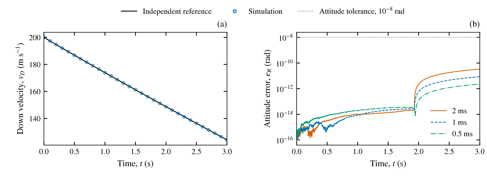

# Verification of the Physical Model Implementation in the RLV Simulator

**Abstract.** The physical model implementation of a reusable launch vehicle simulator was verified against analytical solutions and independently integrated reference models. The assessment covered rigid-body motion, variable mass properties, propulsion, aerodynamic loads, grid fins, reaction-control thrusters, and actuator dynamics. All evaluated cases satisfied their numerical acceptance criteria. At a 1 ms integration step, the largest position and attitude discrepancies across four coupled six-degree-of-freedom cases were $1.02\times10^{-9}$ m and $1.50\times10^{-11}$ rad, respectively. These results establish agreement with the specified mathematical models within the evaluated conditions; validation against measured vehicle behavior was outside the scope.

## 1. Model Definition

The verification configuration comprised nine engines in an octaweb arrangement, a gimballed central engine, two cylindrical propellant tanks, four grid fins, and a cold-gas reaction control system (RCS). Structural mass was 25,000 kg, nominal total mass was 40,000 kg, and the initial RCS gas reserve was 200 kg. Translational states were expressed in a fixed North–East–Down (NED) frame, with altitude $h=-r_D$. The body-frame origin was located at the nose, and the positive body x-axis pointed toward the nose. The matrix $C_{BN}$ mapped body-frame vectors into NED. Earth rotation and propellant slosh were excluded from the verification configuration.

### 1.1 Rigid-Body Dynamics and Mass Properties

The governing equations were

$$
\begin{aligned}
\dot{\mathbf r}&=\mathbf v, &
\dot{\mathbf v}&=\mathbf g+\frac{C_{BN}\mathbf F}{m}, &
\dot q_{BN}&=\tfrac12q_{BN}\otimes[0,\boldsymbol\omega],\\
I\dot{\boldsymbol\omega}&=\mathbf M-\boldsymbol\omega\times(I\boldsymbol\omega)-\dot I\boldsymbol\omega, &
\dot m&=-\beta_p-\beta_g.
\end{aligned}
\tag{1}
$$

Here, $\mathbf F$ is the body-frame resultant excluding gravity, $\mathbf M$ is the moment about the instantaneous center of gravity (CG), and $\beta_p,\beta_g\ge0$ are the main-propellant and RCS-gas consumption rates. Gravity was either uniform or $\mathbf g=[0,0,\mu/(R_E+h)^2]^T$. The CG and inertia tensor were evaluated from the structural, liquid-propellant, and gas distributions:

$$
\mathbf r_{CG}=\frac{\sum_jm_j\mathbf r_j}{m},\qquad
I=\int\left[(\mathbf d^T\mathbf d)\mathbf 1-\mathbf d\mathbf d^T\right]dm,
\qquad \mathbf d=\boldsymbol\xi_b-\mathbf r_{CG},
\tag{2}
$$

where $\boldsymbol\xi_b$ denotes the body-frame position of a mass element. The production solver propagated a scalar-first quaternion using fixed-step fourth-order Runge–Kutta integration, followed by quaternion normalization.

### 1.2 Propulsion and Reaction Control

For engine pitch and yaw angles $p_i,y_i$, the reference thrust direction, magnitude, and propellant consumption rate were

$$
\hat{\mathbf d}_i=
\begin{bmatrix}\cos p_i\cos y_i&\cos p_i\sin y_i&-\sin p_i\end{bmatrix}^{T},\quad
T_i=\max(u_iT_{vac,i}-p_aA_{e,i},0),\quad
\beta_p=\sum_i\frac{u_iT_{vac,i}}{I_{sp,i}g_0}.
\tag{3}
$$

Equation (3) was assessed for healthy engines at $u_i=0$ or $0.4\le u_i\le1$. Each engine had $T_{vac}=981$ kN, $I_{sp}=311$ s, and $A_e=0.9$ m², with $g_0=9.80665$ m/s². The specified model used vacuum thrust and specific impulse to determine mass flow independently of the ambient-pressure thrust correction. Engine and RCS forces and moments were assembled as $\mathbf F_i=T_i\hat{\mathbf d}_i$ and $\mathbf M_i=(\mathbf r_i-\mathbf r_{CG})\times\mathbf F_i$. Rotational jet damping contributed

$$
\mathbf M_{jet}=-\beta_p(x_e-x_{CG})^2[0,\omega_y,\omega_z]^T.
\tag{4}
$$

The RCS used a nominal nozzle thrust of 2,000 N, moment arm $\ell_g=1.85$ m, and specific impulse of 60 s. For nozzle activity $a_j$, gas consumption and the single-axis pure-couple verification condition were

$$
\beta_g=\sum_j\frac{a_jT_j}{I_{sp,g}g_0},\qquad
M_{pair}=2T_g\ell_g=7,400\ \mathrm{N\,m},\qquad
I_k(t)\omega_k(t)-I_k(0)\omega_k(0)=\int_0^t M_k\,dt.
\tag{5}
$$

Pulse-width modulation (PWM) used a period $P=20$ ms, with $N=P/\Delta t$ and $N_{on}=\lfloor|u|N+0.5\rfloor$. At a 1 ms step, a requested duty of 0.33 therefore produced an effective duty of 0.35. Impulse and gas consumption were evaluated against the quantized firing duration. The final partially fueled pulse was constrained by the remaining gas reserve.

### 1.3 Atmosphere and Aerodynamic Loads

For NED wind velocity $\mathbf w$, air-relative body velocity $\mathbf v_a=C_{BN}^{T}(\mathbf v-\mathbf w)$, speed $V=\|\mathbf v_a\|$, dynamic pressure $q_a=\rho V^2/2$, and Mach number $\mathcal M=V/a$, the body loads were

$$
\begin{aligned}
\mathbf F_{aero}&=q_aS(-C_D\hat{\mathbf v}_a+C_L\hat{\mathbf e}_L),\\
\mathbf M_{aero}&=(x_{CP}-x_{CG})\mathbf e_x\times\mathbf F_{aero}
-\frac{q_aSL^2}{4V}[0,\omega_y,\omega_z]^T.
\end{aligned}
\tag{6}
$$

The body reference area and length were $S=10.52$ m² and $L=42$ m. The lift direction $\hat{\mathbf e}_L$ was perpendicular to the flow; loads were set to zero at zero speed. Reference coefficient tables were reconstructed from the prescribed analytical parameterization. Lookup values were evaluated using piecewise cubic Hermite interpolation in $\cos\alpha$ and linear interpolation in Mach number.

The exponential atmosphere used $\rho=\rho_0e^{-h/H}$ and $p=p_0e^{-h/H}$. The layered atmosphere reference followed the hydrostatic solution

$$
h_g=\frac{R_gh}{R_g+h},\quad
T=T_b+\lambda(h_g-h_b),\quad
\frac{dp}{dh_g}=-\frac{g_0p}{RT},\quad
\rho=\frac{s_\rho p}{R(T+\Delta T)},\quad
a=\sqrt{\gamma R(T+\Delta T)},
\tag{7}
$$

where $R_g$ is the geopotential conversion radius, $\lambda$ is the layer lapse rate, $s_\rho$ is the density multiplier, and $\Delta T$ is the temperature offset.

Grid-fin loads included the local velocity induced by body rotation. For the CG-relative mounting vector $\mathbf l_i$, tangential fin normal $\mathbf n_i$, and aerodynamic reference axis $\mathbf f=[-1,0,0]^T$,

$$
\mathbf v_i=\mathbf v_a+\boldsymbol\omega\times\mathbf l_i,\quad
\alpha_i=\delta_i-\operatorname{atan2}\!\left(
\mathbf v_i\cdot\mathbf n_i,\max(|\mathbf v_i\cdot\mathbf f|,\epsilon_V)\right),\quad
\bar\alpha_i=\alpha_s\tanh(\alpha_i/\alpha_s),
\tag{8}
$$

with $\epsilon_V=10^{-9}$ m/s. The corresponding fin loads were

$$
\begin{aligned}
\mathbf F_{fin,i}&=q_iA_f\left[
a_f\eta(\mathcal M_i)\bar\alpha_i\hat{\mathbf e}_{L,i}
-\left(C_{D0}K_{tr}(\mathcal M_i)+C_{D\alpha^2}\eta(\mathcal M_i)\bar\alpha_i^2\right)\hat{\mathbf v}_i\right],\\
\mathbf M_{fin,i}&=\mathbf l_i\times\mathbf F_{fin,i},\qquad
q_i=\tfrac12\rho\|\mathbf v_i\|^2.
\end{aligned}
\tag{9}
$$

The functions $\eta$ and $K_{tr}$ represented the specified transonic efficiency and drag corrections. Each fin had an area of 2 m², mounting radius of 2 m, axial station of −3 m, and stall parameter $\alpha_s=25^\circ$. A binary deployment factor multiplied the resultant fin force and moment. This represented instantaneous aerodynamic exposure without hinge motion, deployment impulse, or stowed-fin drag.

### 1.4 Actuator Dynamics

The nonlinear throttle and angular-servo models were

$$
\dot u=r_u\tanh\!\left(\frac{u_c-u}{\tau r_u}\right),\qquad
\dot\delta=v_\delta,\qquad
\dot v_\delta=2\zeta\omega_n\left[
r_\delta\tanh\!\left(\frac{\omega_n(\delta_c-\delta)}{2\zeta r_\delta}\right)-v_\delta\right].
\tag{10}
$$

Linear actuator references replaced each hyperbolic tangent with its argument. The throttle parameters were $\tau=0.25$ s and $r_u=1$ s⁻¹. The thrust-vector-control (TVC) servo used $(\omega_n,\zeta,r_\delta)=(37.7,0.707,0.35)$, and the fin servo used $(18.8,0.7,0.52)$, with angular frequencies and rate limits expressed in rad/s. Target throttle was restricted to [0,1] and set to zero below 0.4. TVC and fin command bounds were ±0.14 and ±0.35 rad, respectively. These bounds applied to commanded angles; mechanical stops were not represented.

## 2. Verification Method

Analytical solutions or independent reference integrations were evaluated using the same initial conditions, physical constants, and prescribed inputs as the production solver. Production force, mass-property, coordinate-transformation, and aerodynamic-table generation routines were excluded from the reference calculations. Reference tank inertias were obtained by quadrature. Reference attitude was propagated as a rotation matrix, and the inertia-rate term was evaluated by analytical differentiation. Component diagnostics and the assembled translational and angular accelerations were both assessed.

Maximum vector-state and attitude errors were defined as

$$
e_{x,\max}=\max_k\|\mathbf x_{sim}(t_k)-\mathbf x_{ref}(t_k)\|_2,\qquad
e_{R,\max}=\max_k\left\|\operatorname{Log}\!\left(C_{ref}^{T}(t_k)C_{sim}(t_k)\right)^\vee\right\|_2,
\tag{11}
$$

where $\operatorname{Log}(\cdot)^\vee$ is the relative rotation vector. Actuator-array errors were the largest absolute channel errors over the sampled history. Acceptance thresholds were absolute numerical tolerances, rather than allowable deviations from flight measurements.

Nonlinear references were integrated with DOP853. Relative tolerances were tightened from $10^{-10}$ to $10^{-12}$ for actuator responses and from $10^{-11}$ to $10^{-13}$ for coupled trajectories. The resulting reference differences remained below 1% of the corresponding acceptance thresholds. Production runs used 2, 1, and 0.5 ms steps. Canonical-motion and coupled-trajectory results were additionally compared at common epochs between adjacent step sizes.

## 3. Results and Discussion

### 3.1 Canonical Motion

The canonical cases began at an altitude of 10 km and nominal mass of 40,000 kg. The depletion case instead used 25,700 kg total mass, including 500 kg of main propellant. Table 1 summarizes the independent reference problems and representative maximum errors at 1 ms.

**Table 1. Canonical-motion verification results.**

| Case | Independent reference | Maximum error | Acceptance threshold |
|---|---|---:|---:|
| Uniform-gravity free fall, 20 s | Vacuum, initially at rest; $r_D=r_{D,0}+g_0t^2/2$ | Position: $6.97\times10^{-10}$ m | $10^{-5}$ m |
| Inverse-square free fall, 20 s | Vertical ODE; $v_D^2/2-\mu/(R_E+h)=\mathrm{const.}$ | Position: $5.91\times10^{-10}$ m | $10^{-5}$ m |
| Torque-free rotation, 20 s | Euler equations; inertial angular momentum and rotational energy conservation | Attitude: $1.58\times10^{-12}$ rad | $10^{-8}$ rad |
| Vacuum burn, 10 s | Zero gravity; $m=m_0-\beta_pt$, $\Delta v=I_{sp}g_0\ln(m_0/m)$ | Position: $1.73\times10^{-10}$ m | $10^{-5}$ m |
| Propellant depletion, 10 s | Burn until $t_d=(m_0-m_{min})/\beta_p$, followed by constant-velocity coast | Position: $3.01\times10^{-6}$ m | $10^{-5}$ m |
| Drag-limited descent, 20 s | Constant-density quadratic drag; $v_D=v_\infty\tanh(g_0t/v_\infty+b)$ | Position: $1.11\times10^{-6}$ m | $10^{-4}$ m |

For the drag solution, $v_\infty=\sqrt{2mg_0/(\rho C_DS)}$ and $b=\operatorname{artanh}(v_{D,0}/v_\infty)$. The initial descent speed was 150 m/s. Both burn cases used a central-engine throttle of 0.7. The torque-free case began at roll/pitch/yaw angles [10,20,30]° and angular velocity [0.1,0.2,−0.15] rad/s.

The depletion-case position discrepancy was consistent with distributing the final partial-burn impulse over one integration step. The drag reference assumed constant density, whereas the production case retained a weak exponential variation with a scale height of $10^{12}$ m. These approximations account for the larger discrepancies in those two cases relative to the other canonical problems.

### 3.2 Component Loads and Actuator Responses

Static load comparisons covered total masses of 25,700, 40,000, and 50,000 kg. Engine cases included individual, symmetric, and combined firing patterns. Fin cases covered local-flow effects, deflection, body rotation, and deployed/stowed states at 0, 10, and 40 km. RCS cases included three-axis couples, PWM quantization, nozzle failure, and gas exhaustion. Atmospheric properties were assessed on both sides of layer boundaries up to 84.852 km. Body loads were evaluated over Mach 0–9 and incidence angles of 0–180°, including boundary clamping beyond the coefficient-table domain of Mach 0–8 and 0–90°. Actuator cases included step commands, reversals, and shutdowns.

**Table 2. Representative component errors. Dynamic entries correspond to 1 ms runs.**

| Component | Comparison quantity | Maximum absolute error | Acceptance threshold |
|---|---|---:|---:|
| Engine/TVC, static | CG moment [N·m] | 0 | $10^{-6}$ |
| TVC servo | Angle [rad] | $1.70\times10^{-10}$ | $10^{-7}$ |
| Grid fins | Force / CG moment [N / N·m] | $1.97\times10^{-10}$ / $3.73\times10^{-9}$ | $10^{-6}$ / $10^{-5}$ |
| RCS | Angular impulse [N·m·s] | $6.00\times10^{-11}$ | $10^{-5}$ |
| RCS | Gas consumption [kg] | $1.37\times10^{-12}$ | $10^{-9}$ |
| Throttle actuator | Throttle fraction | $7.87\times10^{-13}$ | $10^{-8}$ |
| Fin servo | Angle [rad] | $2.50\times10^{-10}$ | $10^{-7}$ |
| Atmosphere | Density [kg/m³] | $2.17\times10^{-19}$ | $10^{-12}$ |
| Body aerodynamics | Force / CG moment [N / N·m] | $9.09\times10^{-7}$ / $2.15\times10^{-6}$ | $10^{-6}$ / $10^{-5}$ |

All reported comparisons satisfied their acceptance thresholds. Native command clipping and nonlinear actuator rate limits also satisfied their separate constraints. The TVC peak angle was 0.140607761 rad, exceeding the command bound by approximately 0.03482°. The independent servo solution reproduced this transient. The overshoot was therefore recorded as a model response, with mechanical-stop compliance outside the assessment.

### 3.3 Coupled Six-Degree-of-Freedom Motion

Four 3 s cases assessed the simultaneous propagation of translation, rotation, propellant consumption, and changing inertia. Initial NED position and velocity were [100,−70,−8000] m and [30,−10,200] m/s. Initial roll/pitch/yaw angles were [18,80,−27]°, angular velocity was [0.03,−0.02,0.015] rad/s, and total mass was 40,000 kg. Constant commands were [0.025,−0.018] rad for the gimbal, [0.08,0.03,−0.06,−0.02] rad for the fins, and [0.1,−0.15,0.2] for the RCS axis duties. Ideal actuation and averaged RCS isolated the continuous coupled equations from actuator and PWM transients.

**Table 3. Maximum coupled-trajectory errors at a 1 ms integration step.**

| Case | Engine throttle and fin state | Position error [m] | Attitude error [rad] |
|---|---|---:|---:|
| Asymmetric vacuum burn | Center: 0.7; one outer engine: 0.5; fins stowed | $2.11\times10^{-11}$ | $1.52\times10^{-13}$ |
| Atmospheric coast | Engines off; fins deployed | $7.98\times10^{-11}$ | $9.28\times10^{-13}$ |
| Atmospheric burn | Center: 0.6; two opposing outer engines: 0.4 each; fins deployed | $1.02\times10^{-9}$ | $8.50\times10^{-12}$ |
| Atmospheric burn, fins stowed | Same engine commands as the preceding case; fins stowed | $6.28\times10^{-10}$ | $1.50\times10^{-11}$ |

Position, velocity, attitude, angular velocity, total mass, and RCS gas were compared throughout each trajectory. Their respective acceptance thresholds were $10^{-5}$ m, $10^{-6}$ m/s, $10^{-8}$ rad, $10^{-8}$ rad/s, $10^{-7}$ kg, and $10^{-8}$ kg. All four cases passed at each tested step size, and adjacent-step comparisons satisfied the same thresholds.

**Figure 1. Atmospheric burn with deployed fins.** (a) NED down velocity from the 1 ms run. The solid black line denotes the independent reference; open circles show production-solver samples at 0.1 s intervals. (b) Attitude error evaluated at every integration sample for 2, 1, and 0.5 ms steps. The dotted line denotes the $10^{-8}$ rad acceptance threshold. [Vector PDF](figures/physics_coupled_6dof.pdf).

Figure 1 demonstrates agreement in the coupled response and the margin to the attitude-error threshold. Reference refinement and adjacent-step agreement support the numerical consistency of these trajectories. A uniform fourth-order convergence rate was not established across all cases because roundoff, finite-difference inertia rates, and event averaging also contributed to the observed errors.

## 4. Conclusions

The evaluated implementation reproduced the prescribed force and moment models, coordinate transformations, variable mass properties, and translational and rotational dynamics within the stated numerical tolerances. Component comparisons and coupled trajectories provided complementary evidence: the former isolated individual physical mechanisms, while the latter assessed their assembly in the equations of motion.

The findings apply to the specified model assumptions. Instantaneous fin exposure, unloaded servo dynamics, and coefficient-table boundary clamping remain approximations. File-based aerodynamic databases, incremental-fin models, and coupled trajectories combining nonlinear actuators with PWM were not assessed by this comparison campaign. Agreement with actual aerodynamic coefficients, actuator hardware, or flight measurements requires separate physical validation.

## Verification Sources

The reported cases were evaluated on 21–22 October 2026. The version-controlled implementations below define the independent references and acceptance criteria. Generated run records are retained separately under `results/`.

[1] Canonical motion: [reference calculations](../../src/validation/references.py) and [comparison implementation](../../src/validation/analytical.py).

[2] [Engine and TVC verification](../../src/validation/propulsion.py).

[3] Component and coupled dynamics: [reference calculations](../../src/validation/vehicle_references.py) and [comparison implementation](../../src/validation/vehicle_physics.py).
