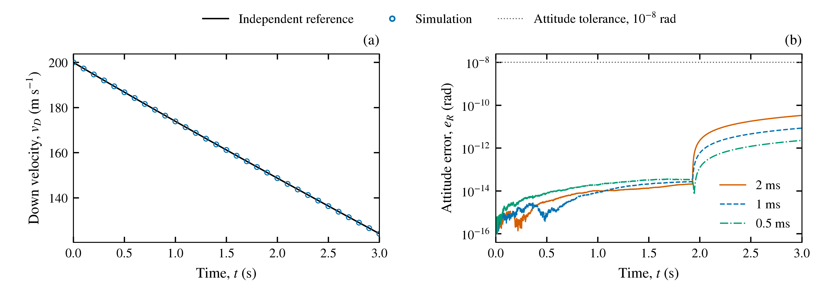
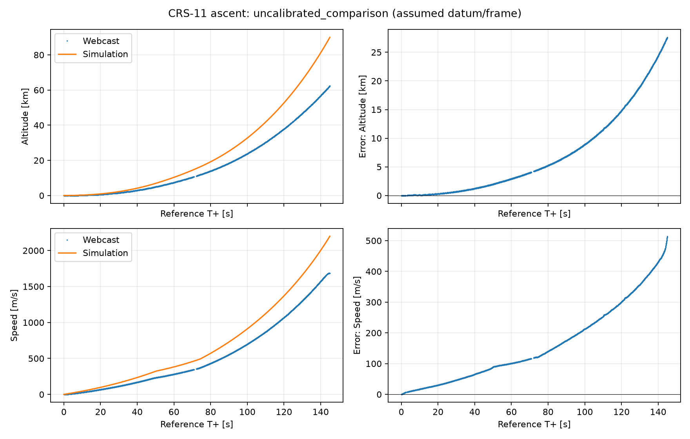

# Verification of the Physical Model Implementation in the RLV Simulator

**Current scope (2026-11-03):** Five independent representative phases use rotating spherical
Earth. The current landing entry point is `scenario=project2_landing`; Sections
[11](#11-spherical-rotating-earth-verification) and
[12](#12-landing-added-as-the-fifth-representative-phase) describe rotating-frame mechanics and
landing qualification. Latest checks: **400 tests**, Ruff, five phase checks and **25 WebGL checks**
passed. Sections 1–10 and their dated counts preserve earlier verification campaigns; their
fixed-Earth assumptions and earlier terminal-descent conditions do not define the current five-phase set.

**Abstract.** The physical model implementation of a reusable launch vehicle simulator was verified against analytical solutions and independently integrated reference models. The assessment covered rigid-body motion, variable mass properties, propulsion, aerodynamic loads, grid fins, reaction-control thrusters, and actuator dynamics. All evaluated cases satisfied their numerical acceptance criteria. At a 1 ms integration step, the largest position and attitude discrepancies across four coupled six-degree-of-freedom cases were $1.02\times10^{-9}$ m and $1.50\times10^{-11}$ rad, respectively. These results establish agreement with the specified mathematical models within the evaluated conditions; validation against measured vehicle behavior was outside the scope.

## 1. Model Definition

The verification configuration comprised nine engines in an octaweb arrangement, a gimballed central engine, two cylindrical propellant tanks, four grid fins, and a cold-gas reaction control system (RCS). Structural mass was 25,000 kg, nominal total mass was 40,000 kg, and the initial RCS gas reserve was 200 kg. Translational states were expressed in a fixed North–East–Down (NED) frame, with altitude $h=-r_D$. The body-frame origin was located at the nose, and the positive body x-axis pointed toward the nose. The matrix $C_{BN}$ mapped body-frame vectors into NED. Earth rotation and propellant slosh were excluded from the verification configuration.

### 1.1 Rigid-Body Dynamics and Mass Properties

The governing equations were

$$
\begin{aligned}
\dot{\mathbf r}&=\mathbf v, &
\dot{\mathbf v}&=\mathbf g+\frac{C_{BN}\mathbf F}{m}, &
\dot q_{BN}&=\tfrac12q_{BN}\otimes[0,\boldsymbol\omega],\\
I\dot{\boldsymbol\omega}&=\mathbf M-\boldsymbol\omega\times(I\boldsymbol\omega)-\dot I\boldsymbol\omega, &
\dot m&=-\beta_p-\beta_g.
\end{aligned}
\tag{1}
$$

Here, $\mathbf F$ is the body-frame resultant excluding gravity, $\mathbf M$ is the moment about the instantaneous center of gravity (CG), and $\beta_p,\beta_g\ge0$ are the main-propellant and RCS-gas consumption rates. Gravity was either uniform or $\mathbf g=[0,0,\mu/(R_E+h)^2]^T$. The CG and inertia tensor were evaluated from the structural, liquid-propellant, and gas distributions:

$$
\mathbf r_{CG}=\frac{\sum_jm_j\mathbf r_j}{m},\qquad
I=\int\left[(\mathbf d^T\mathbf d)\mathbf 1-\mathbf d\mathbf d^T\right]dm,
\qquad \mathbf d=\boldsymbol\xi_b-\mathbf r_{CG},
\tag{2}
$$

where $\boldsymbol\xi_b$ denotes the body-frame position of a mass element. The production solver propagated a scalar-first quaternion using fixed-step fourth-order Runge–Kutta integration, followed by quaternion normalization.

### 1.2 Propulsion and Reaction Control

For engine pitch and yaw angles $p_i,y_i$, the reference thrust direction, magnitude, and propellant consumption rate were

$$
\hat{\mathbf d}_i=
\begin{bmatrix}\cos p_i\cos y_i&\cos p_i\sin y_i&-\sin p_i\end{bmatrix}^{T},\quad
T_i=\max(u_iT_{vac,i}-p_aA_{e,i},0),\quad
\beta_p=\sum_i\frac{u_iT_{vac,i}}{I_{sp,i}g_0}.
\tag{3}
$$

Equation (3) was assessed for healthy engines at $u_i=0$ or $0.4\le u_i\le1$. Each engine had $T_{vac}=981$ kN, $I_{sp}=311$ s, and $A_e=0.9$ m², with $g_0=9.80665$ m/s². The specified model used vacuum thrust and specific impulse to determine mass flow independently of the ambient-pressure thrust correction. Engine and RCS forces and moments were assembled as $\mathbf F_i=T_i\hat{\mathbf d}_i$ and $\mathbf M_i=(\mathbf r_i-\mathbf r_{CG})\times\mathbf F_i$. Rotational jet damping contributed

$$
\mathbf M_{jet}=-\beta_p(x_e-x_{CG})^2[0,\omega_y,\omega_z]^T.
\tag{4}
$$

The RCS used a nominal nozzle thrust of 2,000 N, moment arm $\ell_g=1.85$ m, and specific impulse of 60 s. For nozzle activity $a_j$, gas consumption and the single-axis pure-couple verification condition were

$$
\beta_g=\sum_j\frac{a_jT_j}{I_{sp,g}g_0},\qquad
M_{pair}=2T_g\ell_g=7,400\ \mathrm{N\,m},\qquad
I_k(t)\omega_k(t)-I_k(0)\omega_k(0)=\int_0^t M_k\,dt.
\tag{5}
$$

Pulse-width modulation (PWM) used a period $P=20$ ms, with $N=P/\Delta t$ and $N_{on}=\lfloor|u|N+0.5\rfloor$. At a 1 ms step, a requested duty of 0.33 therefore produced an effective duty of 0.35. Impulse and gas consumption were evaluated against the quantized firing duration. The final partially fueled pulse was constrained by the remaining gas reserve.

### 1.3 Atmosphere and Aerodynamic Loads

For NED wind velocity $\mathbf w$, air-relative body velocity $\mathbf v_a=C_{BN}^{T}(\mathbf v-\mathbf w)$, speed $V=\|\mathbf v_a\|$, dynamic pressure $q_a=\rho V^2/2$, and Mach number $\mathcal M=V/a$, the body loads were

$$
\begin{aligned}
\mathbf F_{aero}&=q_aS(-C_D\hat{\mathbf v}_a+C_L\hat{\mathbf e}_L),\\
\mathbf M_{aero}&=(x_{CP}-x_{CG})\mathbf e_x\times\mathbf F_{aero}
-\frac{q_aSL^2}{4V}[0,\omega_y,\omega_z]^T.
\end{aligned}
\tag{6}
$$

The body reference area and length were $S=10.52$ m² and $L=42$ m. The lift direction $\hat{\mathbf e}_L$ was perpendicular to the flow; loads were set to zero at zero speed. Reference coefficient tables were reconstructed from the prescribed analytical parameterization. Lookup values were evaluated using piecewise cubic Hermite interpolation in $\cos\alpha$ and linear interpolation in Mach number.

The exponential atmosphere used $\rho=\rho_0e^{-h/H}$ and $p=p_0e^{-h/H}$. The layered atmosphere reference followed the hydrostatic solution

$$
h_g=\frac{R_gh}{R_g+h},\quad
T=T_b+\lambda(h_g-h_b),\quad
\frac{dp}{dh_g}=-\frac{g_0p}{RT},\quad
\rho=\frac{s_\rho p}{R(T+\Delta T)},\quad
a=\sqrt{\gamma R(T+\Delta T)},
\tag{7}
$$

where $R_g$ is the geopotential conversion radius, $\lambda$ is the layer lapse rate, $s_\rho$ is the density multiplier, and $\Delta T$ is the temperature offset.

Grid-fin loads included the local velocity induced by body rotation. For the CG-relative mounting vector $\mathbf l_i$, tangential fin normal $\mathbf n_i$, and aerodynamic reference axis $\mathbf f=[-1,0,0]^T$,

$$
\mathbf v_i=\mathbf v_a+\boldsymbol\omega\times\mathbf l_i,\quad
\alpha_i=\delta_i-\operatorname{atan2}\!\left(
\mathbf v_i\cdot\mathbf n_i,\max(|\mathbf v_i\cdot\mathbf f|,\epsilon_V)\right),\quad
\bar\alpha_i=\alpha_s\tanh(\alpha_i/\alpha_s),
\tag{8}
$$

with $\epsilon_V=10^{-9}$ m/s. The corresponding fin loads were

$$
\begin{aligned}
\mathbf F_{fin,i}&=q_iA_f\left[
a_f\eta(\mathcal M_i)\bar\alpha_i\hat{\mathbf e}_{L,i}
-\left(C_{D0}K_{tr}(\mathcal M_i)+C_{D\alpha^2}\eta(\mathcal M_i)\bar\alpha_i^2\right)\hat{\mathbf v}_i\right],\\
\mathbf M_{fin,i}&=\mathbf l_i\times\mathbf F_{fin,i},\qquad
q_i=\tfrac12\rho\|\mathbf v_i\|^2.
\end{aligned}
\tag{9}
$$

The functions $\eta$ and $K_{tr}$ represented the specified transonic efficiency and drag corrections. Each fin had an area of 2 m², mounting radius of 2 m, axial station of −3 m, and stall parameter $\alpha_s=25^\circ$. A binary deployment factor multiplied the resultant fin force and moment. This represented instantaneous aerodynamic exposure without hinge motion, deployment impulse, or stowed-fin drag.

### 1.4 Actuator Dynamics

The nonlinear throttle and angular-servo models were

$$
\dot u=r_u\tanh\!\left(\frac{u_c-u}{\tau r_u}\right),\qquad
\dot\delta=v_\delta,\qquad
\dot v_\delta=2\zeta\omega_n\left[
r_\delta\tanh\!\left(\frac{\omega_n(\delta_c-\delta)}{2\zeta r_\delta}\right)-v_\delta\right].
\tag{10}
$$

Linear actuator references replaced each hyperbolic tangent with its argument. The throttle parameters were $\tau=0.25$ s and $r_u=1$ s⁻¹. The thrust-vector-control (TVC) servo used $(\omega_n,\zeta,r_\delta)=(37.7,0.707,0.35)$, and the fin servo used $(18.8,0.7,0.52)$, with angular frequencies and rate limits expressed in rad/s. Target throttle was restricted to [0,1] and set to zero below 0.4. TVC and fin command bounds were ±0.14 and ±0.35 rad, respectively. These bounds applied to commanded angles; mechanical stops were not represented.

## 2. Verification Method

Analytical solutions or independent reference integrations were evaluated using the same initial conditions, physical constants, and prescribed inputs as the production solver. Production force, mass-property, coordinate-transformation, and aerodynamic-table generation routines were excluded from the reference calculations. Reference tank inertias were obtained by quadrature. Reference attitude was propagated as a rotation matrix, and the inertia-rate term was evaluated by analytical differentiation. Component diagnostics and the assembled translational and angular accelerations were both assessed.

Maximum vector-state and attitude errors were defined as

$$
e_{x,\max}=\max_k\|\mathbf x_{sim}(t_k)-\mathbf x_{ref}(t_k)\|_2,\qquad
e_{R,\max}=\max_k\left\|\operatorname{Log}\!\left(C_{ref}^{T}(t_k)C_{sim}(t_k)\right)^\vee\right\|_2,
\tag{11}
$$

where $\operatorname{Log}(\cdot)^\vee$ is the relative rotation vector. Actuator-array errors were the largest absolute channel errors over the sampled history. Acceptance thresholds were absolute numerical tolerances, rather than allowable deviations from flight measurements.

Nonlinear references were integrated with DOP853. Relative tolerances were tightened from $10^{-10}$ to $10^{-12}$ for actuator responses and from $10^{-11}$ to $10^{-13}$ for coupled trajectories. The resulting reference differences remained below 1% of the corresponding acceptance thresholds. Production runs used 2, 1, and 0.5 ms steps. Canonical-motion and coupled-trajectory results were additionally compared at common epochs between adjacent step sizes.

## 3. Results and Discussion

### 3.1 Canonical Motion

The canonical cases began at an altitude of 10 km and nominal mass of 40,000 kg. The depletion case instead used 25,700 kg total mass, including 500 kg of main propellant. Table 1 summarizes the independent reference problems and representative maximum errors at 1 ms.

**Table 1. Canonical-motion verification results.**

| Case | Independent reference | Maximum error | Acceptance threshold |
|---|---|---:|---:|
| Uniform-gravity free fall, 20 s | Vacuum, initially at rest; $r_D=r_{D,0}+g_0t^2/2$ | Position: $6.97\times10^{-10}$ m | $10^{-5}$ m |
| Inverse-square free fall, 20 s | Vertical ODE; $v_D^2/2-\mu/(R_E+h)=\mathrm{const.}$ | Position: $5.91\times10^{-10}$ m | $10^{-5}$ m |
| Torque-free rotation, 20 s | Euler equations; inertial angular momentum and rotational energy conservation | Attitude: $1.58\times10^{-12}$ rad | $10^{-8}$ rad |
| Vacuum burn, 10 s | Zero gravity; $m=m_0-\beta_pt$, $\Delta v=I_{sp}g_0\ln(m_0/m)$ | Position: $1.73\times10^{-10}$ m | $10^{-5}$ m |
| Propellant depletion, 10 s | Burn until $t_d=(m_0-m_{min})/\beta_p$, followed by constant-velocity coast | Position: $3.01\times10^{-6}$ m | $10^{-5}$ m |
| Drag-limited descent, 20 s | Constant-density quadratic drag; $v_D=v_\infty\tanh(g_0t/v_\infty+b)$ | Position: $1.11\times10^{-6}$ m | $10^{-4}$ m |

For the drag solution, $v_\infty=\sqrt{2mg_0/(\rho C_DS)}$ and $b=\operatorname{artanh}(v_{D,0}/v_\infty)$. The initial descent speed was 150 m/s. Both burn cases used a central-engine throttle of 0.7. The torque-free case began at roll/pitch/yaw angles [10,20,30]° and angular velocity [0.1,0.2,−0.15] rad/s.

The depletion-case position discrepancy was consistent with distributing the final partial-burn impulse over one integration step. The drag reference assumed constant density, whereas the production case retained a weak exponential variation with a scale height of $10^{12}$ m. These approximations account for the larger discrepancies in those two cases relative to the other canonical problems.

### 3.2 Component Loads and Actuator Responses

Static load comparisons covered total masses of 25,700, 40,000, and 50,000 kg. Engine cases included individual, symmetric, and combined firing patterns. Fin cases covered local-flow effects, deflection, body rotation, and deployed/stowed states at 0, 10, and 40 km. RCS cases included three-axis couples, PWM quantization, nozzle failure, and gas exhaustion. Atmospheric properties were assessed on both sides of layer boundaries up to 84.852 km. Body loads were evaluated over Mach 0–9 and incidence angles of 0–180°, including boundary clamping beyond the coefficient-table domain of Mach 0–8 and 0–90°. Actuator cases included step commands, reversals, and shutdowns.

**Table 2. Representative component errors. Dynamic entries correspond to 1 ms runs.**

| Component | Comparison quantity | Maximum absolute error | Acceptance threshold |
|---|---|---:|---:|
| Engine/TVC, static | CG moment [N·m] | 0 | $10^{-6}$ |
| TVC servo | Angle [rad] | $1.70\times10^{-10}$ | $10^{-7}$ |
| Grid fins | Force / CG moment [N / N·m] | $1.97\times10^{-10}$ / $3.73\times10^{-9}$ | $10^{-6}$ / $10^{-5}$ |
| RCS | Angular impulse [N·m·s] | $6.00\times10^{-11}$ | $10^{-5}$ |
| RCS | Gas consumption [kg] | $1.37\times10^{-12}$ | $10^{-9}$ |
| Throttle actuator | Throttle fraction | $7.87\times10^{-13}$ | $10^{-8}$ |
| Fin servo | Angle [rad] | $2.50\times10^{-10}$ | $10^{-7}$ |
| Atmosphere | Density [kg/m³] | $2.17\times10^{-19}$ | $10^{-12}$ |
| Body aerodynamics | Force / CG moment [N / N·m] | $9.09\times10^{-7}$ / $2.15\times10^{-6}$ | $10^{-6}$ / $10^{-5}$ |

All reported comparisons satisfied their acceptance thresholds. Native command clipping and nonlinear actuator rate limits also satisfied their separate constraints. The TVC peak angle was 0.140607761 rad, exceeding the command bound by approximately 0.03482°. The independent servo solution reproduced this transient. The overshoot was therefore recorded as a model response, with mechanical-stop compliance outside the assessment.

### 3.3 Coupled Six-Degree-of-Freedom Motion

Four 3 s cases assessed the simultaneous propagation of translation, rotation, propellant consumption, and changing inertia. Initial NED position and velocity were [100,−70,−8000] m and [30,−10,200] m/s. Initial roll/pitch/yaw angles were [18,80,−27]°, angular velocity was [0.03,−0.02,0.015] rad/s, and total mass was 40,000 kg. Constant commands were [0.025,−0.018] rad for the gimbal, [0.08,0.03,−0.06,−0.02] rad for the fins, and [0.1,−0.15,0.2] for the RCS axis duties. Ideal actuation and averaged RCS isolated the continuous coupled equations from actuator and PWM transients.

**Table 3. Maximum coupled-trajectory errors at a 1 ms integration step.**

| Case | Engine throttle and fin state | Position error [m] | Attitude error [rad] |
|---|---|---:|---:|
| Asymmetric vacuum burn | Center: 0.7; one outer engine: 0.5; fins stowed | $2.11\times10^{-11}$ | $1.52\times10^{-13}$ |
| Atmospheric coast | Engines off; fins deployed | $7.98\times10^{-11}$ | $9.28\times10^{-13}$ |
| Atmospheric burn | Center: 0.6; two opposing outer engines: 0.4 each; fins deployed | $1.02\times10^{-9}$ | $8.50\times10^{-12}$ |
| Atmospheric burn, fins stowed | Same engine commands as the preceding case; fins stowed | $6.28\times10^{-10}$ | $1.50\times10^{-11}$ |

Position, velocity, attitude, angular velocity, total mass, and RCS gas were compared throughout each trajectory. Their respective acceptance thresholds were $10^{-5}$ m, $10^{-6}$ m/s, $10^{-8}$ rad, $10^{-8}$ rad/s, $10^{-7}$ kg, and $10^{-8}$ kg. All four cases passed at each tested step size, and adjacent-step comparisons satisfied the same thresholds.



**Figure 1. Atmospheric burn with deployed fins.** (a) NED down velocity from the 1 ms run. The solid black line denotes the independent reference; open circles show production-solver samples at 0.1 s intervals. (b) Attitude error evaluated at every integration sample for 2, 1, and 0.5 ms steps. The dotted line denotes the $10^{-8}$ rad acceptance threshold. [Vector PDF](figures/physics_coupled_6dof.pdf).

Figure 1 demonstrates agreement in the coupled response and the margin to the attitude-error threshold. Reference refinement and adjacent-step agreement support the numerical consistency of these trajectories. A uniform fourth-order convergence rate was not established across all cases because roundoff, finite-difference inertia rates, and event averaging also contributed to the observed errors.

## 4. Conclusions

The evaluated implementation reproduced the prescribed force and moment models, coordinate transformations, variable mass properties, and translational and rotational dynamics within the stated numerical tolerances. Component comparisons and coupled trajectories provided complementary evidence: the former isolated individual physical mechanisms, while the latter assessed their assembly in the equations of motion.

The findings apply to the specified model assumptions. Instantaneous fin exposure, unloaded servo dynamics, and coefficient-table boundary clamping remain approximations. File-based aerodynamic databases, incremental-fin models, and coupled trajectories combining nonlinear actuators with PWM were not assessed by this comparison campaign. Agreement with actual aerodynamic coefficients, actuator hardware, or flight measurements requires separate physical validation.

## 5. Ascent Integration and Initial Flight-Data Comparison

**Historical comparison, now deferred.** Flight-data comparison is disabled by default.
This section preserves the earlier experiment; current acceptance work is the independent
physics and rendering verification in Section 6. No flight-data fitting was performed.

This addendum records the 2 November 2026 ascent integration milestone separately from
the October implementation-verification campaign. The [ascent configuration and assumptions](../reference/crs11_ascent.md)
define a 545,200 kg attached stack, prescribed throttle/gimbal inputs, a nose-first
aerodynamic table, and an explicit rigid-pad release state. Attached upper-stage mass
is combined with the booster structure through the parallel-axis theorem and excluded
from first-stage burnable propellant. No stage separation or navigation model is included.

The reproducible commands are:

```bash
python scripts/run_single.py scenario=ascent scenario.reference.enabled=true hydra.run.dir=results/ascent_reference
python scripts/check_convergence.py scenario=ascent hydra.run.dir=results/ascent_convergence
python -m pytest tests/sim/test_ascent.py -q
```

The run reached 150 s without contact or fuel exhaustion. At the prescribed 145 s MECO
command, altitude was 89,996.656 m, speed was 2,199.672 m/s, and first-stage main propellant
was 21,857.358 kg. Effective thrust decayed after the command through the realistic actuator
model. At 150 s, altitude was 99,144.419 m, speed was 2,182.070 m/s, main propellant was
20,654.720 kg, and RCS gas remained 200 kg. This final coast retains the attached component;
it must not be interpreted as the real separated first-stage trajectory.

Independent structural tests check the composite dry CG/inertia and exclusion of attached
mass from the fuel budget. Pad tests cover supported fuel consumption, release, later contact,
and the distinction between a no-liftoff horizon and landing. The cutoff integration test
checks cessation of thrust and fuel use during the final coast. Existing contact-quality
tests explicitly identify terminated contact states, since altitude zero alone may now be
a live pad state.

The complete regression suite passed **316 tests**, and `ruff check src tests scripts`
passed after this extension.

At 751 shared log epochs, the 2→1 ms and 1→0.5 ms comparisons passed the existing numerical
agreement limits. Across both pairs, maximum position, velocity, and mass differences were
approximately $1.66\times10^{-6}$ m, $5.55\times10^{-8}$ m/s, and $4.18\times10^{-6}$ kg.
This establishes timestep agreement for the selected inputs; it does not establish an
integration order or flight-model accuracy.

The comparison uses the [pinned raw CRS-11 stage-1 observations](../reference/crs11_flight_reference.md),
not its derived state channels. The requested 0–145 s interval contains 4,248 raw samples,
ending at 144.978 s. Excluding intervals over 1.1 s leaves 143.676 s of covered duration.
Errors use trapezoidal time weighting, simulation-minus-reference sign, and explicit zero
time/height offsets. The webcast altitude datum and speed frame remain assumptions.

| Observable | Bias | RMSE | Maximum absolute error |
|---|---:|---:|---:|
| Altitude [m] | 7,069.004 | 10,229.588 | 27,594.024 |
| Speed [m/s] | 161.811 | 205.461 | 514.322 |



**Figure 2. Uncalibrated ascent comparison.** Left: raw webcast observations and the
simulated altitude/speed. Right: errors at observation epochs. Missing reference coverage
is not interpolated. Published burn timings are inputs and receive no event-time scores.
[Machine-readable comparison and convergence results](crs11_ascent_results.json).

The differences are much larger than timestep effects. They identify an initial model/input
mismatch, with no flight-accuracy acceptance verdict. Mass, thrust, steering, and aerodynamic
assumptions have not been fitted; scalar altitude/speed alone cannot uniquely separate their
effects. When flight validation resumes, resolve reference conventions and define a
calibration/holdout split before tuning. Separation and its state handoff can be implemented
and physically verified first using declared experiment assumptions.

## 6. Ascent Physics and Rendering Verification

On 2 November 2026, the complete 0–150 s attached-stack ascent was checked independently
of flight observations. The case uses realistic nine-engine throttle and gimbal dynamics,
varying propellant/CG/inertia, nose-first aerodynamic loads, gravity and atmospheric pressure,
a prescribed MECO command at 145 s, and coast to 150 s. It does not include separation.

The [independent reference](../../src/validation/ascent.py) reconstructs loads from configuration
constants without production RHS, mass-property or aerodynamic-table generation calls.
It uses distributed-cylinder mass quadrature, analytical inertia derivatives, rotation-matrix
kinematics and DOP853 integration with exact splits at prescribed command epochs. Relative
tolerances of $10^{-12}$ and $10^{-13}$ check reference refinement; differences must remain
below one tenth of each state acceptance limit. This is verification of the specified
mathematical model, not validation of its coefficients or real-vehicle fidelity.

| State | Maximum native/reference difference | Acceptance limit |
|---|---:|---:|
| Position [m] | $1.00382\times10^{-6}$ | 0.01 |
| Velocity [m/s] | $7.85616\times10^{-8}$ | 0.001 |
| Angular velocity [rad/s] | $6.28274\times10^{-12}$ | $10^{-6}$ |
| Attitude rotation angle [rad] | $1.17134\times10^{-10}$ | $10^{-6}$ |
| Mass [kg] | $3.22418\times10^{-6}$ | 0.001 |

All state and reference-refinement criteria passed. The reference position change on refinement
was $3.08\times10^{-6}$ m, so the listed discrepancy does not establish accuracy at every
displayed digit.

A complementary audit integrates recorded loads. With positive propellant outflow
$\dot m_{\rm out}$, non-gravity body force $\mathbf F_b$, support force $\mathbf F_{\rm pad,b}$,
and effective CG moment $\mathbf M_{\rm eff,b}$ including the modeled exhaust angular
momentum flux, the fixed-frame/coaxial case checks

$$
R_m=\Delta m+\int\dot m_{\rm out}\,dt,\qquad
\mathbf R_p=\Delta(m\mathbf v)
-\int[m\mathbf g+C_{bn}(\mathbf F_b+\mathbf F_{\rm pad,b})]\,dt
+\int\dot m_{\rm out}\mathbf v\,dt,
$$

$$
\mathbf R_H=\Delta(C_{bn}I\boldsymbol\omega)
-\int C_{bn}(\mathbf M_{\rm eff,b}+\mathbf M_{\rm pad,b})\,dt.
$$

Thrust already includes the engine exhaust reaction; the angular flux is already in the
effective moment. Neither is counted twice. Vehicle momentum/energy alone is not held
constant during propulsion. The audit uses production diagnostics and therefore complements,
rather than replaces, independent load calculation.

| Maximum balance residual | 0.01 s log sampling | 0.005 s log sampling | Fine-sampling limit |
|---|---:|---:|---:|
| Mass [kg] | 0.095678 | 0.023992 | 0.1 |
| Linear momentum [kg m/s] | 79.0523 | 19.8160 | 100 |
| Angular momentum [kg m²/s] | 63.4233 | 15.8286 | 50 |

Every fine residual is below its limit and below 0.4 times its coarse value, with a $10^{-6}$
absolute floor. Log spacing changes load quadrature resolution, not the native integration step.
Rigid-pad support is checked separately with fixed pose/rates, continuing propellant/actuator
evolution, and balancing force/moment diagnostics. Native release time is retained separately
from observation time; support-impulse integration stops at that event rather than spreading
the discontinuity over a log interval.

Replay was corrected to render configured engine counts/positions, all gimbal axes, actual
per-engine thrust and fuel-exhaustion shutdown, and a schematic attached upper stack and land
pad. It no longer stretches the recovery first-stage GLB to represent the complete stack.
The ground offset is cosmetic engine-plane alignment; geometric contact remains unmodeled.
Chrome passed six state/geometry checkpoints: ascent at 0, 11, 147 s and a reverse seek to
11 s, single-engine landing, and fuel depletion. Checks cover CG transform, engine
count/placement/thrust axes, upper-stage presence, fin state, pad alignment, zero-force
plume hiding and JavaScript errors.

```bash
python scripts/check_ascent_physics.py
python -m pytest tests/ -q
```

The complete test suite passed **321 tests**. [Physics verdict and source hashes](ascent_physics_results.json),
[browser checkpoint report](ascent_replay_checks.json), and
[browser reproduction commands](../../viz/README.md#ascent-and-rendering-checks) accompany this record.
Example verified views: [attached stack at launch](figures/ascent_launch.png) and
[attached-stack coast](figures/ascent_coast.png).

The impulse-free separation and retained-coast extension is recorded in Section 7.
Remaining scope includes nonzero release impulses, flip/boostback and full-flight integration. Settled propellant, simplified jet
damping, fixed local NED, vertical gravity, assumed aerodynamic coefficients and schematic
contact remain explicit model limitations. Sensor/navigation and flight-data validation are deferred.

## 7. Impulse-free Separation and Retained Booster Coast

The `ascent_separation` experiment extends the same native session through assumed
T+150 s release and a 10 s retained-booster coast. Release timing, attached-component
properties and post-release aerodynamic coefficients are **Assumed**, not reconstructed
CRS-11 observations. The existing `ascent` experiment remains attached through 150 s.

### Event model and state mapping

At release, external impulses and separation impulses are zero. Both rigid components
inherit the attached body's orientation and angular rate. Let $M$, $x_G$, $I$ denote
pre-release mass, axial CG and inertia; $m_u$, $x_u$, $I_u$ the removed component;
and $m_b=M-m_u$, $x_b$, $I_b$ the retained booster, with axial coordinates here
expressed in the old stack frame. The new body origin is at old $x_o=-28$ m,
so $x_b=x_{G,b}^{new}+x_o$. For $d_i=[x_i-x_G,0,0]^T$ and rotation $C$:

$$
r_i=r_G+C d_i,\qquad v_i=v_G+C(\omega\times d_i),\qquad
q_i=q_G,\quad\omega_i=\omega_G.
$$

The state jump changes the tracked CG, not material-point motion. In particular,
all retained engine positions and velocities agree across release after translation.
The native transition verifies reconstruction of the original CG and principal inertia:

$$
M x_G=m_b x_b+m_u x_u,\qquad
I=I_b+I_u+\sum_{i\in\{b,u\}}m_i[(d_i^T d_i)\mathbf1-d_i d_i^T].
$$

The independent audit includes both spin and orbital angular momentum about the old CG:

$$
\sum_i m_i=M,\qquad \sum_i m_i v_i=Mv_G,
$$
$$
\sum_i\left[C I_i\omega_i+(r_i-r_G)\times m_i(v_i-v_G)\right]=C I\omega_G.
$$

The retained tank dimensions/densities, main/RCS fuel, engine layout, gimbal slots,
actuator states/rates, held command, wind/filter state and native RNG are retained.
The native session is copied directly rather than reconstructed through `reset`.
The attachment interface becomes the new body origin; structural/tank/engine/fin/RCS
coordinates translate together. Length changes from 70 to 42 m. The post-release
nose-first body table has assumed drag parameters 0.5/0.4/0.2 (base/transonic/hyper),
CP fraction 0.70 and the existing 0–180° / Mach 0–12 domain. This is an explicit
configuration change, not an empirical aerodynamic validation. Fins remain stowed.

### Independent checks and results

Independent cylinder quadrature verifies both configurations' CG and inertia.
Nonvertical, rotating release cases exercise transport velocity and orbital angular
momentum, including zero main propellant. Regression checks reject repeated or pad
release and unsupported impulse models, preserve actuator/fuel state, and compare
the event's incoming state against the standalone ascent endpoint.

The 150–160 s reference integrates position, velocity, a rotation matrix and angular
rate with DOP853, independently evaluated body aerodynamics, gravity and quadrature
mass properties. It starts from the recorded post-event state; the event mapping is
checked separately by the two-body balances above. Reference tolerance is refined
from $10^{-11}$ to $10^{-13}$. Coast thrust is exactly zero. A second complete run
halves the native timestep from 1 ms to 0.5 ms.

| Quantity | Measured residual / maximum difference | Limit |
|---|---:|---:|
| Release mass | 0 kg | 1e-7 kg |
| Release total centroid | 1.10e-12 m | 1e-8 m |
| Release linear momentum | 7.36e-9 kg m/s | 1e-5 kg m/s |
| Release angular momentum | 1.40e-7 kg m²/s | 1e-4 kg m²/s |
| Release main/RCS propellant | 0 / 0 kg | 1e-7 kg each |
| Coast position | 1.01e-7 m | 1e-3 m |
| Coast velocity | 4.55e-10 m/s | 1e-4 m/s |
| Coast attitude | 1.03e-13 rad | 1e-7 rad |
| Coast angular rate | 3.69e-18 rad/s | 1e-8 rad/s |
| Coast mass | 0 kg | 1e-6 kg |
| Full-run timestep position | 2.22e-6 m | 1e-3 m |
| Full-run timestep mass | 4.18e-6 kg | 1e-3 kg |

The full-run mass threshold retains the earlier powered-ascent tolerance; the coast
has a separate constant-mass threshold. All reference refinement differences are
below one tenth of the corresponding acceptance limit. At release the mass changes
from 165,854.720264 to 45,854.720264 kg. Remaining main/RCS propellant is
20,654.720264 / 200 kg. The removed 120,000 kg is excluded from propellant consumption.

The full suite passed **352 tests** on 2 November 2026. Chrome passed **12 checks**:
the existing six ascent/landing/depletion checkpoints, five separation/reverse-seek
checkpoints and a material-point continuity check at the exact release boundary.
Replay records both limits at the same timestamp, selects the post-event configuration
at release, and never interpolates across the CG/mass jump. The recorded trajectory
is strictly increasing in time and uses the post-event state at release. Both limits
and the removed body's release state remain available in `events.json`.

```bash
python scripts/run_single.py scenario=ascent_separation hydra.run.dir=results/ascent_separation
python scripts/check_separation_physics.py
python -m pytest tests/ -q
python scripts/check_replay_browser.py --browser /opt/google/chrome/chrome \
  --separation results/ascent_separation/replay.json --output results/visual_checks/separation
```

The browser command also uses the three existing baseline replays documented in
[the viewer instructions](../../viz/README.md#ascent-and-rendering-checks).
[Physics verdict/source hashes](../../results/verification/separation_physics_results.json),
[browser assertions](../../results/verification/separation_replay_checks.json),
[before release](../../results/verification/figures/separation_before.png), and [after release](../../results/verification/figures/separation_after.png)
are retained with this report. The removed body is recorded only at release and is
not propagated or rendered afterward. Nonzero impulses, inter-body contact, slosh at
release, closed-loop memory handoff, flip/boostback and full-flight landing remain
outside this milestone. These checks establish consistency of the assumed model,
not flight accuracy.

## 8. Attitude Maneuver and Boostback Connection

`scenario=ascent_boostback` continues the same ascent and separation state through
rate damping, an RCS attitude maneuver, alignment hold, three-engine boostback,
actual thrust shutdown and 10 s of coast. Propellant, actuator states and the
retained vehicle configuration are preserved. This is a truth-fed experiment with
a dedicated supervisor. The sequence completes, but **the return target is not attained**.

The target rotates body +x toward a horizontal velocity correction using the shortest
quaternion rotation. A constant-current-gravity, drag-free projection to a descending
60 km interface supplies the correction. For NED down coordinate $r_D$, altitude $h$
and positive gravity $g$:

$$t_f=\frac{-v_D+\sqrt{v_D^2+2g(-h-r_D)}}{g},\qquad
\hat{\mathbf r}_{NE}=\mathbf r_{NE}+t_f\mathbf v_{NE}.$$

The desired horizontal velocity is $(\mathbf r_{NE,target}-\mathbf r_{NE})/t_f$.
Its difference from current velocity determines thrust direction once, after rate
damping. This direction is held through the burn. The projection is a targeting
diagnostic, not a verified landing prediction or optimized return trajectory.

The trapezoidal slew limits reference angular speed to 0.014 rad/s and acceleration
to 0.0007 rad/s². The existing quaternion PD uses live diagonal inertia, with gains
$K_p=2I\omega_n^2$, $K_d=2(0.9)I\omega_n$, angular-acceleration feedforward and
gyroscopic compensation. Bandwidth is 0.08 rad/s before ignition and 0.2 rad/s during
burn/shutdown. Stowed fins receive no authority. TVC allocation uses delivered
per-engine thrust and current CG lever arms; RCS supplies residual torque. The healthy,
uncanted symmetric cluster uses engines 0, 1 and 5 at throttle 0.7.

Ignition requires attitude error ≤1° and angular speed ≤0.0005 rad/s for 2 s.
Guards cover duration, rate, pointing error, interface altitude and propellant reserves.
Main/RCS reserves are 4,000 / 30 kg, assumptions rather than demonstrated recovery
requirements. The main guard includes a conservative shutdown-tail allowance and one
control interval. Target, integrated thrust delta-v and duration cutoff modes are
supported. Actual thrust must fall to ≤1e-6 N before coast begins.

| Event | Time after launch |
|---|---:|
| Separation / rate damping | 150.00 s |
| Start 123.72° maneuver | 158.94 s |
| Reference slew complete | 333.18 s |
| Aligned ignition command | 335.18 s |
| Main reserve cutoff command | 360.94 s |
| Actual thrust off | 361.38 s |
| Coast complete | 371.38 s |

Maximum attitude tracking error is 0.604° and maximum angular speed is 0.014123 rad/s.
Remaining main/RCS propellant is 4,596.448 / 70.856 kg. The ideal slew estimate is
120.94 kg of RCS gas, while the complete post-separation run uses 129.144 kg.
The integrated inertial thrust acceleration has magnitude 1,319.413 m/s.
Projected miss decreases from 563.76 km at ignition to 279.19 km at actual shutdown,
outside the 10 km criterion. Long maneuver time and retained fuel budget constrain
this case. `mission.json` distinguishes sequence completion, guard failure, cutoff
reason, target success and landing validation. Termination code 5 means sequence
completion, not landing success; code 6 denotes mission abort.

Verification independently replays recorded commands for four 1 s windows starting
at damping, maneuver, ignition and shutdown. DOP853 integrates Newton–Euler equations,
rotation matrices, quadrature mass properties, inertia derivatives, realistic actuator
states and individual PWM switching boundaries. Each window starts from the recorded
native state. This verifies local plant dynamics, not an independent controller or
independent integration of the entire mission. Refining reference tolerance from
1e-12 to 1e-13 also passes.

| Check | Maximum difference / residual | Limit |
|---|---:|---:|
| Independent windows: position | 1.20e-8 m | 1e-4 m |
| Independent windows: velocity | 1.61e-8 m/s | 1e-5 m/s |
| Independent windows: mass | 1.57e-7 kg | 1e-3 kg |
| Full-run RCS mass vs. independent nozzle on-time integral | 1.07e-10 kg | 1e-6 kg |
| PWM full-run 1 / 0.5 ms position | 1.30e-5 m | 0.1 m |
| PWM full-run 1 / 0.5 ms mass | 3.93e-6 kg | 0.01 kg |
| PWM transition-time difference | 0 s | 0.021 s |
| Averaged-RCS full-run 1 / 0.5 ms position | 1.41e-5 m | 0.1 m |

Native time uses an epoch and integer step count, preserved across separation, to
avoid floating-point drift changing PWM phase. Physical duty resolution stays at 5%
of a 20 ms period on both integration grids. Averaged and PWM RCS remain different
models: position differs by up to 159.56 m and transition timing by 0.12 s. Their
agreement is not a convergence criterion. Release mass, centroid, linear/angular
momentum and propellant balances also pass. No energy-consumption verification is added.

The trajectory reaches approximately 275 km. Extrapolation of the existing layered
atmosphere activates numerical temperature/pressure floors; high-altitude sound speed
and Mach are not validated physical predictions. Post-separation dynamic pressure peaks
near 1.57 Pa. Wide-angle aerodynamics, thermospheric atmosphere, local-NED errors,
actual vehicle data and recovery remain limitations. Numerical agreement establishes
consistency of the declared model only.

On 2 November 2026, the complete suite passed **363 tests** and Chrome passed **18
WebGL checks**, including six maneuver/burn/shutdown/reverse-seek checkpoints. The
viewer normalizes rounded replay quaternions before interpolation and transformation.
Checks cover attitude, CG, engine layout, actual thrust axes, active plumes and stowed fins.

```bash
python scripts/run_single.py scenario=ascent_boostback hydra.run.dir=results/ascent_boostback
python scripts/check_boostback_physics.py
python -m pytest tests/ -q
python scripts/check_replay_browser.py --browser /opt/google/chrome/chrome \
  --separation results/ascent_separation/replay.json \
  --boostback results/ascent_boostback/replay.json --output results/visual_checks/boostback
```

Evidence: [physics results/source hashes](../../results/verification/boostback_physics_results.json),
[browser assertions](../../results/verification/boostback_replay_checks.json),
[tracking/fuel diagnostics](../../results/verification/figures/boostback_mission.png),
[maneuver](../../results/verification/figures/boostback_maneuver.png), and [burn](../../results/verification/figures/boostback_burn.png).
For an optional continuous-recovery extension, establish return feasibility across
ascent trajectory, maneuver timing and propellant allocation before connecting recovery.
The selected Project 2 scope instead uses the independent cases below.

## 9. Independent Project 2 Scenarios

This section preserves the initial observation-comparison experiment, including
the former 35 s terminal run. The current physics-first scope, optional comparison
and revised terminal duration are recorded in Section 10 below.

On 3 November 2026, four separately initialized prescribed-input cases were added:
`project2_ascent`, `project2_entry_burn`, `project2_aero_descent`, and
`project2_powered_descent`. Existing generic scenarios and the connected mission
experiments remain available. The [scenario specification](../reference/project2_scenario_spec.md)
separates webcast observations, velocity reconstruction and assumed vehicle/input
parameters. No parameters were fitted in this implementation step.

The configuration-only ascent reference was extended to support detached booster
mass properties and exposed neutral fins. Full trajectories use independent
Newton–Euler equations, matrix attitude, mass quadrature, realistic throttle/TVC
and DOP853 at rtol 1e−11 and 1e−12. Independent position/velocity/attitude/rate/mass
limits are 0.01 m / 0.001 m/s / 1e−6 rad / 1e−6 rad/s / 0.001 kg; refinement
differences must meet one tenth of those limits. All four cases passed. Adjacent
2/1/0.5 ms native comparisons also passed the declared numerical tolerances.
CG/inertia, mass bookkeeping, fuel nonnegativity, inactive-engine forces, RCS
reserve and actual shutdown checks passed. These checks verify the declared
equations, including their lookup clipping; they do not establish empirical fidelity.

The common comparison tool now handles segment-specific local/reference epochs,
checkpoints and plot labels, initial-sample exclusion, actual overlap and explicit
early-termination reporting. It retains gap-aware time weighting and assigns no
flight-accuracy verdict or prescribed-event score.

| Case / reference T+ window [s] | Altitude RMSE [m] | Scalar-speed RMSE [m/s] |
|---|---:|---:|
| Ascent / 0–145 | 10,230.763 | 205.485 |
| Entry burn / 372–384 | 136.234 | 22.105 |
| Aerodynamic descent / 384–429 | 648.874 | 59.821 |
| Terminal powered descent / 429–462 | 878.760 | 48.022 |

The ascent assumptions retain a large discrepancy. Constant terminal throttle
arrests descent before contact and initiates a climb: the run ends at 1,373.709 m
altitude after 35 local seconds. Body incidence exceeds the configured 90° domain
from approximately 30.3 s, reaching 173.322°. Thus the terminal case fails its
body-aerodynamic applicability check even though the implemented clipped dynamics
agree numerically. No run reaches touchdown or establishes landing success.
The altitude datum, speed frame, reconstructed velocity and assumed mass/input
uncertainties remain limitations. Further input/model review and declared
calibration/withheld-data choices are required before empirical validation.

The complete suite passed **382 tests**, Ruff passed, and Chrome passed **20
WebGL state/geometry checks** across initial/middle/final and reverse seeks.
The [runtime summary](../../results/verification/project2_segments/runtime/summary.json),
[browser checks](../../results/verification/project2_segments/runtime/browser_checks.json), and
[detailed results, plots and commands](../../results/verification/project2_segments/runtime_results.md)
preserve scope, hashes and limitations. Sensor/navigation implementation remains
future Project 2 work; continuous launch-to-touchdown connection is optional.

## 10. Physics-Experiment Scope and Optional Flight Comparison

This section records the four-prescribed-experiment milestone before the rotating-Earth and
fifth-phase landing extensions in Sections 11–12.

The current Project 2 vehicle milestone is to run approximate independent phase
experiments under documented engineering initial conditions and prescribed inputs.
Matching CRS-11 or reducing its RMSE is not an acceptance criterion. Webcast data
provides optional context for scales; it does not provide complete state truth or
separable navigation-error records. A later scoped comparison remains part of
Project 2 reporting, and sensor/navigation implementation is deferred by user choice.

All four `project2_*` configurations now set `scenario.reference.enabled=false`.
The verification runner also omits comparison by default; explicit `--compare-flight`
enables it, with output separate from the default physics records. Single runs can
enable `scenario.reference.enabled=true`. Physics acceptance uses independent
equations, step refinement, mass/actuator checks and body lookup-domain checks,
and does not use observed-flight errors.

Experiment/burn durations are engineering choices separate from reference event
windows. Terminal powered descent now burns for 20 s, followed by 2 s of shutdown
observation. It ends at 1,523.744 m altitude with down velocity +80.761 m/s and
scalar speed 80.990 m/s, demonstrating deceleration while still descending.
Maximum body incidence is 0.720°, within its 90° table. Actual terminal thrust is
zero and main propellant remaining is 3,557.695 kg. Touchdown is not required.
The earlier 35 s out-of-domain run remains a historical record, not the current
nominal experiment.

All four current experiments pass the declared-equation, 2/1/0.5 ms numerical and
body-table checks. Native state/load/propellant histories and physical plots are
stored alongside independent integrations. Current replays pass 20 WebGL checks;
the full suite passes 383 tests and Ruff passes. Empirical vehicle accuracy and
the high-altitude/local-frame approximations remain explicitly unvalidated.
See the [physics specification](../reference/project2_scenario_spec.md),
[current physical histories and verdicts](project2_segments/physics_results.md),
[summary/hashes](../../results/verification/project2_segments/physics/summary.json) and
[browser checks](../../results/verification/project2_segments/physics/browser_checks.json).

## 11. Spherical Rotating-Earth Verification

The mechanics below remain the current rotating model. The 397-test/20-WebGL counts at
the end of this section belong to its four-prescribed-phase milestone; Section 12 records
the latest five-phase landing checks and 400-test/25-WebGL results.

On 2026-11-03 the rotating option was extended from local translational corrections to
spherical central gravity, radial altitude/contact and consistent Earth-relative attitude
dynamics. All four `project2_*` experiments now select this model. Older fixed-Earth
experiments retain their previous equations. Their historical results above are unchanged;
the current rotating-phase results are in [the phase report](project2_segments/physics_results.md).

### 11.1 Frame and equations

The reference axes are Earth-fixed Cartesian axes aligned with NED at a spherical surface
origin. They do not follow the vehicle. Thus the existing state names are compatible with
an affine ECEF representation without adding a moving-local-level transport rate. Let
$\mathbf R_f=\mathbf r+[0,0,-R_e]^T$ and
$\boldsymbol\Omega=\Omega_e[\cos\phi,0,-\sin\phi]^T$. The origin latitude is **geocentric**
for this sphere; the assumed 28.6° in the four independent phase experiments is not a
reconstructed flight site. The origin and initial horizontal coordinates of ascent are
now the launch point, rather than the earlier assumed landing-origin offset.

$$
h=\|\mathbf R_f\|-R_e,\qquad
\dot{\mathbf v}=C\mathbf F_b/m
-\mu\mathbf R_f/\|\mathbf R_f\|^3
-2\boldsymbol\Omega\times\mathbf v
-\boldsymbol\Omega\times(\boldsymbol\Omega\times\mathbf R_f).
$$

Pure gravitation excludes centrifugal acceleration. The atmosphere uses radial height,
and the air co-rotates with Earth when the prescribed wind is zero. Contact uses the
spherical surface, not the reference tangent plane. Flight-path angle and contact
speed/tilt use the local radial vertical. Incomplete centrifugal settings or uniform
gravity are rejected in rotating mode.

The quaternion maps body to the reference axes. Stored $\boldsymbol\omega$ is body relative
to those axes, expressed in body coordinates. Define
$\boldsymbol\omega_i=\boldsymbol\omega+C^T\boldsymbol\Omega$. Then

$$
\dot C=C[\boldsymbol\omega]_\times,\qquad
\dot{\boldsymbol\omega}=I^{-1}\left(\mathbf M_{CG}
-\boldsymbol\omega_i\times I\boldsymbol\omega_i
-\dot I\boldsymbol\omega_i\right)
+\boldsymbol\omega\times(C^T\boldsymbol\Omega).
$$

Jet angular flux also uses $\boldsymbol\omega_i$; local aerodynamic rates use
$\boldsymbol\omega$. Pad reactions include the torque needed to rotate the changing
inertia with Earth. Diagnostics expose `omega_inertial_body`, `local_down_ned` and Earth
metadata, preventing a future gyro model from confusing reference-relative rates with
inertial rates. Recorded-load balances transform velocity, force and spin momentum to
an inertial frame; a burning-ascent check confirms residual reduction with finer sampling.

The distinction between inertial and planet-relative angular rates is also explicit in
[JSBSim's official acceleration implementation](https://github.com/JSBSim-Team/jsbsim/blob/master/src/models/FGAccelerations.cpp).
The reference here was implemented independently from configuration constants and rotation
matrices, not by invoking JSBSim or production force/frame helpers.

### 11.2 Orbital and rotational checks

`scripts/check_rotating_earth.py` runs circular and eccentricity-0.2 elliptical orbits
from 400 km perigee, with equatorial/inclined planes and reference latitudes 0°, 28.6°,
−37° and 89°. Native propagation covers a full revolution (approximately 5,545 or 7,749 s)
at both 1 and 0.5 s steps. The independent trajectory solves Kepler's equation in a
fixed inertial plane. The comparison includes the velocity transformation
$\mathbf V_i=Q(\mathbf v+\boldsymbol\Omega\times\mathbf R_f)$, not merely rotated velocity.
Two-body conic propagation is the same physical test problem described in the
[JPL SPICE two-body documentation](https://naif.jpl.nasa.gov/pub/naif/toolkit_docs/C/cspice/prop2b_c.html);
SPICE itself is not called by this checker.

At 0.5 s, across all four cases:

| Quantity | Maximum observed error/drift | Acceptance limit |
|---|---:|---:|
| Inertial position vs Kepler solution | 1.080×10⁻⁶ m | 0.005 m |
| Inertial velocity vs Kepler solution | 1.115×10⁻⁹ m/s | 1×10⁻⁵ m/s |
| Relative specific orbital energy drift | 1.741×10⁻¹⁴ | 1×10⁻¹⁰ |
| Relative orbital angular-momentum drift | 8.871×10⁻¹⁵ | 1×10⁻¹⁰ |
| Initially inertially fixed attitude drift | 2.411×10⁻¹⁴ rad | 1×10⁻⁹ rad |

All four 1 s runs also pass their stated limits. Full orbits traverse positive reference
D coordinates without false tangent-plane contact. These are unusually small numerical
errors for smooth, unperturbed test problems, not estimates of real-Earth accuracy.

A 120 s torque-free test uses asymmetric inertia and nonzero products of inertia. Native
quaternions/rates are transformed to the inertial frame and compared to separate matrix
Euler/DOP853 propagation. Maximum attitude/rate errors are 1.454×10⁻¹² rad and
3.239×10⁻¹³ rad/s. Relative spin angular-momentum and rotational-energy drifts are
1.947×10⁻¹⁴ and 2.892×10⁻¹⁴. Component tests additionally cover five latitudes including
both poles, spherical contact, radial touchdown metrics and rotating pad reaction torque.

### 11.3 Phase verification and rotation sensitivity

The independent phase reference now integrates **geocentric inertial** position,
velocity, orientation matrices and angular rates. Only its outputs are transformed
back to the stored reference state. All four full-phase comparisons, reference-tolerance
refinement, 2/1/0.5 ms agreement and body-table checks pass. Maximum native/reference
position and velocity differences are 3.083×10⁻⁶ m and 4.229×10⁻⁷ m/s.

To isolate rotation from curvature, the sensitivity comparison retains the same spherical
model, initial **Earth-relative** state and inputs, setting only the rotation rate to zero.
These are different inertial initial states, as appropriate for comparing the same pad/
ground-relative experiment on rotating and nonrotating planets.

| Phase | Maximum position difference | Final radial-altitude change | Final ground-speed change |
|---|---:|---:|---:|
| Ascent | 4,029.162 m | +1,700.807 m | −9.408 m/s |
| Entry burn | 15.467 m | +2.547 m | −0.395 m/s |
| Aero descent | 82.750 m | +6.935 m | −0.050 m/s |
| Powered descent | 5.070 m | +3.898 m | −0.357 m/s |

These differences include the coupled attitude, jet-flux, aerodynamic and translational
response under prescribed inputs. They are not a universal correction or observed flight
error. No inputs were retuned. Generated evidence, NPZ histories, phase settings, figures
and source hashes are in `results/verification/rotating_earth/`; full phase evidence is in
`results/verification/project2_segments/physics/`.

The validated scope is a uniformly rotating **spherical central-gravity model**. Oblateness/
J2, gravity-gradient torque, tides, precession/nutation, empirical aerodynamics and high-altitude
atmosphere fidelity are outside this verification. Fixed-origin Cartesian geometry is valid
globally for the sphere; existing GNC laws and replay terrain retain their documented local/
tangent-plane approximations. WebGL pose checks do not validate spherical scenery/contact.

After this change the complete regression suite passes **397 tests**, Ruff passes, and the
four regenerated Project 2 replays pass **20 WebGL state/geometry checks**. Reproduce with:

```bash
.venv/bin/python scripts/check_rotating_earth.py
.venv/bin/python scripts/check_project2_segments.py
.venv/bin/python -m pytest tests/ -q
.venv/bin/ruff check src tests scripts
```

## 12. Landing Added as the Fifth Representative Phase

The selected Project 2 set now contains ascent, entry burn, aerodynamic descent, terminal
powered descent, and **landing**. The first four retain the prescribed rotating-Earth
experiments verified above. Landing is now selected with `scenario=project2_landing` and
also uses rotating Earth at the assumed latitude 28.6°. It reuses PDG's independent
300 m altitude, 25 m/s downward velocity, 29,500 kg mass, single engine, ideal actuation,
truth pass-through navigation and LCvx/PD architecture. The original `+baseline=pdg`
remains a separate fixed-Earth regression; the five cases are not connected into a mission.

Simply enabling rotation exposed two closed-loop shortcomings: the planner's nominal
gravity omitted surface centrifugal acceleration, and common-axis tracking gains allowed
lateral errors to grow through the slower attitude-mediated thrust response. The shared
GNC builder now includes the surface centrifugal term in the planner's constant gravity
when Earth rotates. Tracking accepts either the original scalar gains or N/E/D vectors.
The new landing configuration uses position gains [0.1,0.1,1] s⁻² and velocity gains
[0.6,0.6,4] s⁻¹, preserving the original vertical gains. No physical model, initial fuel
budget or success threshold was relaxed. The planner remains a local constant-gravity
3-DOF approximation; the plant propagates the full declared rotating-sphere dynamics.

`check_project2_segments.py` includes all five cases. The landing branch checks actual
soft touchdown, configured success limits, finite states, quaternion norm, nonnegative
propellant, mass bookkeeping and the body lookup domain. Its assessment is explicitly
separate from the configuration-only prescribed-input DOP853 and timestep comparisons;
those comparisons are not claimed for the closed-loop landing case. Flight-data comparison
is not assigned to this engineering landing initialization.

The current run reaches contact at approximately 17.468 s, with interpolated contact speed
0.086245 m/s, tilt 0.055317°, position error 0.019430 m and 1,378.823 kg main propellant.
Both `landing_class=soft` and `success=true` hold. The native terminal sample is slightly
below the surface and has speed 0.084560 m/s and 1,378.778 kg main propellant; contact
KPIs are interpolated, as defined in the shared runner. An additional [1,−1] m lateral
position and [0.1,−0.1] m/s lateral velocity perturbation also lands softly, at 0.140369 m/s
with 0.098386 m position error. These are scoped regression cases, not a general robustness claim.

All five phase checks pass, the full suite passes **400 tests**, Ruff passes and the five
replays pass 25 WebGL checks. A test also compares the planner's nominal gravity to the
native stationary surface acceleration, while standard gravity for Isp remains 9.80665 m/s².
The rotation-sensitivity runner now includes landing and compares only shared epochs through
17.1 s because its rotating and zero-spin cases reach contact at different times. It uses the
same initial Earth-relative state and controller settings; closed-loop commands need not match.
This does not qualify realistic-actuator landing, sensor navigation or landing-leg impact
dynamics. See [the five-phase specification](../reference/project2_scenario_spec.md)
and [current results](project2_segments/physics_results.md).

## Verification Sources

The original cases were evaluated on 21–22 October 2026; ascent additions were evaluated on 2 November 2026. The version-controlled implementations below define the independent references and acceptance criteria. Generated run records are retained separately under `results/`.

[1] Canonical motion: [reference calculations](../../src/validation/references.py) and [comparison implementation](../../src/validation/analytical.py).

[2] [Engine and TVC verification](../../src/validation/propulsion.py).

[3] Component and coupled dynamics: [reference calculations](../../src/validation/vehicle_references.py) and [comparison implementation](../../src/validation/vehicle_physics.py).

[4] Ascent: [independent equations and balance audit](../../src/validation/ascent.py),
[verification runner](../../scripts/check_ascent_physics.py), and [regression tests](../../tests/plant/test_ascent_physics.py).

[5] Rendering: [browser assertions](../../scripts/check_replay_browser.py).

[6] Separation: [event/coast references](../../src/validation/separation.py),
[verification runner](../../scripts/check_separation_physics.py), and
[release regressions](../../tests/plant/test_separation_physics.py).

[7] Boostback: [supervisor](../../src/gnc/guidance/boostback.py),
[independent equations](../../src/validation/boostback.py),
[verification runner](../../scripts/check_boostback_physics.py), and
[mission regressions](../../tests/sim/test_boostback.py).

[8] Independent Project 2 cases: [verification runner](../../scripts/check_project2_segments.py),
[scenario/reference regressions](../../tests/sim/test_project2_segments.py), and
[reference preparation](../../src/validation/segment_spec.py).
